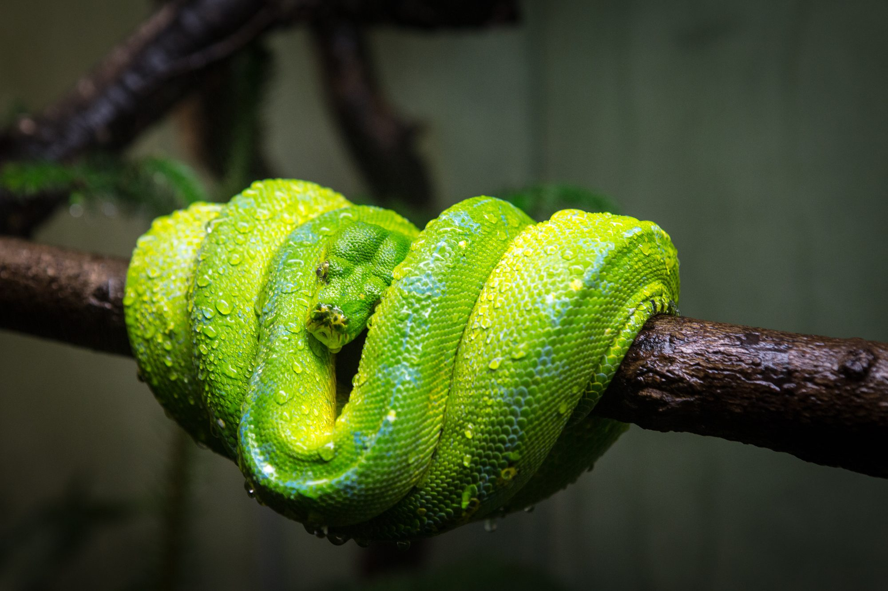
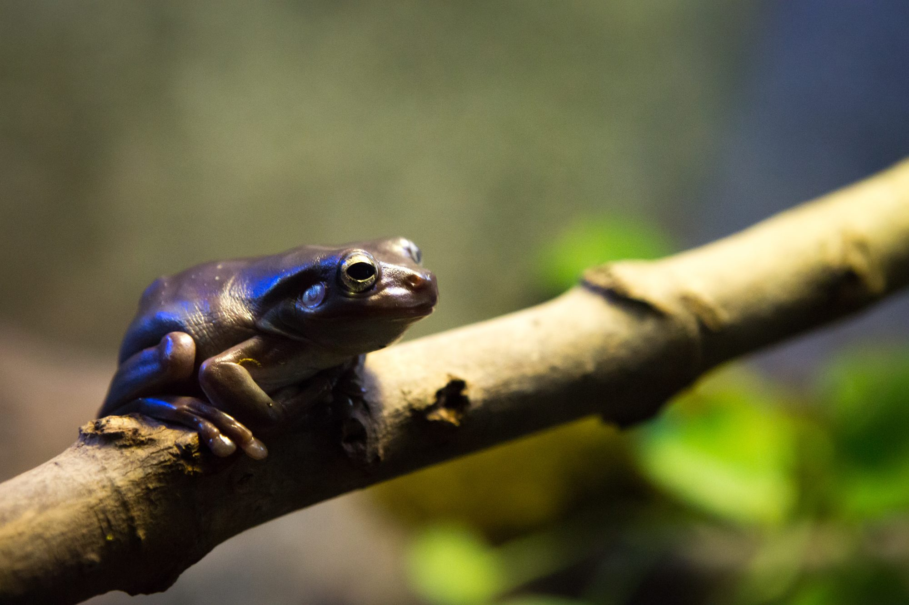
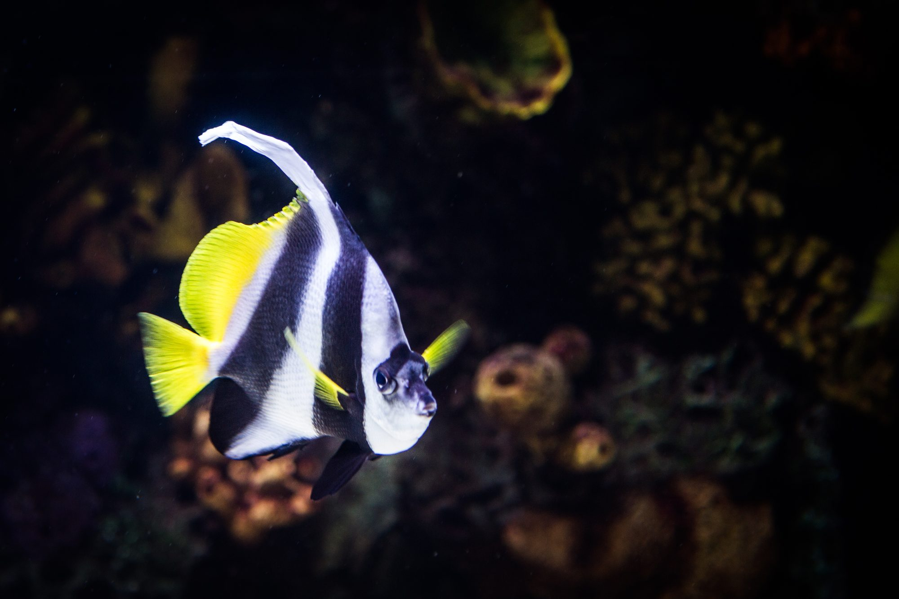
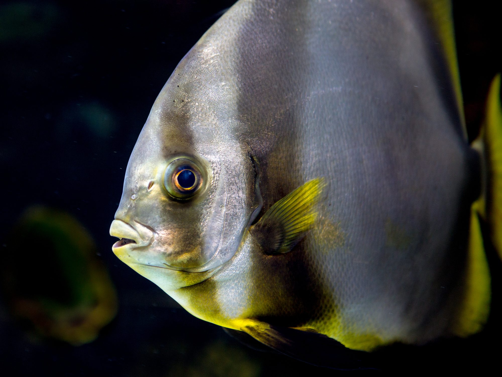
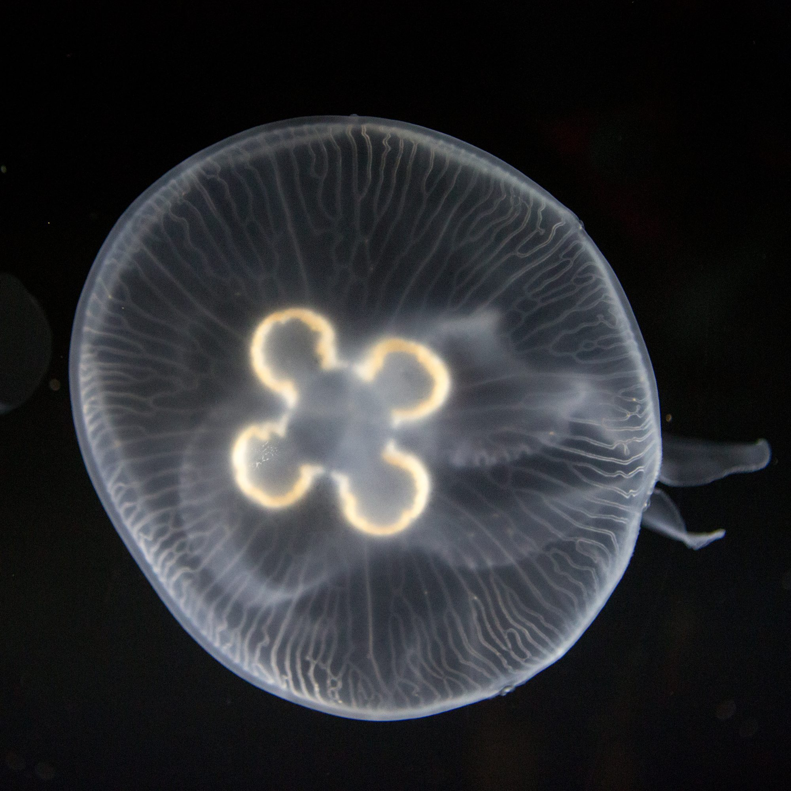
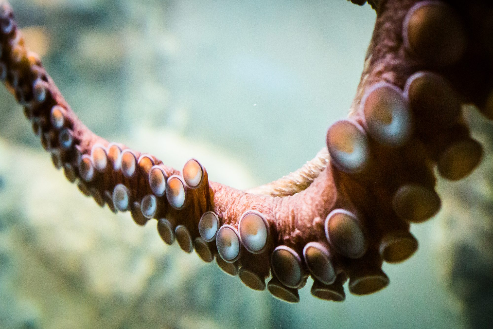
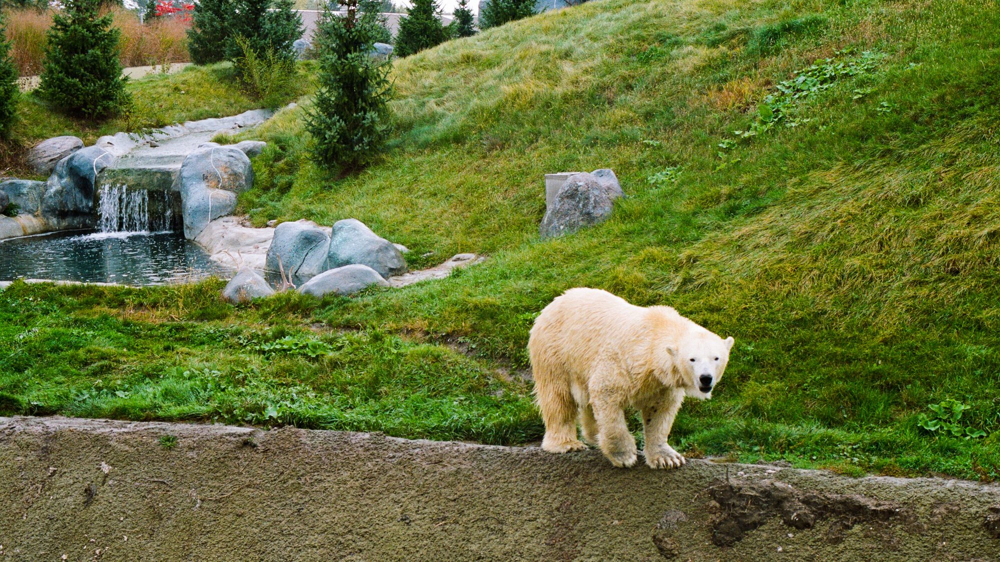
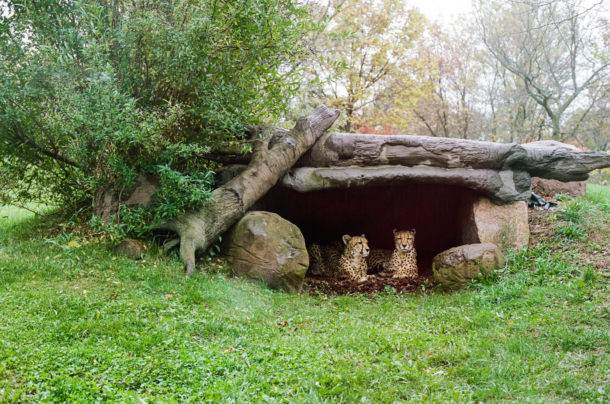

## AMPHIBIANS

## Underwater Life

## Butterfly

I brought my 50mm f/1.4 lens especially for the butterfly exhibit. Was not disappointed.

## Waterfall

Handheld long-exposure? Aw yeah.

## Film

I said I brought \*cameras\*, plural. One of them used film These are the results.

