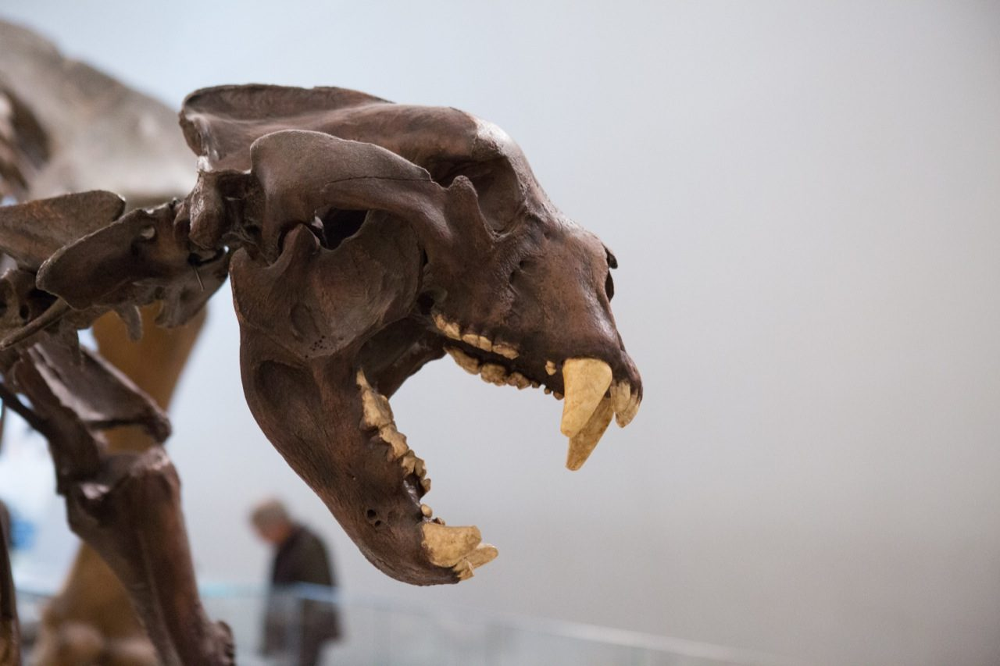
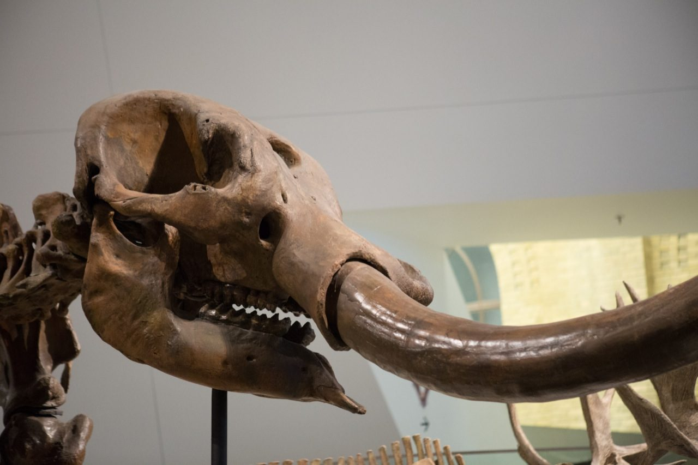
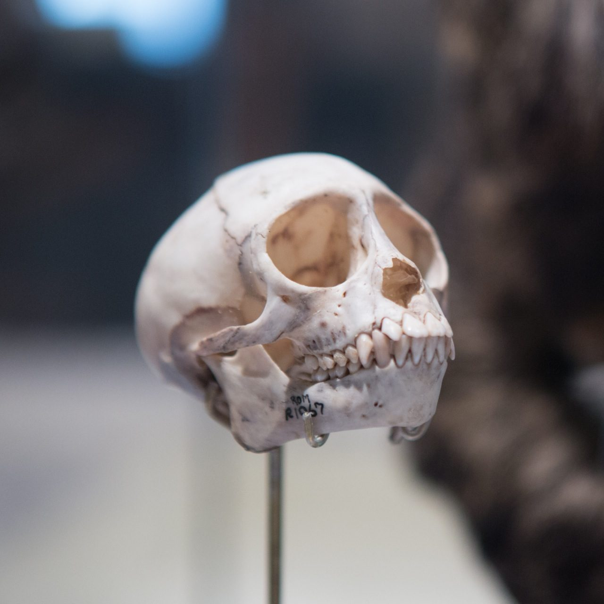
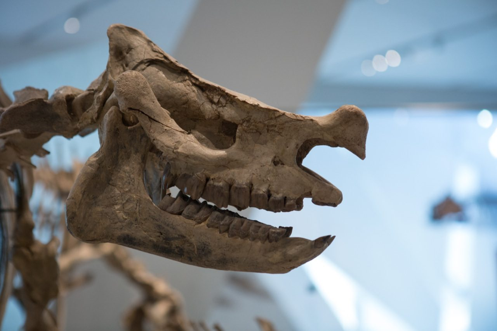
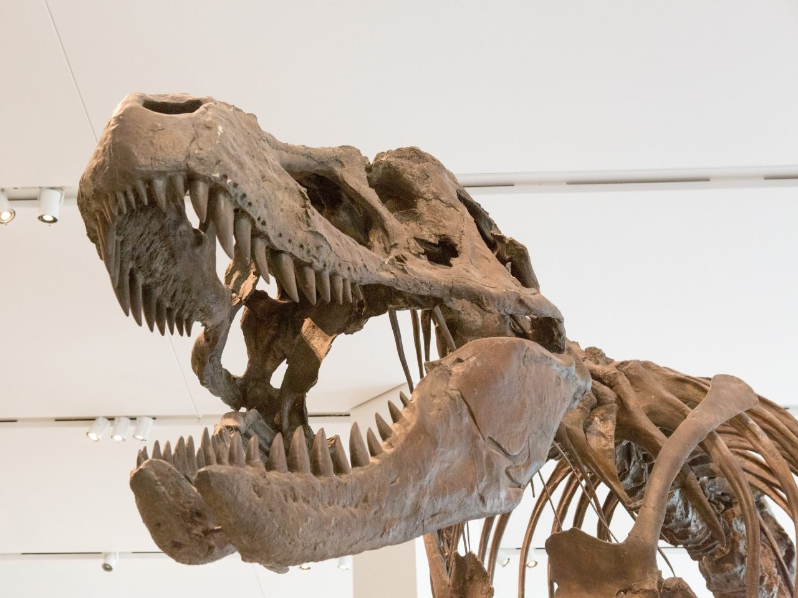
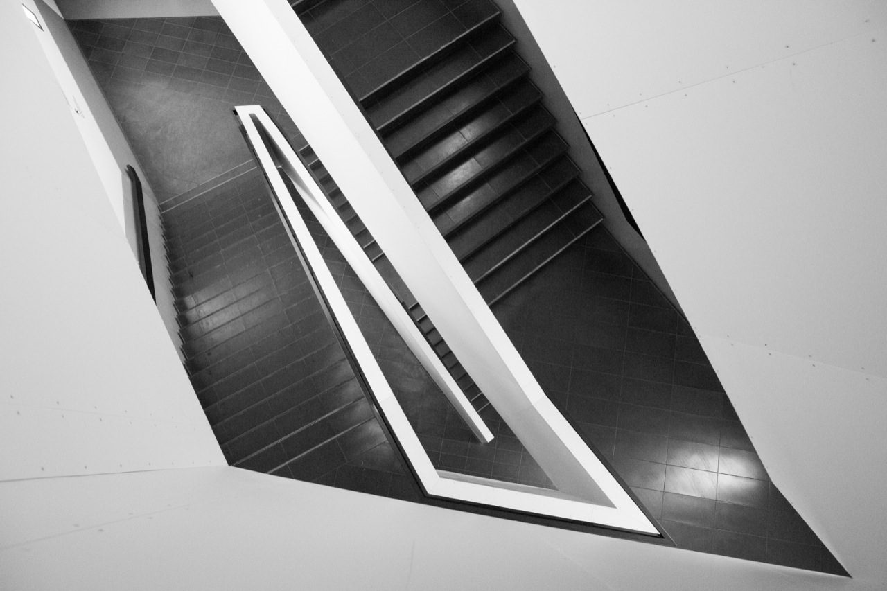
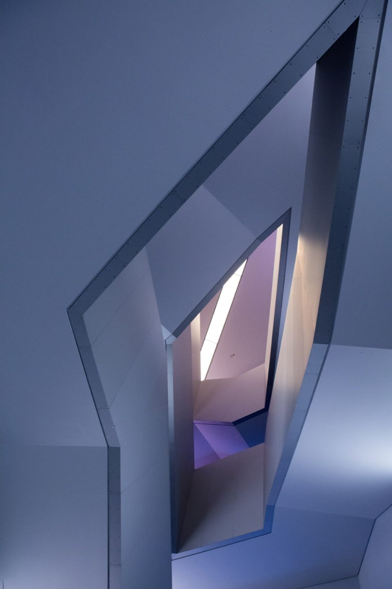
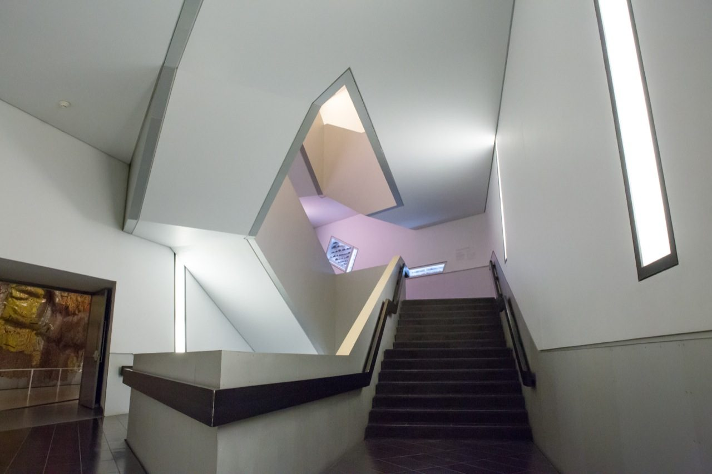
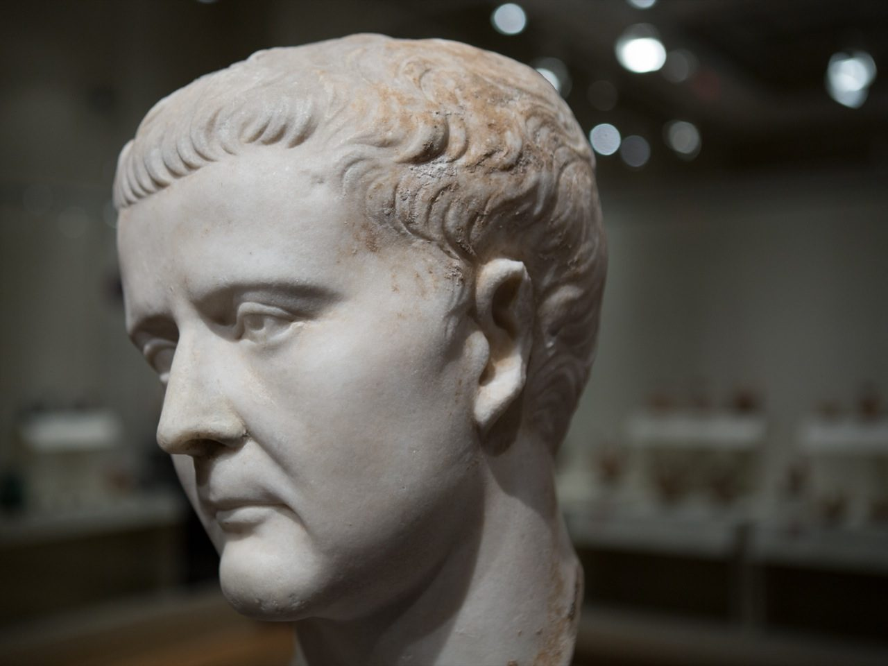
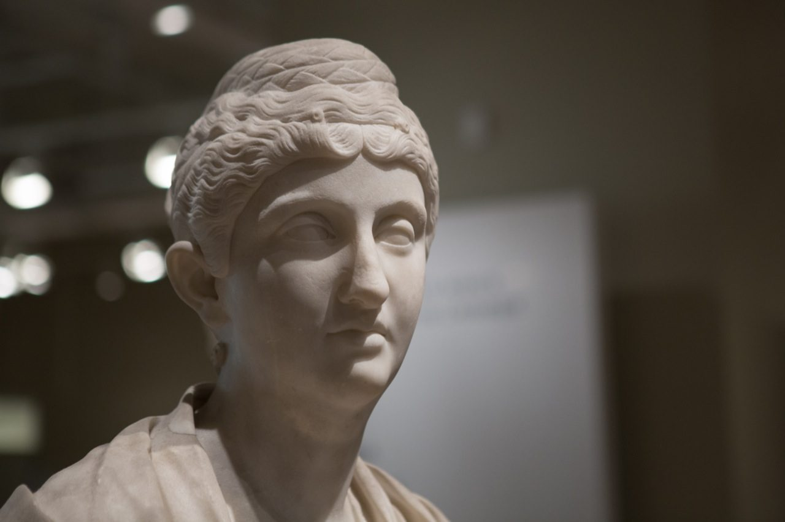

## These old bones

## Michael Lee-Chin Crystal

This, I think, is one of the most remarkable aspects of the ROM. The interesting architecture fuses new and old together in a way that makes every treasure contained within more interesting.

## Sabretooth

## Stair of Wonders

One of my favourite parts of the museum is the Stair of Wonders.

## Flight

## Statuesque

