## Cats and Luggage

We started our journey by packing up everything we wanted to take and throwing out everything else. We moved with only three suitcases and two cats. The cats had never flown before, and we were as nervous as they were.

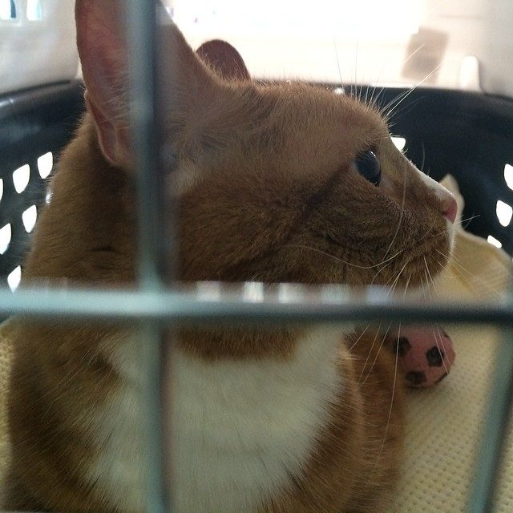
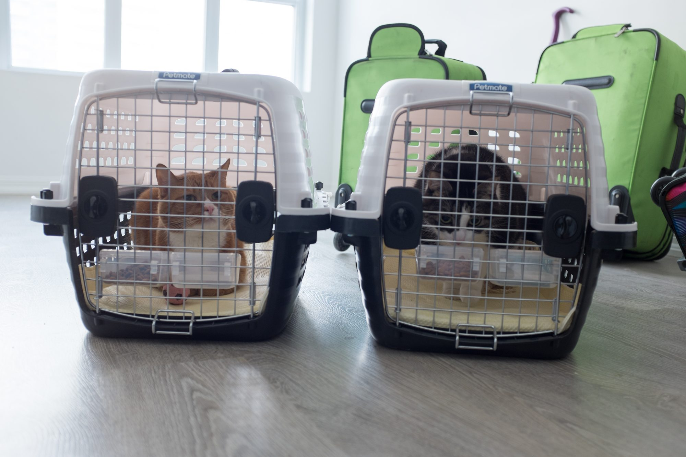
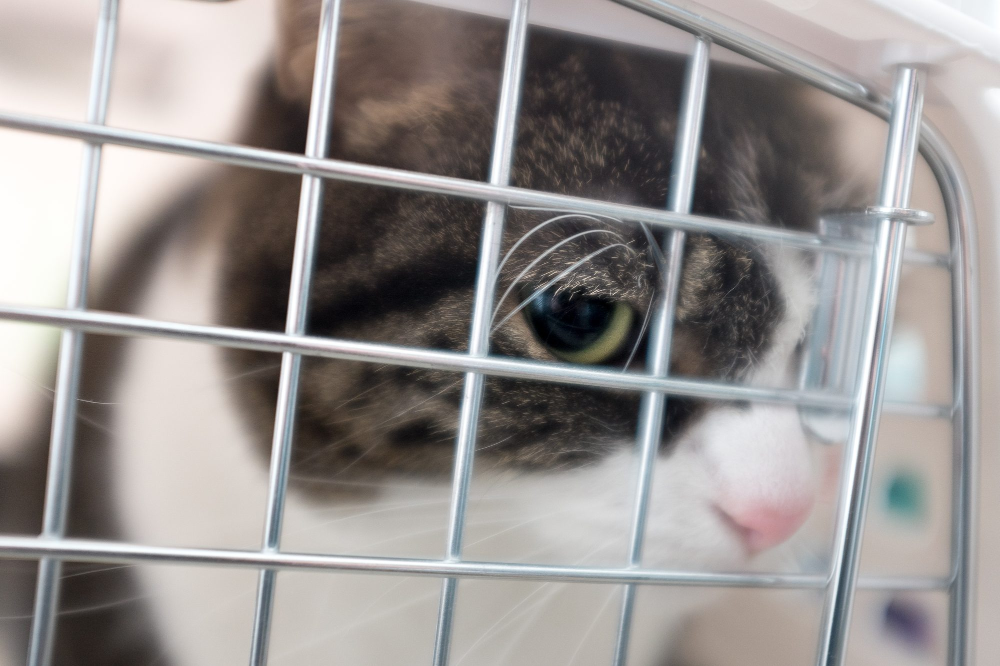
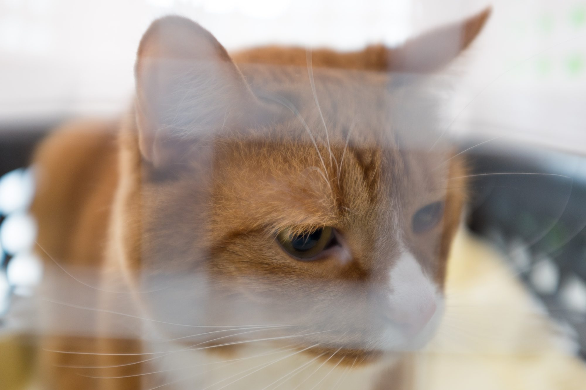
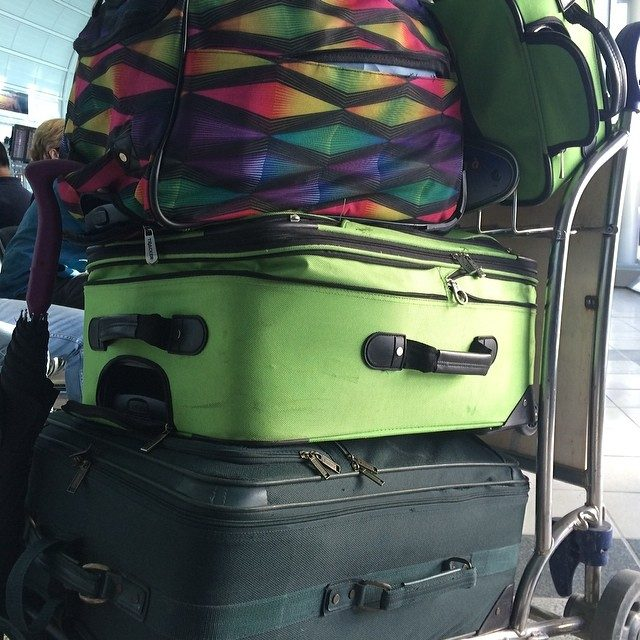

## At the Toronto Airport

We had an eventful time at the airport. After a long wait to check in, we learnt that our carry-on was three kilos overweight. Oh no! We couldn’t check it because it contained my medium-format camera, so we had to do some last-minute shuffling around to make things fit. Additionally, getting the cats checked in was an ordeal. Nothing affirmed that our cats love us like having to hold them in the middle of an airport while their crates were X-rayed. Poor, shivering things.

## The Lounge

Luckily, after getting checked in, we had free access to the KLM airport lounge. We enjoyed free drinks and some food before we set off on our journey.

Unfortunately, not many photos were taken between here and Amsterdam. We flew to Reykjavik first where we had to go through security again to barely make our connecting flight to Amsterdam. No one could really confirm that our cats had made it on board, so the three-hour flight was nerve-racking.

Finally arriving in Holland, we got our luggage and eventually found the cats. Passport control was thorough, but ultimately let us in.

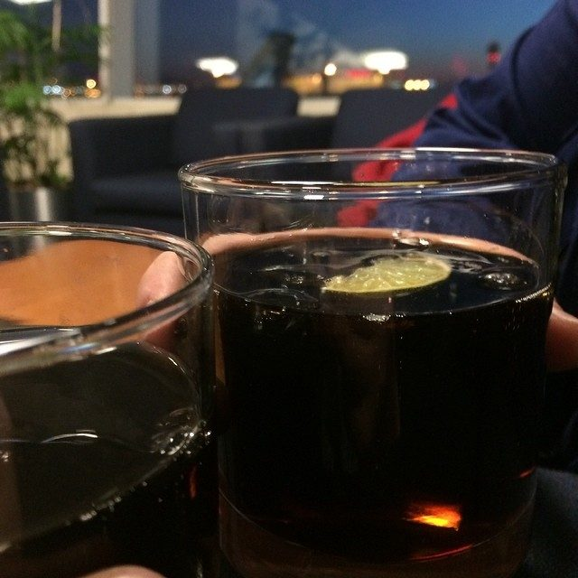
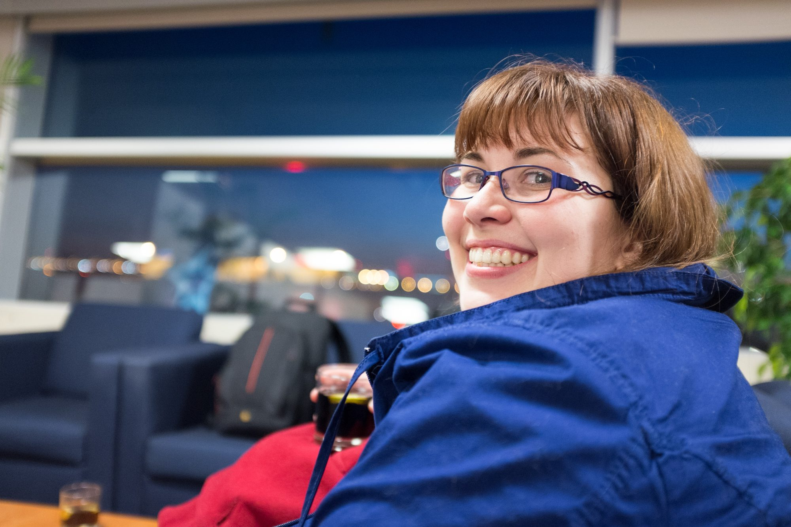

## Our nEighbourhood

We took a taxi to get to our new apartment in Transvaalbuurt. We unpacked the cats and set off to time find some food and essentials like toilet paper. While our apartment came furnished, it was empty otherwise.

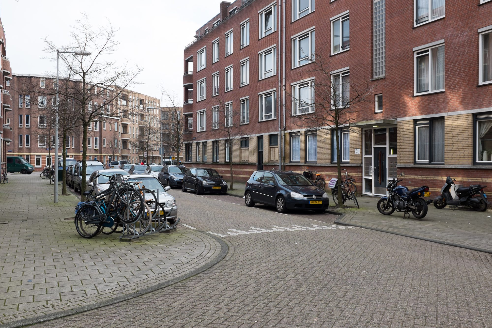
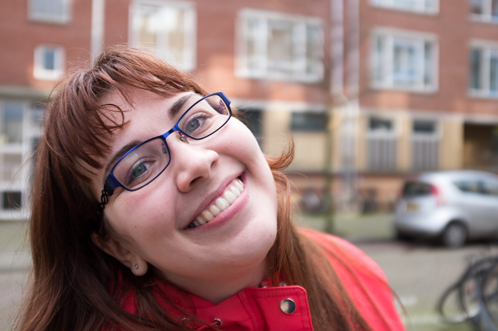

## UnDerpass

Here’s a photo of the underpass near our apartment. It’s one of two, and the other is much more well-lit, as you’ll see.

## ExpLoring

We eventually found the supermarket, SIM cards for our phones, and made our way to the Apple store to get plugs for European power sockets and a wifi router. Our first experience with the transit here was very positive. It’s a straightforward system that we’re looking forward to getting familiar with.

The LEDs on the walls of the underpass are actually an artwork installation and will flash to show different pictures.

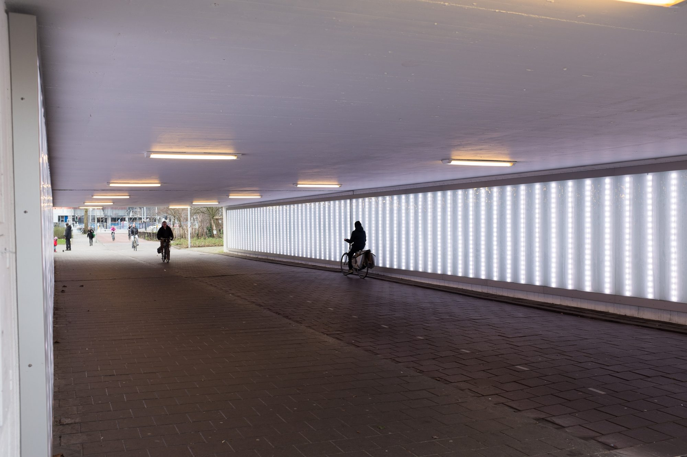
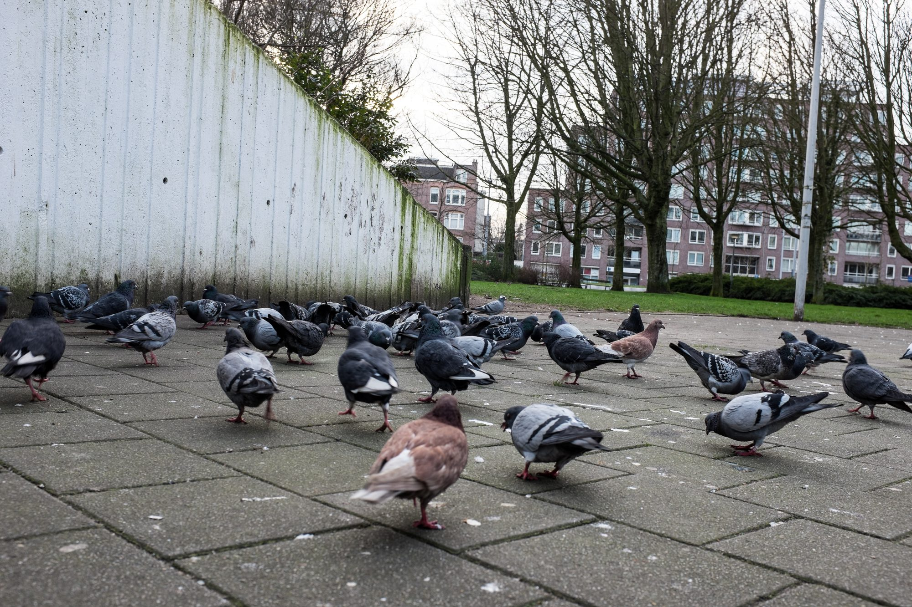
