## Our walk to De Pijp

These photos are along our route to get to the Nieuw De Pijp. We get to pass by house boats, trams, and parked bikes on our way over the canal.

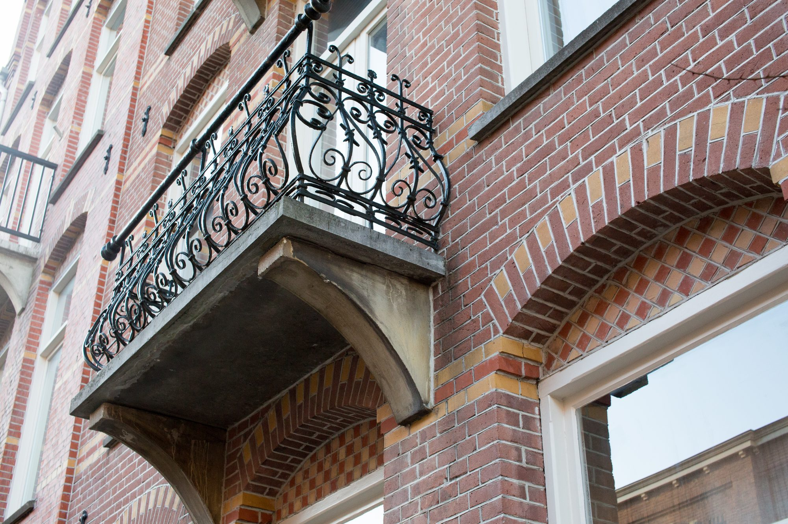
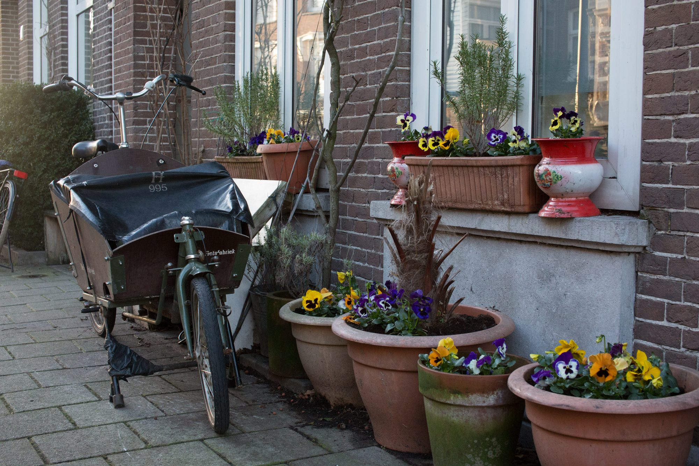
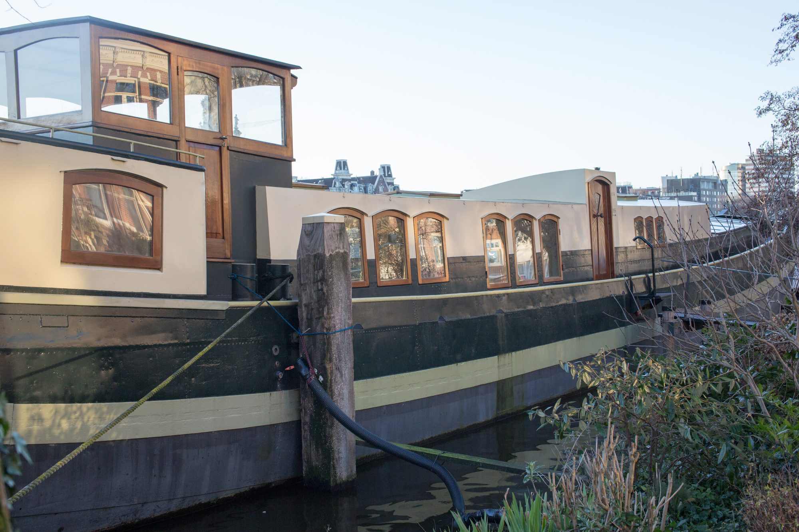
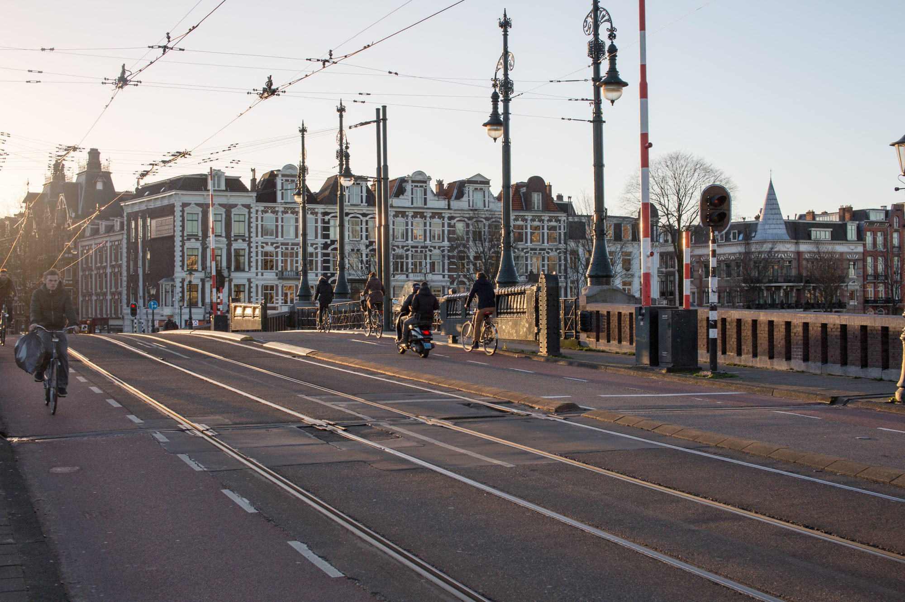

## Parking along the Canal

And you thought parallel parking was bad before you saw it done inches away from a body of water.

## Cloudlapse

Long-exposure done at night with moving clouds. Any longer and the star trails really interfered with the look of the photo.

On the plus side, I love that you can see stars from the city.

## Transit

We love the transit here. It’s efficient, cheap, and fast.

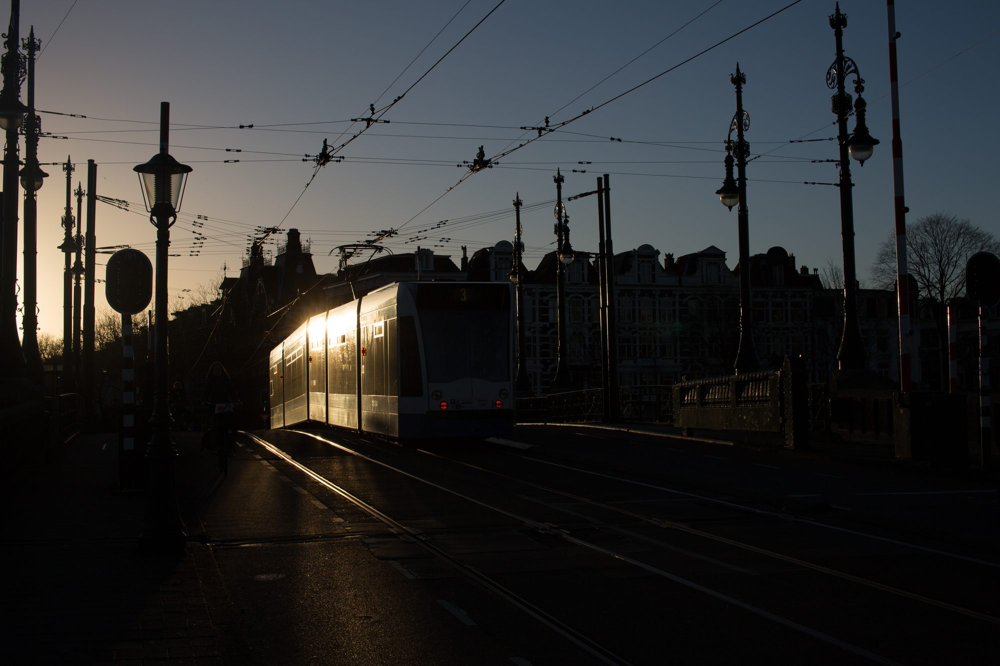

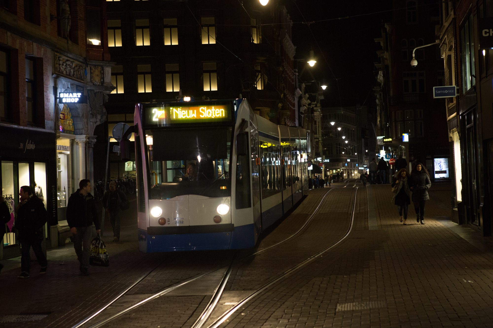
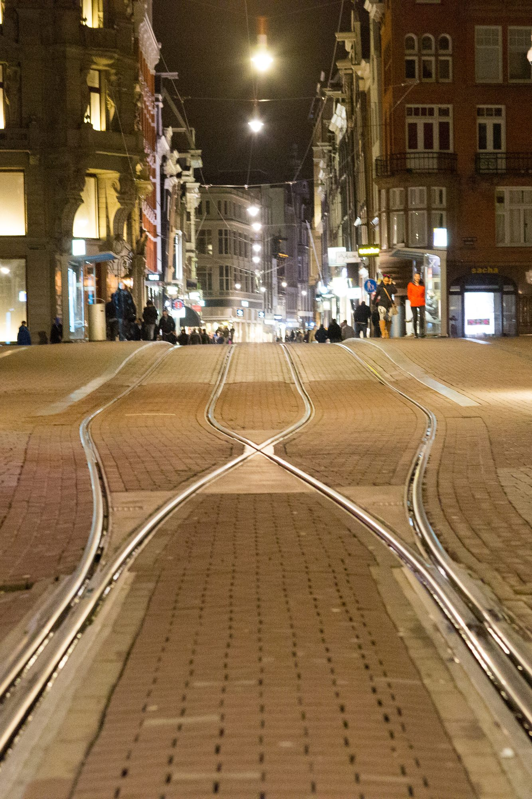

What are these photos about?

## Leaning Buildings

Buildings in Amsterdam tend to lean. It’s weird. Oh, and you see those hooks at the top? Those are for raising furniture into apartments since the stairs here are so narrow.

## Canal Lights

What are these photos about?

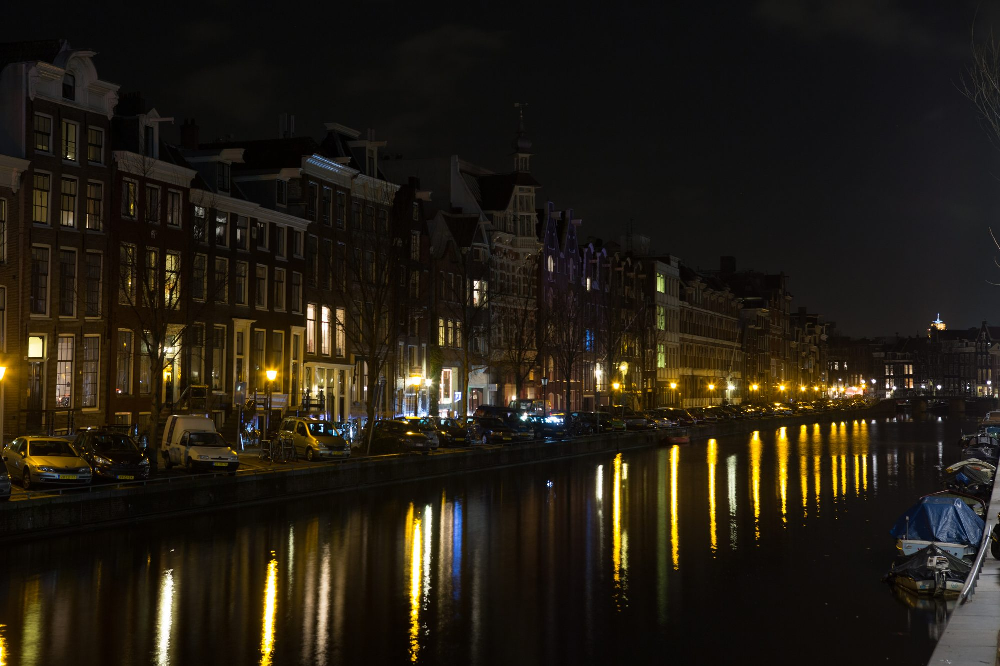
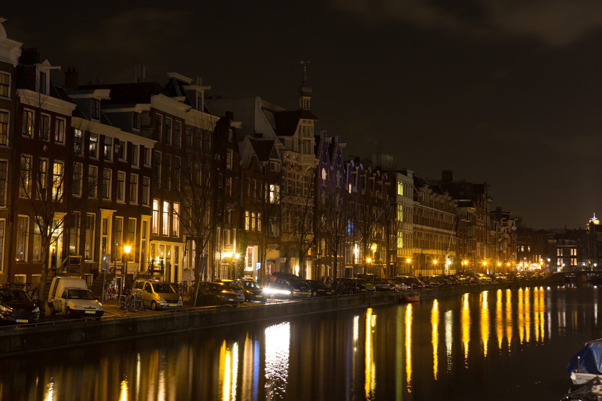

## De L'Europe

What are these photos about?

## Leidesplein Fountain

What are these photos about?

## Canals Encore

What are these photos about?

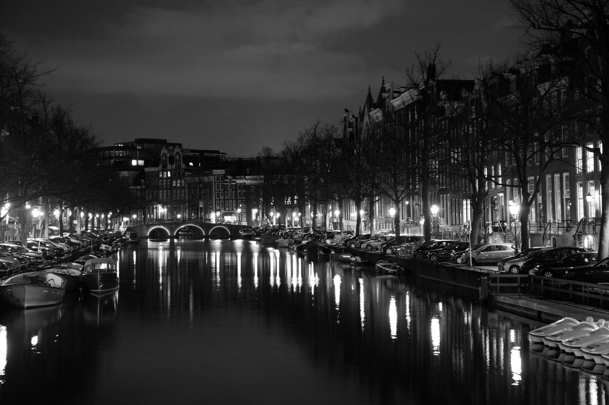

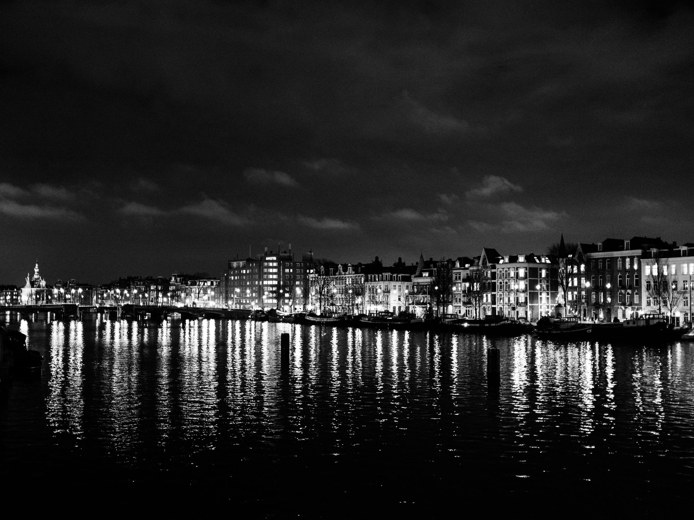
