## Cute Girl with Cute Camera

My wife, Ashley, taking on the mantle of photography with an X100S.

## Ducks, Ducks, Ducks

Lots of ducks in this park, probably because this older gentleman was feeding them.

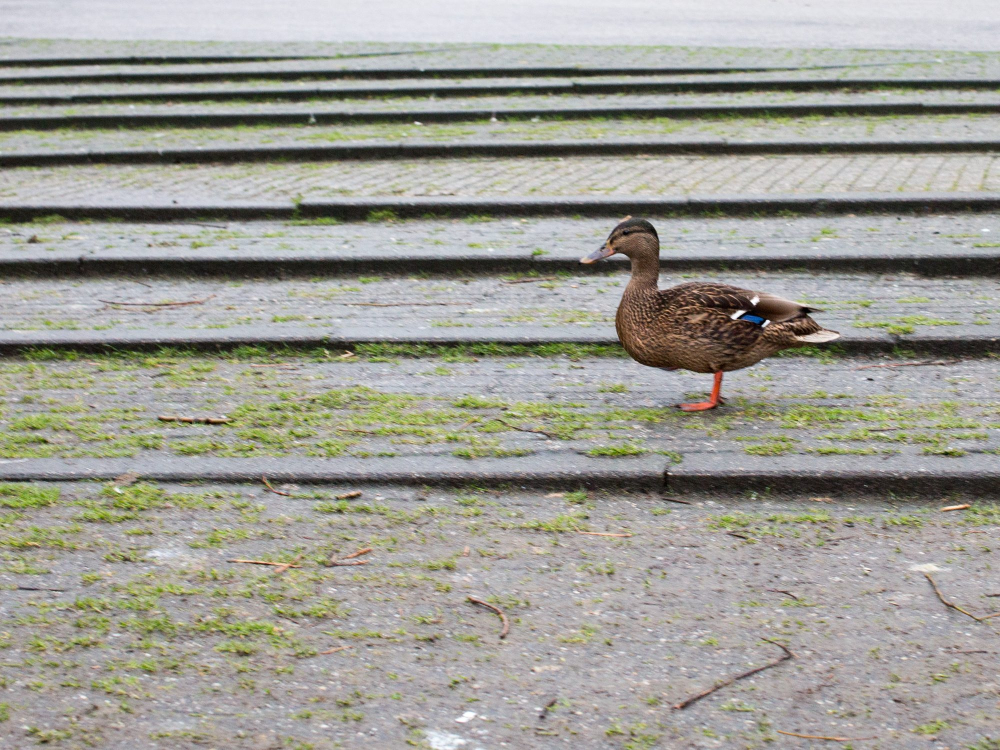
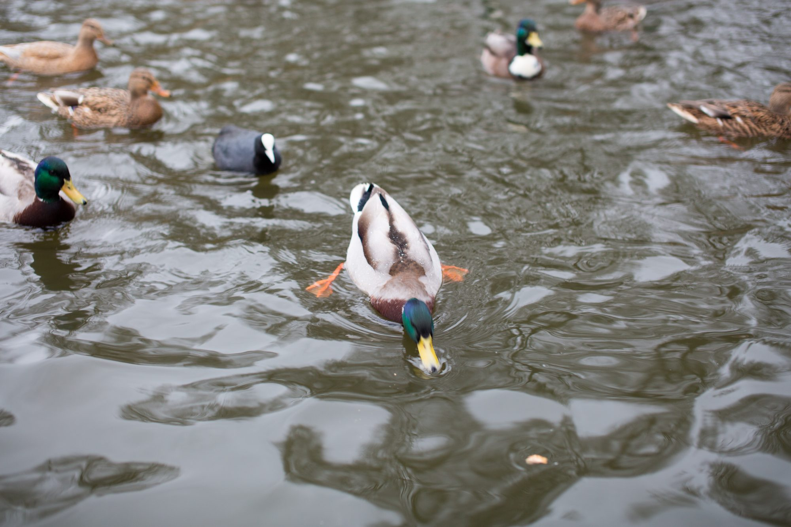
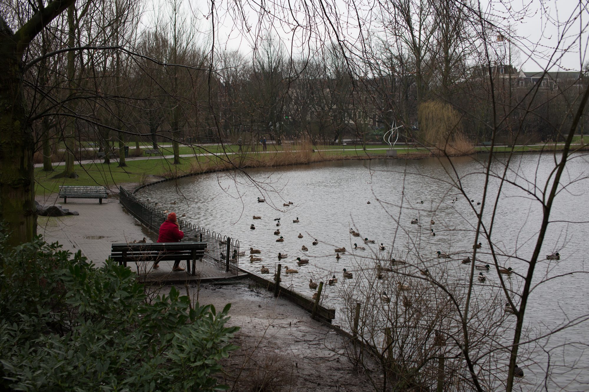
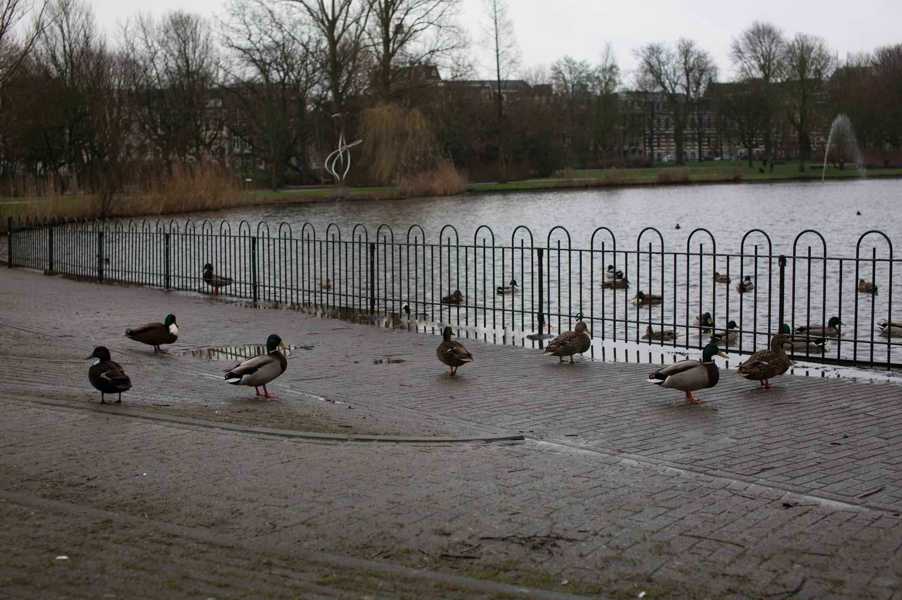
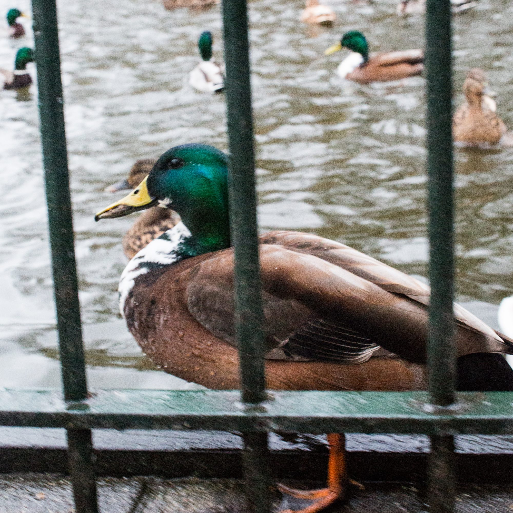

## The Park

This is a cross-section of the park itself. It contains a long pond where you can walk, jog, or bike along.

## Flight or Fight

I may have had my assistant chase the birds a bit for the sake of this photo.

## In Blossom

Spring comes early in the Netherlands.

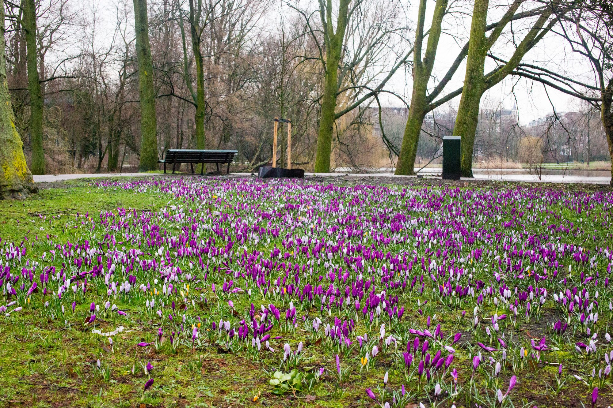
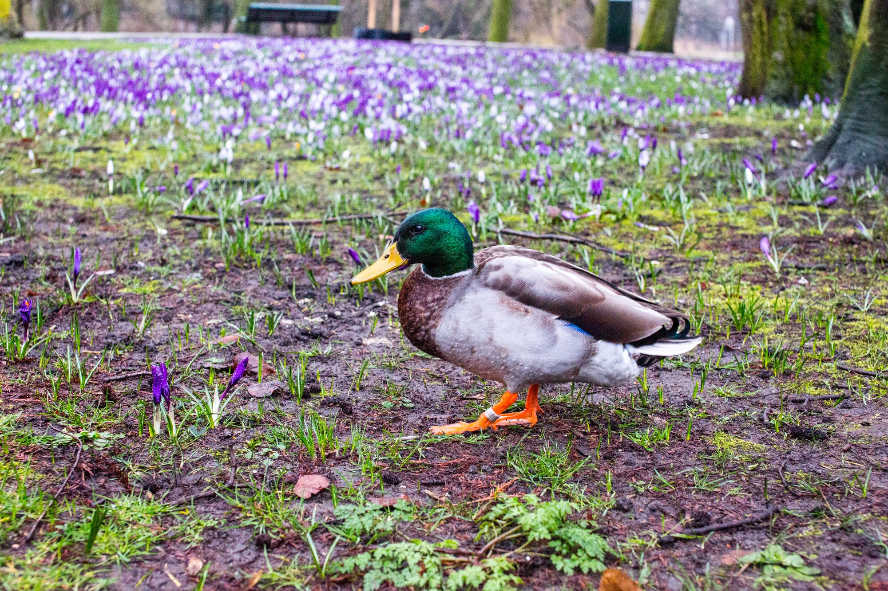

## The Bridges of Oosterpark

I love these two photos because they so perfectly capture the completely different feel of digital and analogue photography. Digital has its advantages, but film hs this just romantic feel to it that I can’t quite get away from. I love shooting on both, but shooting film makes me feel more alive.

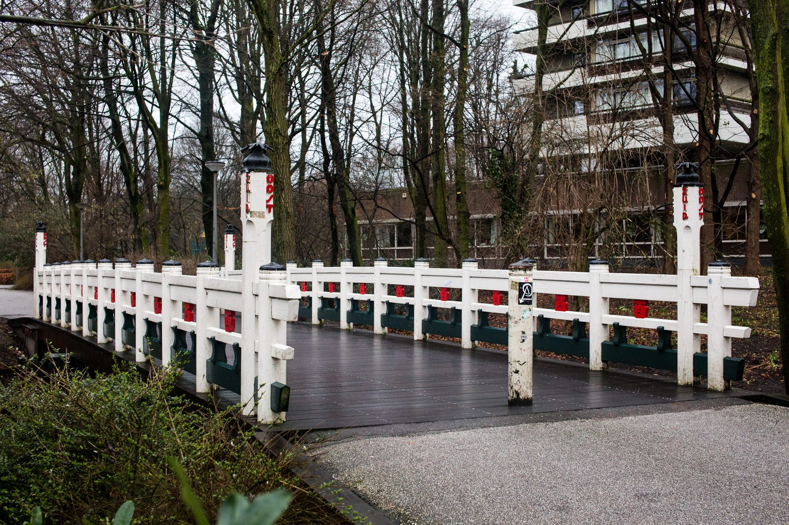
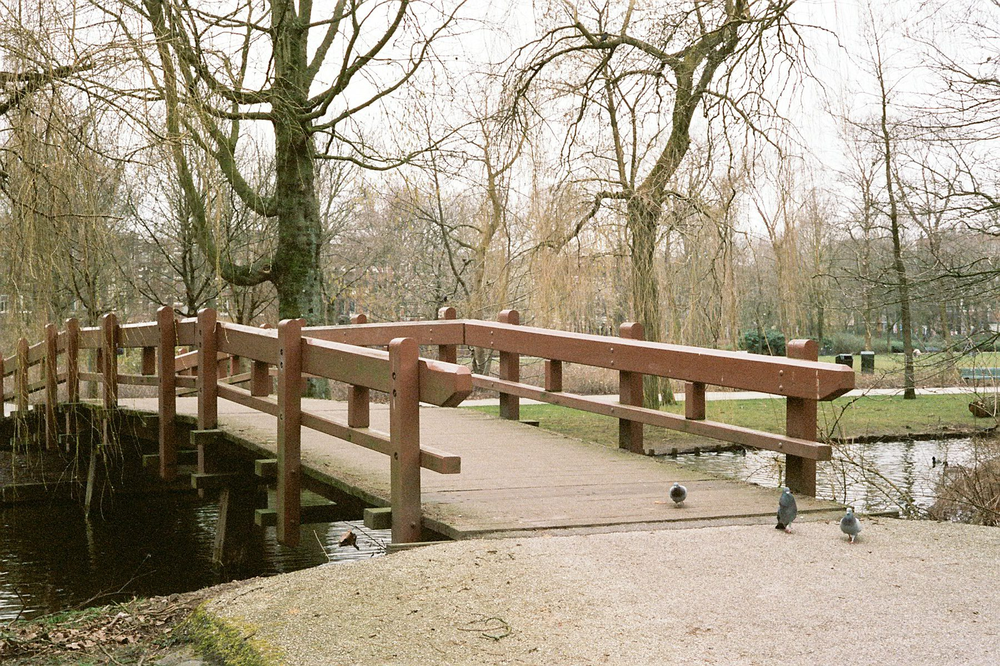

## Swarm

Here we see the aforementioned gentleman feeding the ducks and surrounded by gulls.

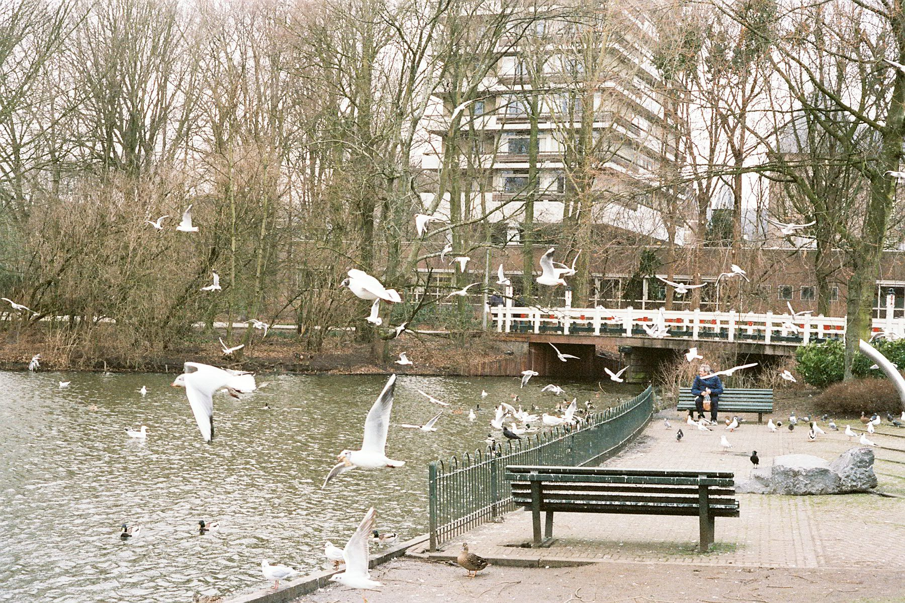
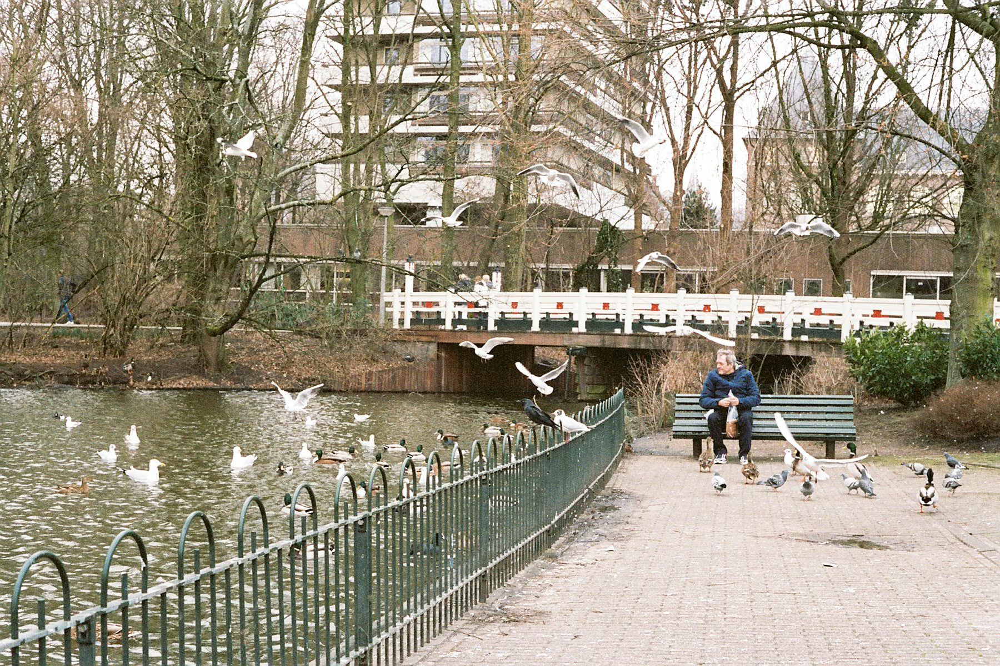
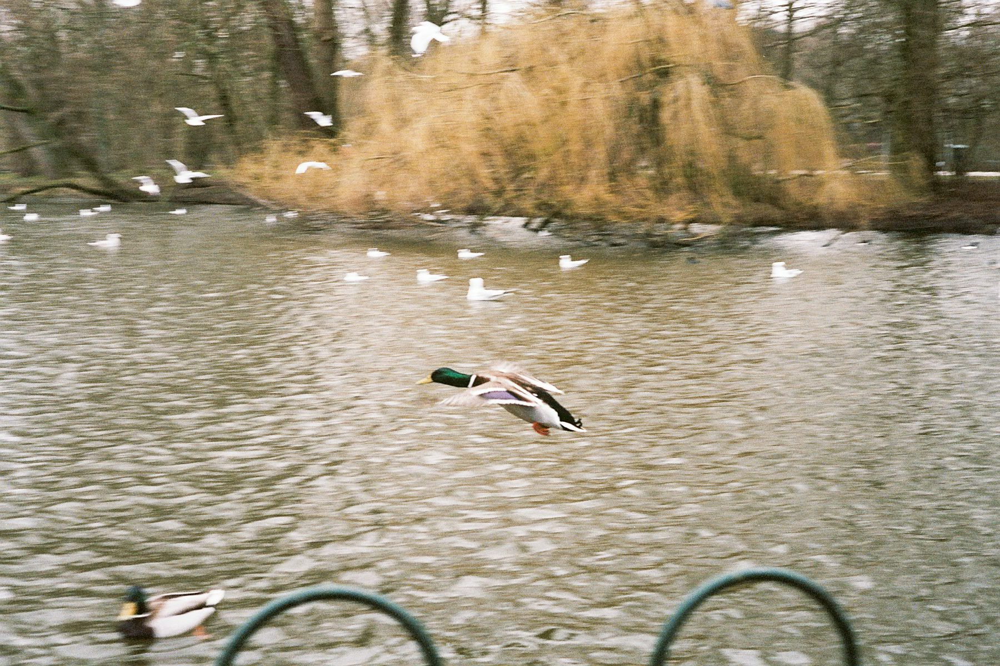
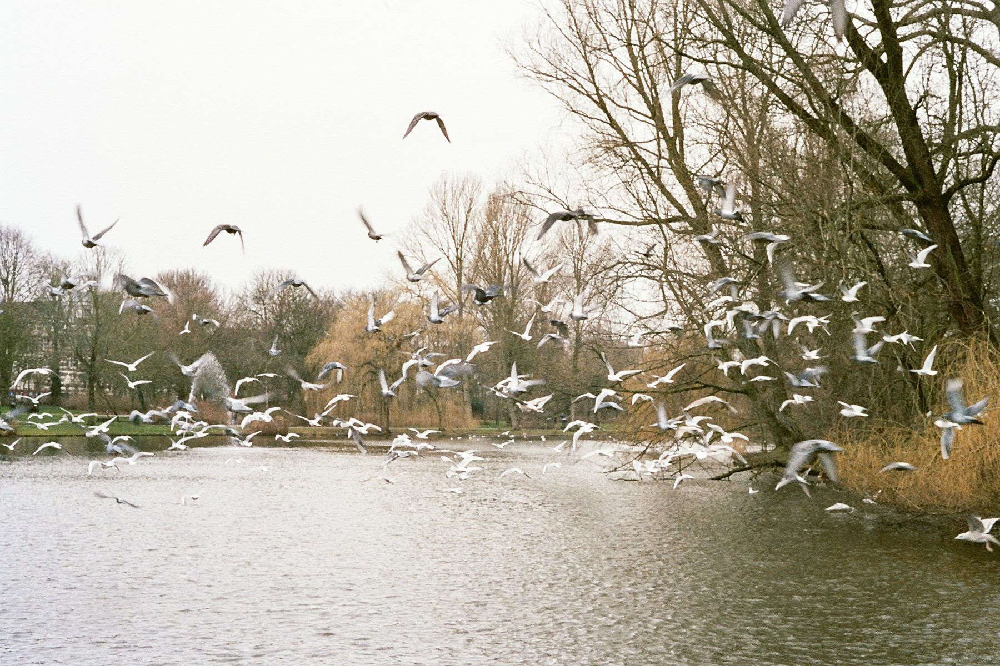

What are these photos about?

