## A Walk Through Vondelpark

We passed by the Amstel Hotel on our way to Vondelpark, where Ashley found some beautiful yellow blossoms.

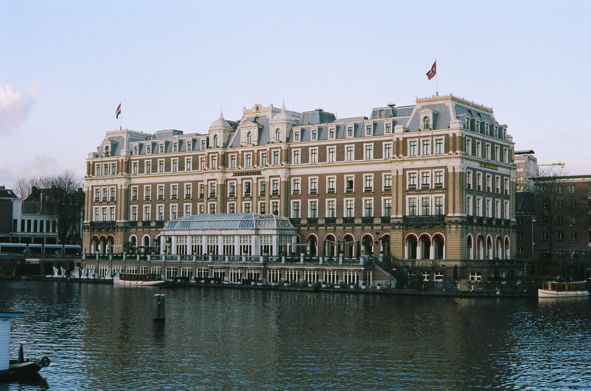
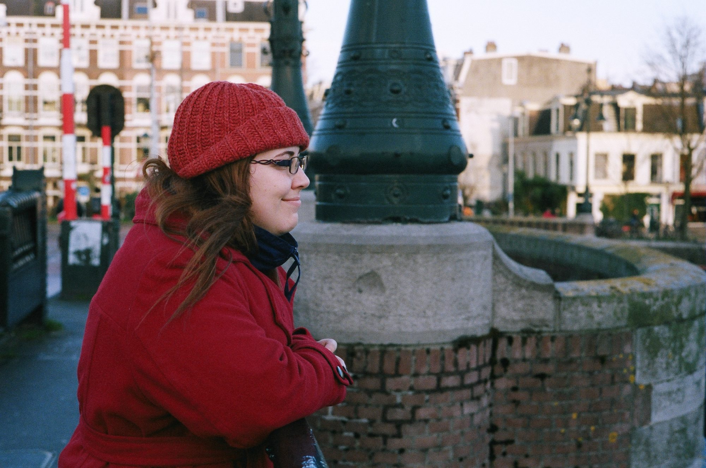
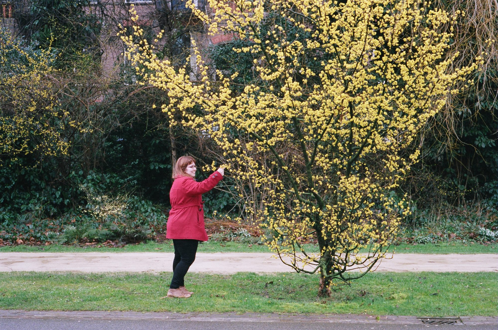

## Silhouette

A duck in silhouette. I took this with both a digital and film camera and I honestly love this one 100% more.

## Along the canal

Could have used a polarizing filter to darken the sky. Next on my shopping list.

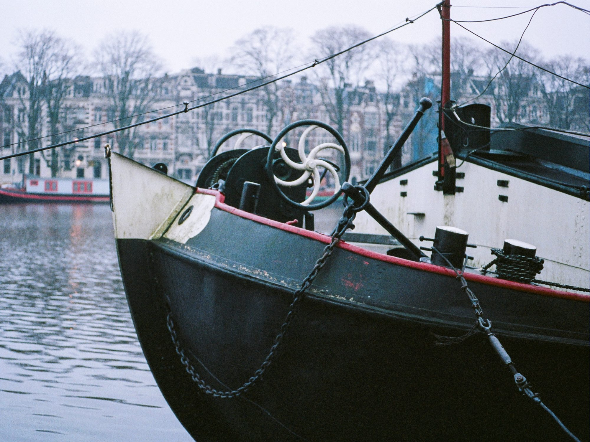
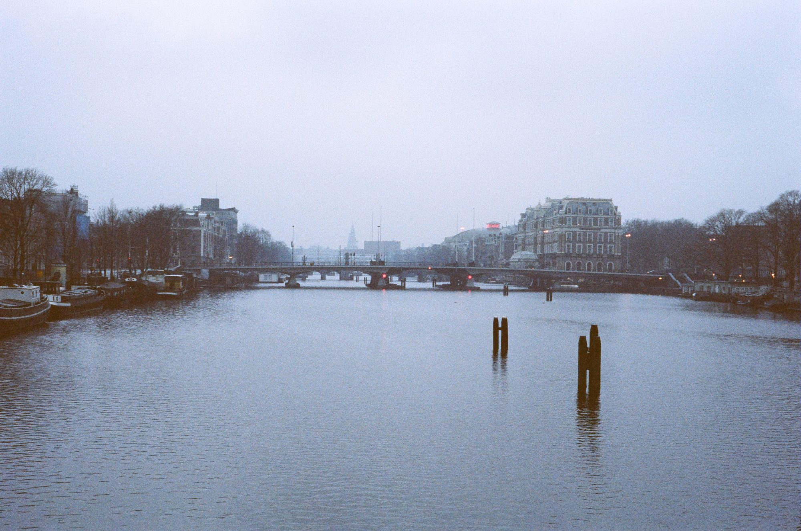
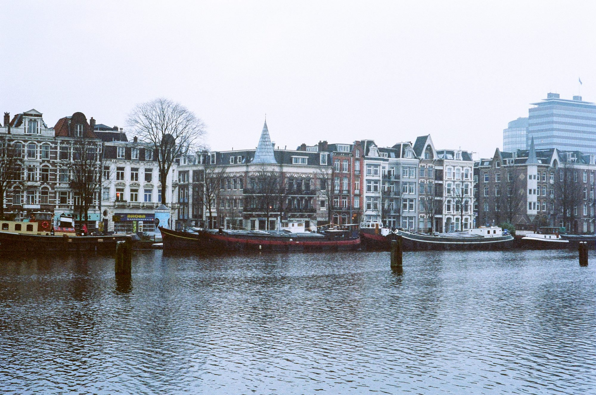
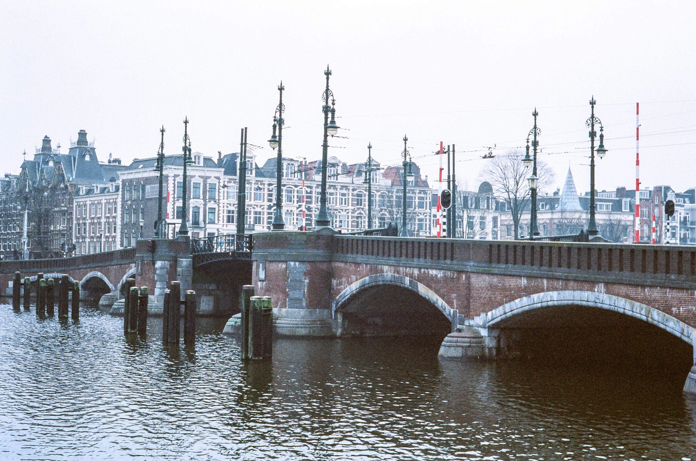

## A Walk at Night

Ashley and I took a stroll last night through our neighbourhood and the accompanying canal. I took some photos by streetlight.

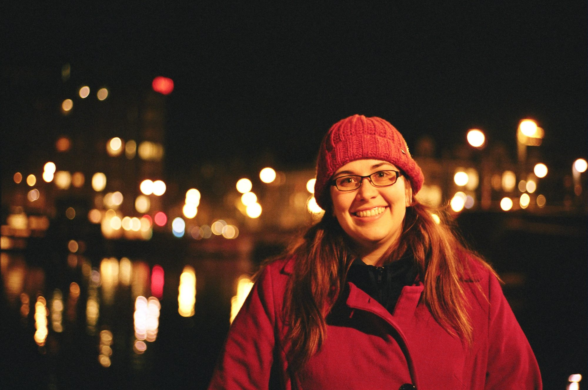
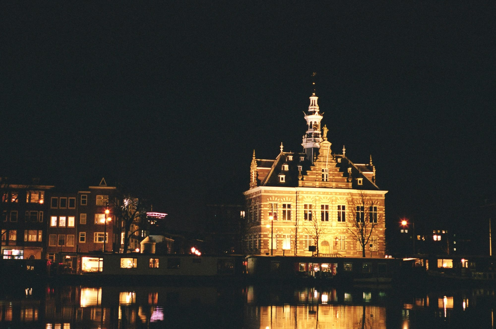

## Night Bike

A real beauty.

## A STurdy Tripod

All of these were taken using a tripod. The Dutch Royal Palace and two beautiful canals.

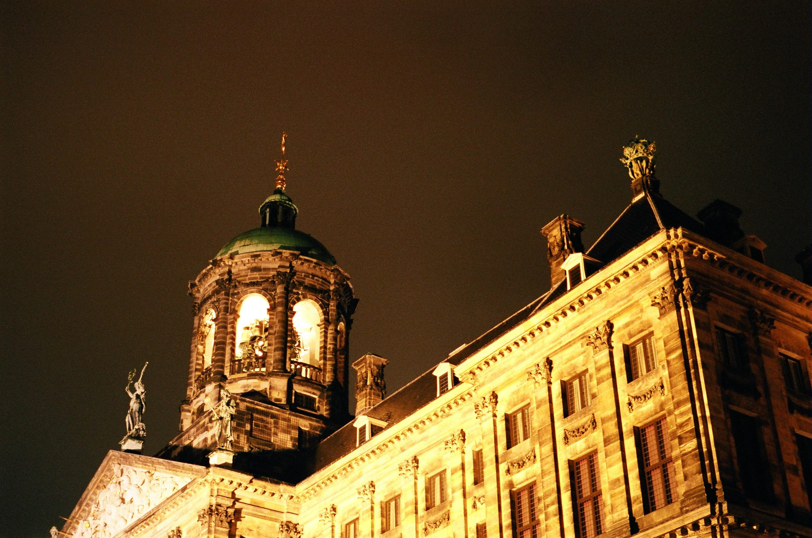
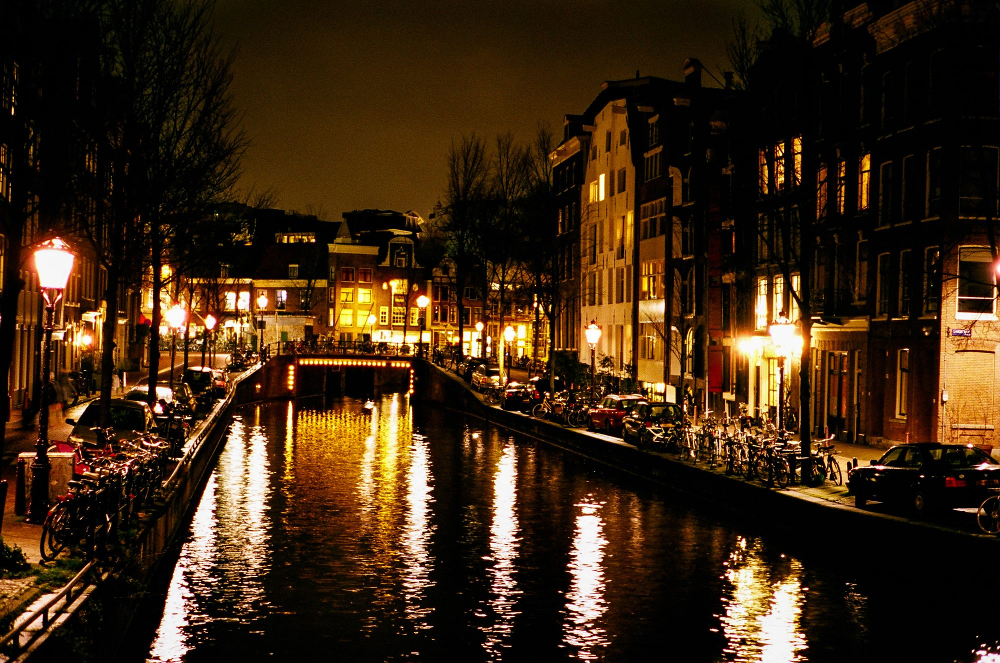
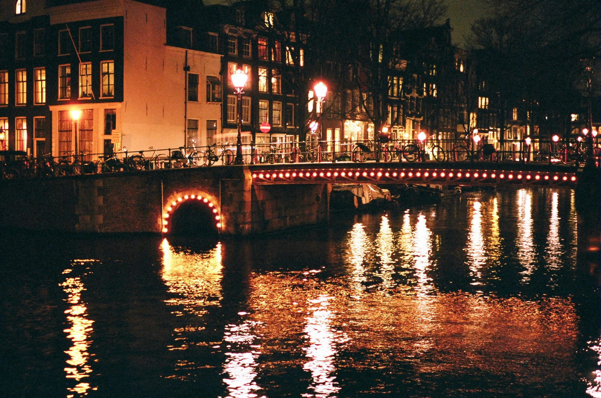
