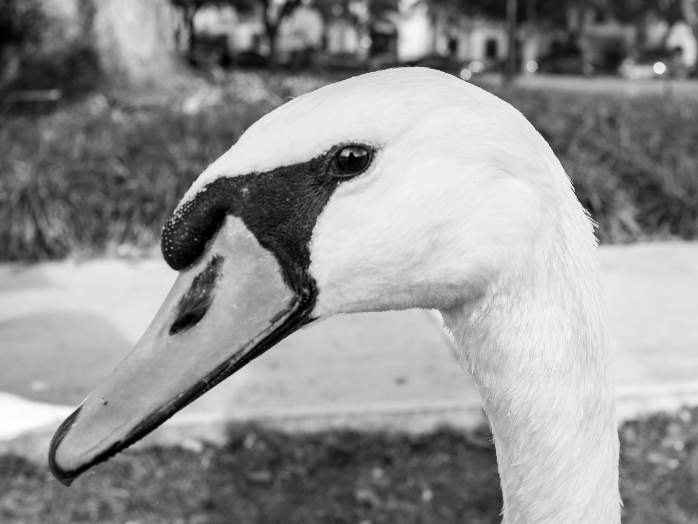
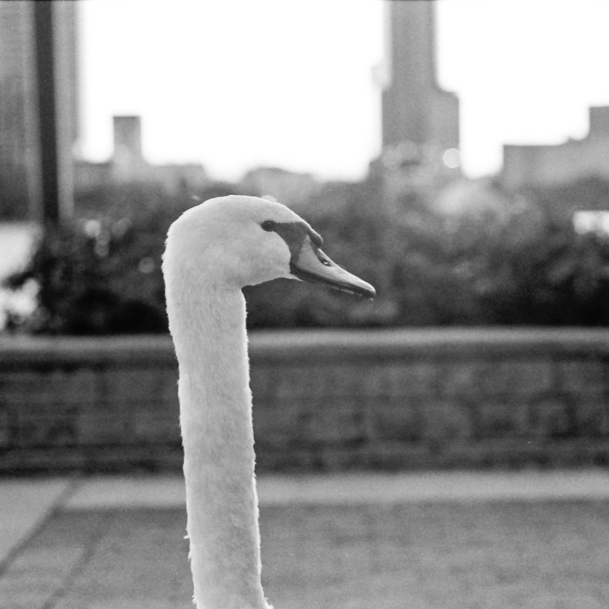
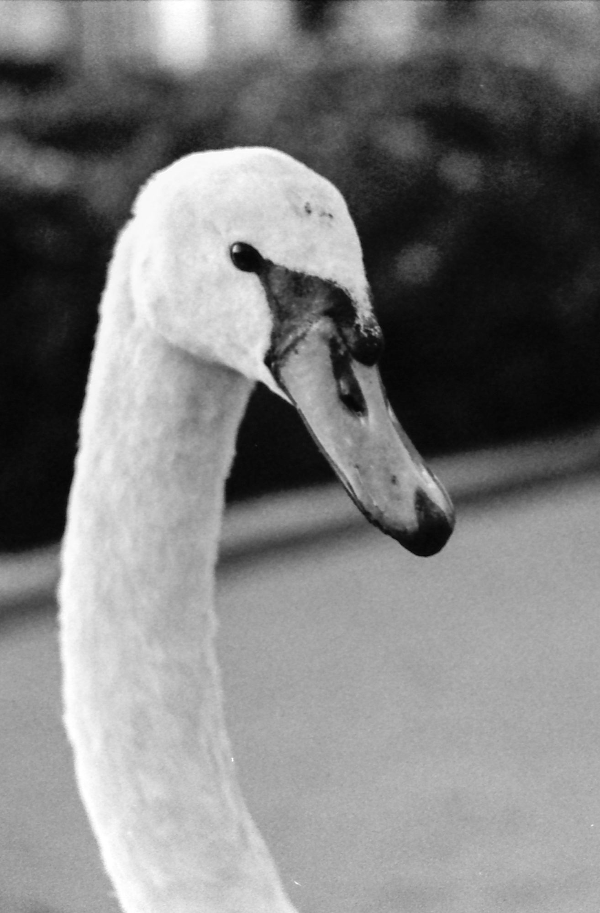
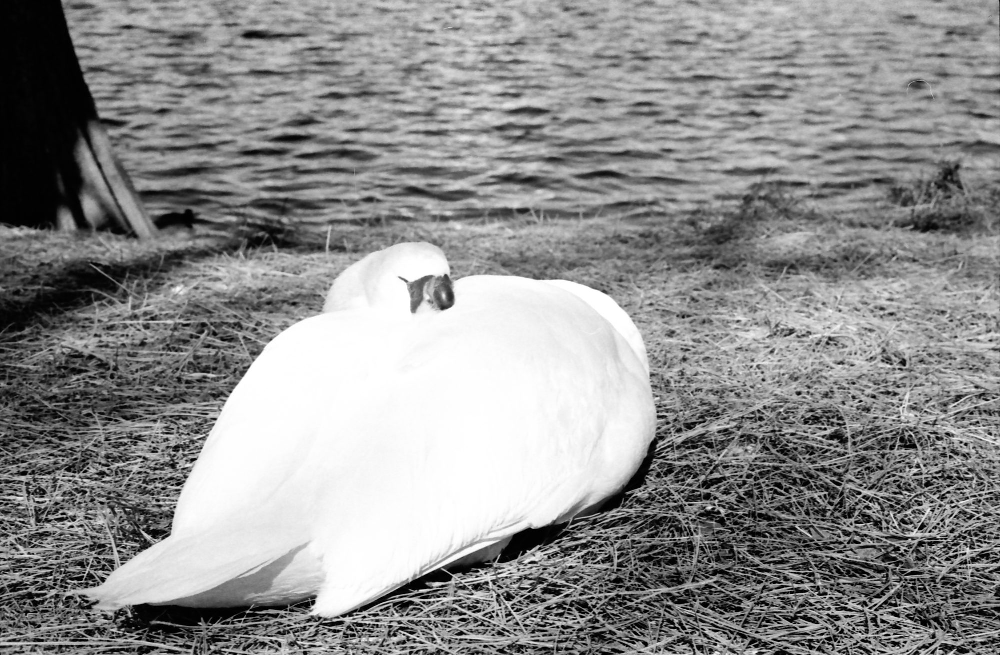
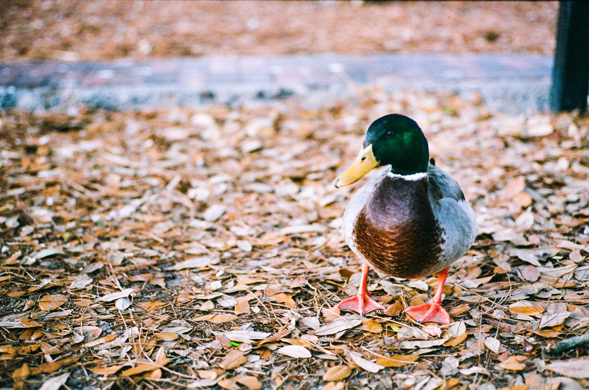
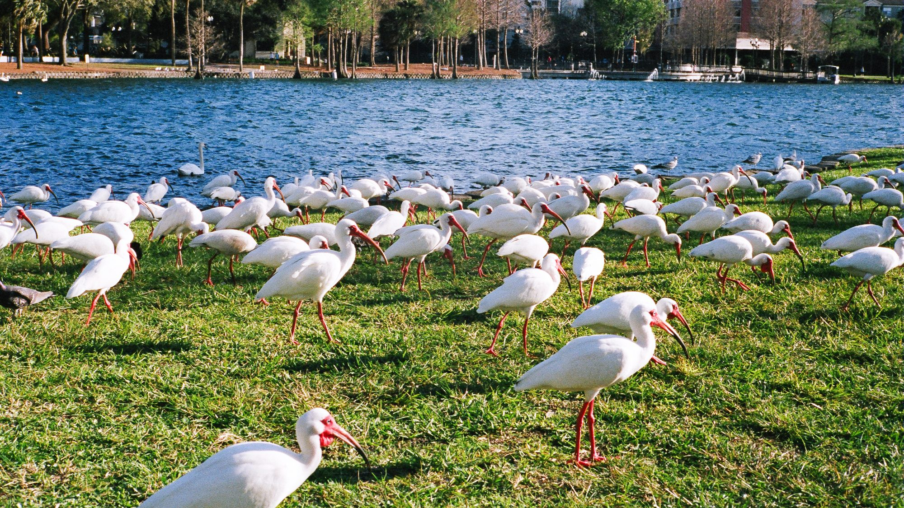

## Swans

Lake Eola is surrounded by birds. The overwhelming majority of those birds are swans.

Let me tell you about swans. They’re majestic on the water, clumsy on water, but foremost, are assholes. They’ll let you feed them out of your own hand, but do so at your own risk. They nearly took off my wedding ring in the process.

What are these photos about?

## More Birds

Lots and lots of birds. Some were more tame than others.

## A HERD OF BIRDS

What are these photos about?

## Fountain

Americans love them some flashing lights. At night, this otherwise fine fountain turns a garish rotation of neon colours.

## Birds of a Feather

Cuddling ducks. What’s cuter?

## Waves

Abstract art never looked so good.

## Sunset

What are these photos about?

