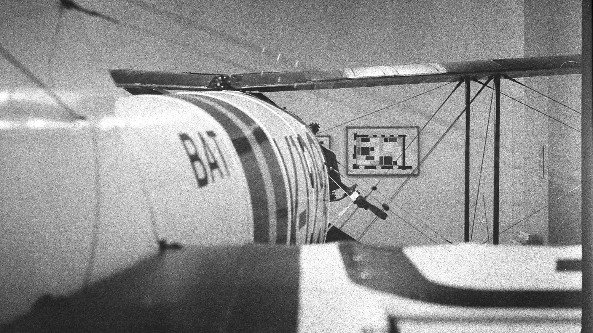
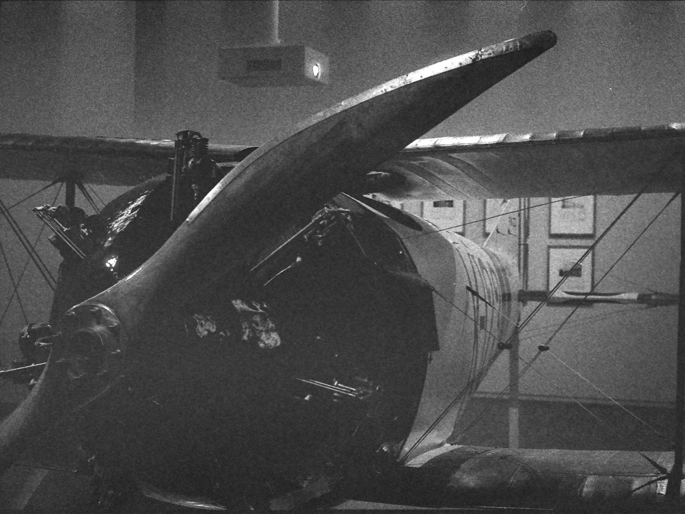
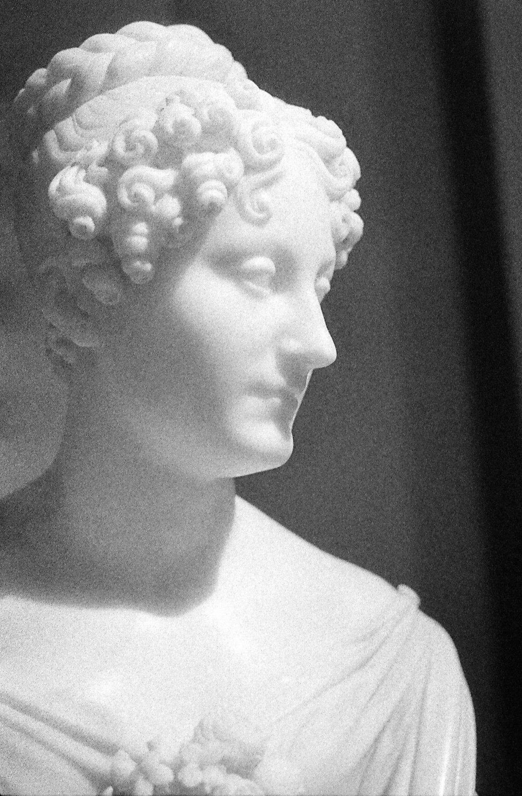
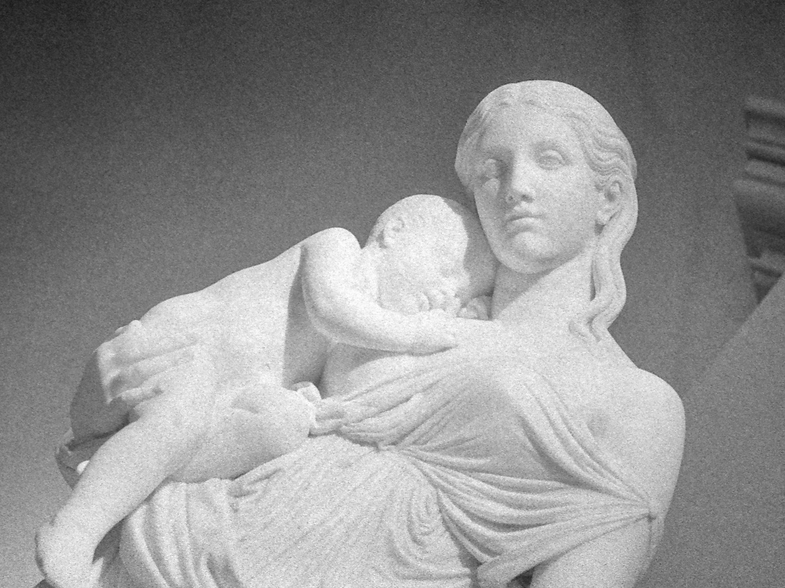

## Aviation

The museum was less about natural history than I’m used to, and more about art. However, they did feature a small section on the 20th century, which included works of art in the form of photograph, video, and even instruction manuals from era machines. Such a machine is this air plane, it itself something of a work of art.

## NachtWatch

Literally translated to “Night Watch”, this massive Rembrant was quite impressive.

## statuesque

What are these photos about?

## Lighting

What are these photos about?

## Abstract

What are these photos about?

