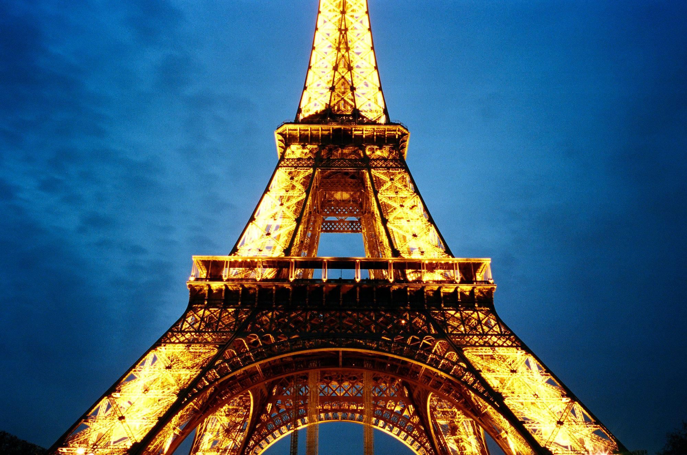
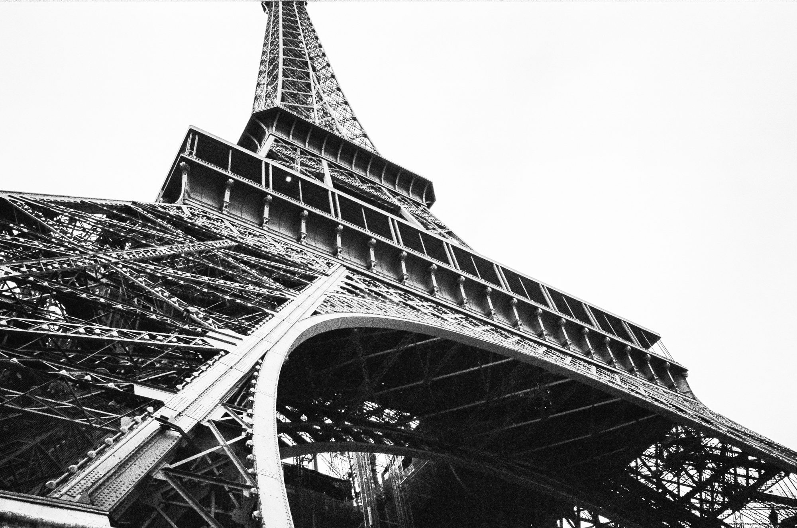
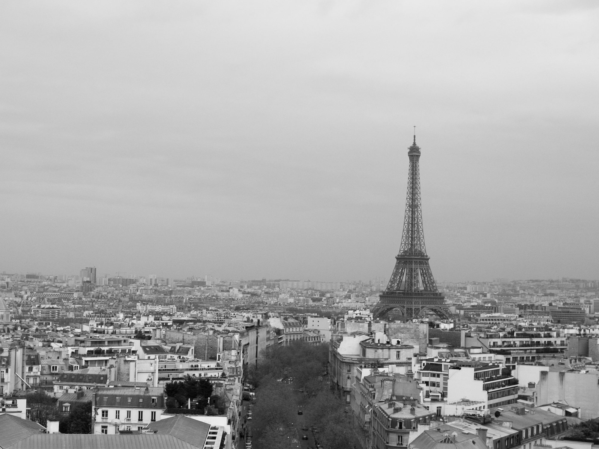
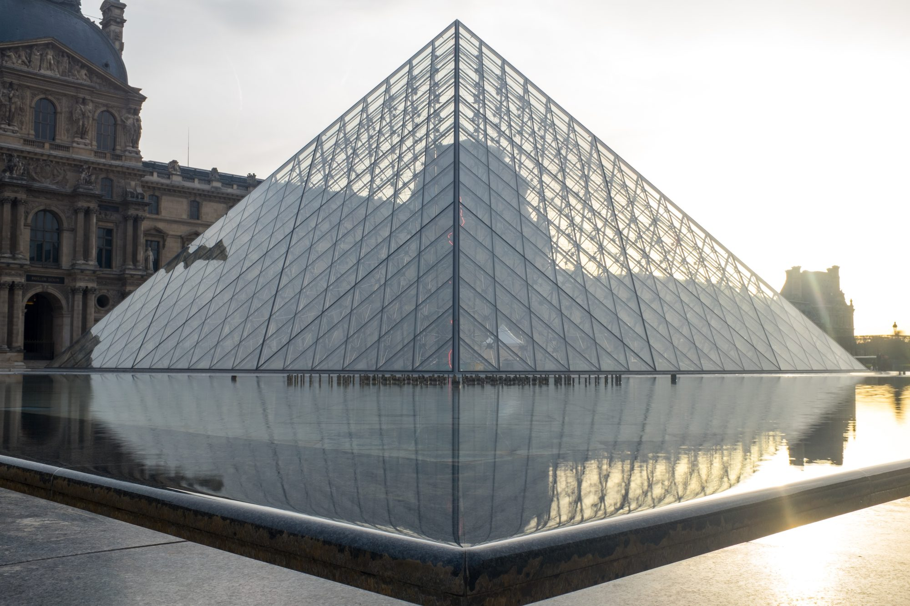
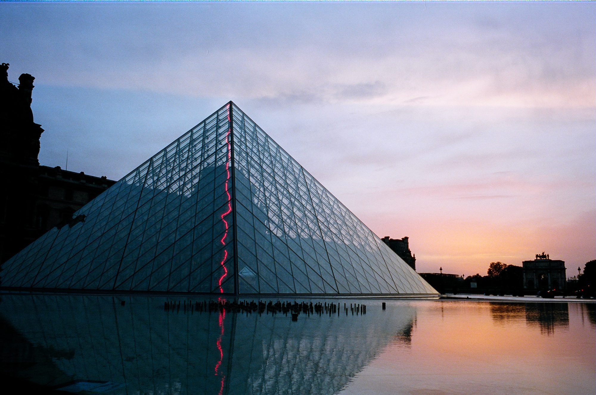
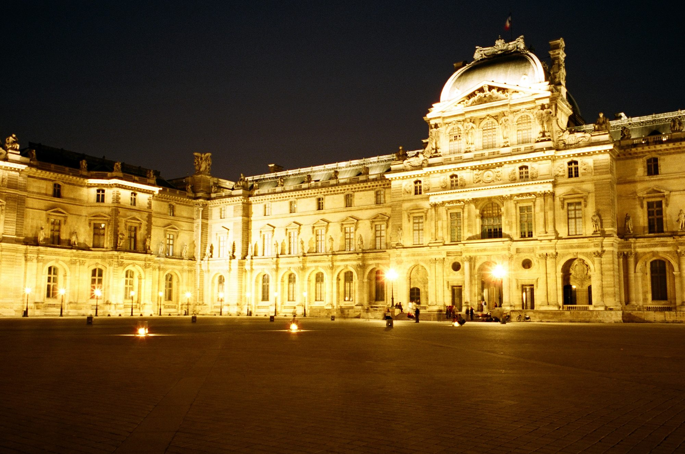
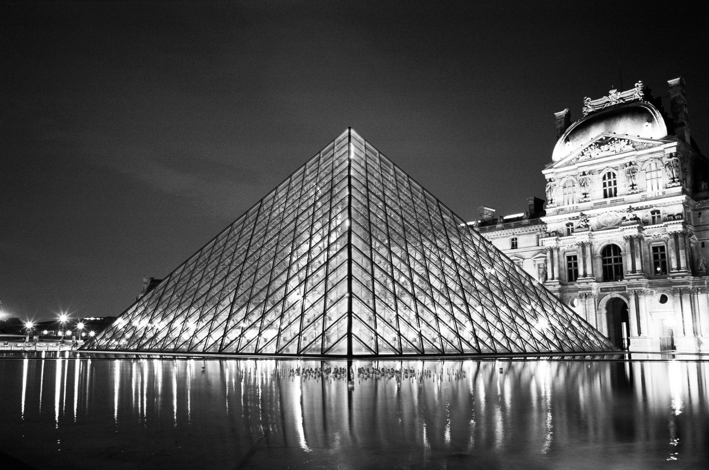
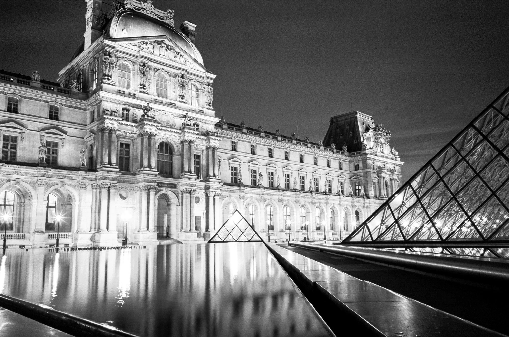
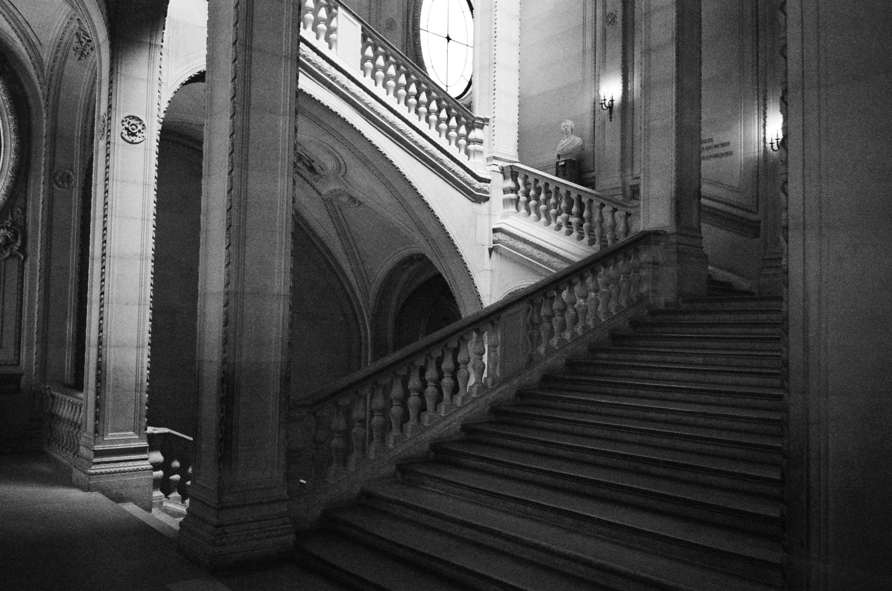
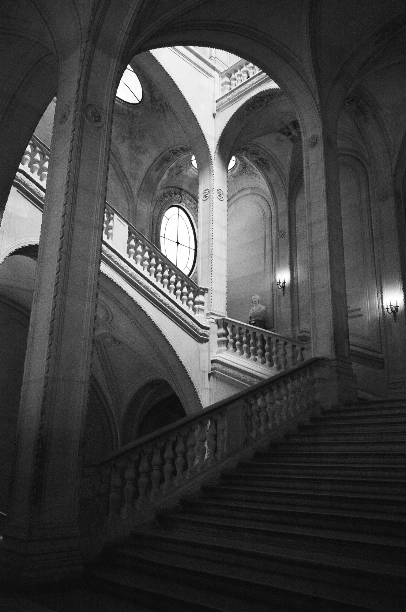

## The Eiffel Tower

This was our first visit after arriving and checking into the hotel. We walked along La Seine until we finally arrived.

## OUTSIDE THE LOUVRE

This was where we spent most of our time photographing during our time in Paris. Our hotel was only a five minute walk away, so we came by frequently. The Louvre interested me so much because of its juxtaposition of new and old, garish and elegant. Walking through the halls was an experience in and of itself.

## The Grand Gallery

I had read about the Grand Gallery before, but nothing could have prepared me for the scale of it. Massive is the best word to describe it. It was difficult to appreciate the works of art on the walls whilst people constantly milled about. Everything about this part of the museum was inspiring, from the floor to the ceiling and all that fell in between.

## the halls of the louvre

Far less busy than the floor of the Grand Gallery was this little stairwell, tucked away. The lighting was harsh, but I did my best to capture it.

## Resting after a day of art

After an entire day of wandering the Louvre, we decided to set up camp outside the pyramid for sunset. We were joined with many other photographers, with whom we chatted, swapped stories, and compared photos.

## La Seine

On the last day of our journey, we walked along the Seine, holding hands, stopping whenever we got tired. The previous day, I received my job offer from Artsy and we celebrated with a wonderful meal and a bottle of Bordeaux. As we traipsed along the river, we talked about how lucky we were. Lucky to have been able to move to Europe, to have come to visit this beautiful city, and lucky to be starting a new job in just a few days. It was the end of a magical trip.

