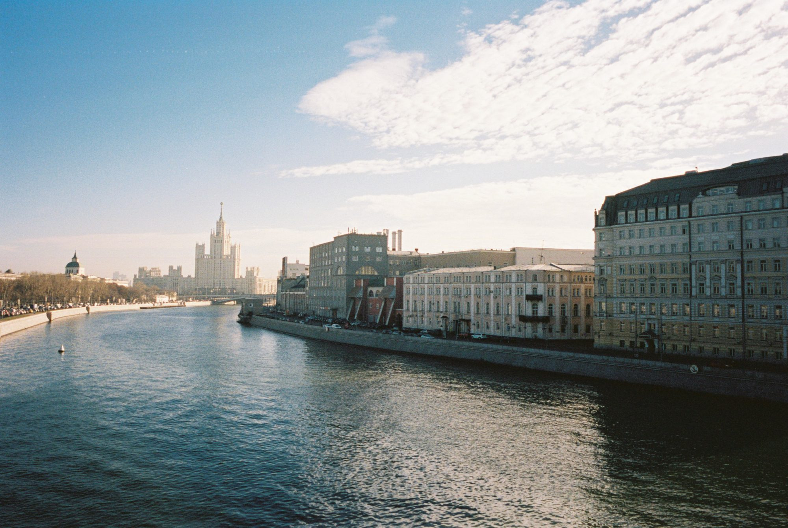

## St Basil's Cathedral

We explored in here a bit – very interesting and very old church.

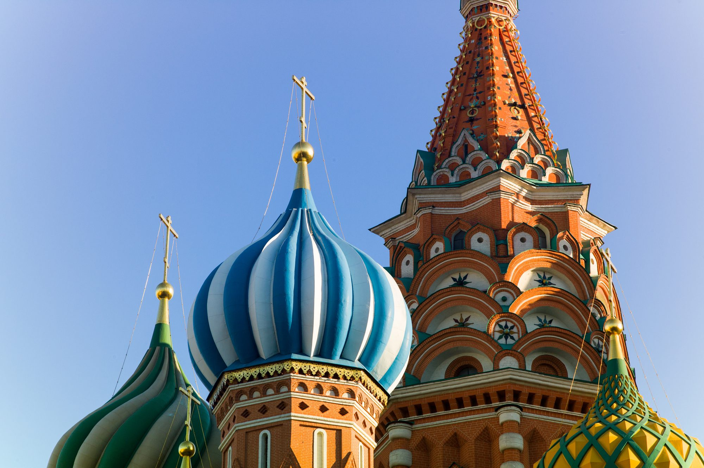
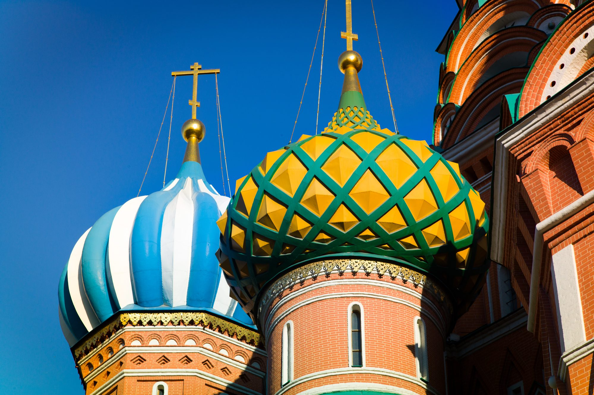
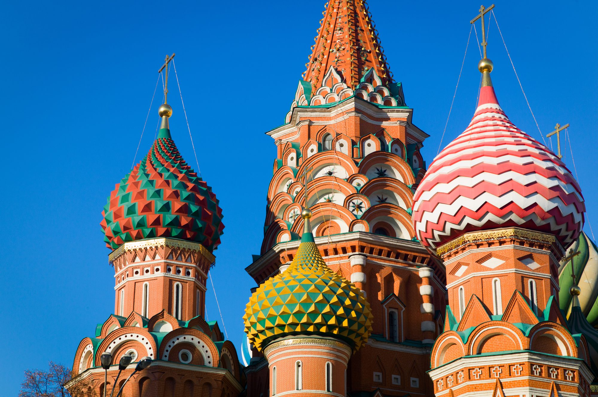

## Red Square

Named after the revolution of 1917, this square is at the centre of Moscow. The cranes are representative of the construction and renovation that permeated the city.

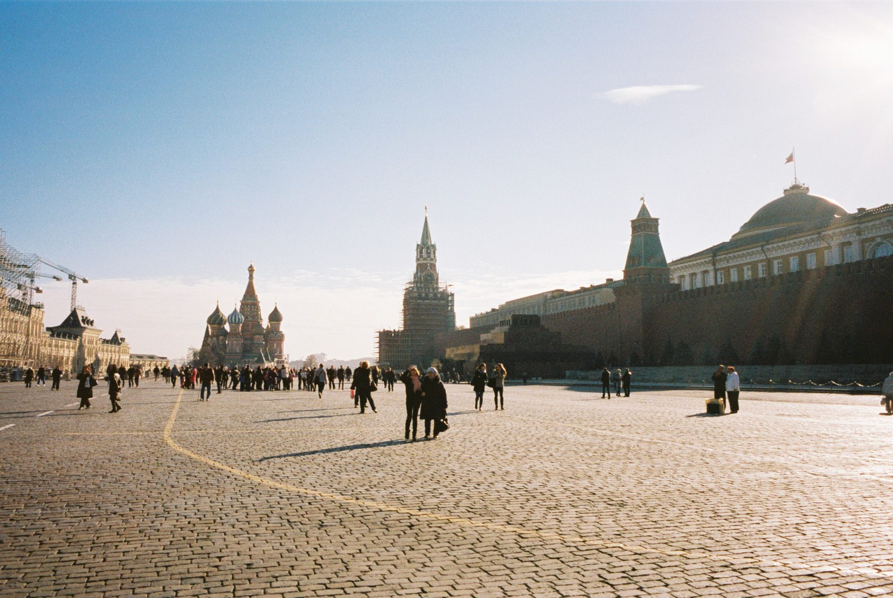
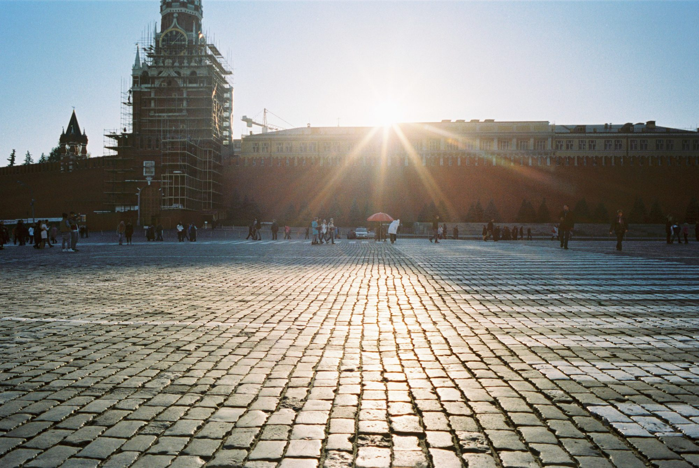

## Post-Soviet Boom

The shopping mall on the left was enormous and seemed to go on forever. It featured all sorts of luxury brands and stores selling high-end wares. The building on the right featured a really common sight: air-conditions added to buildings. Definitely not a centrally-planned economy.

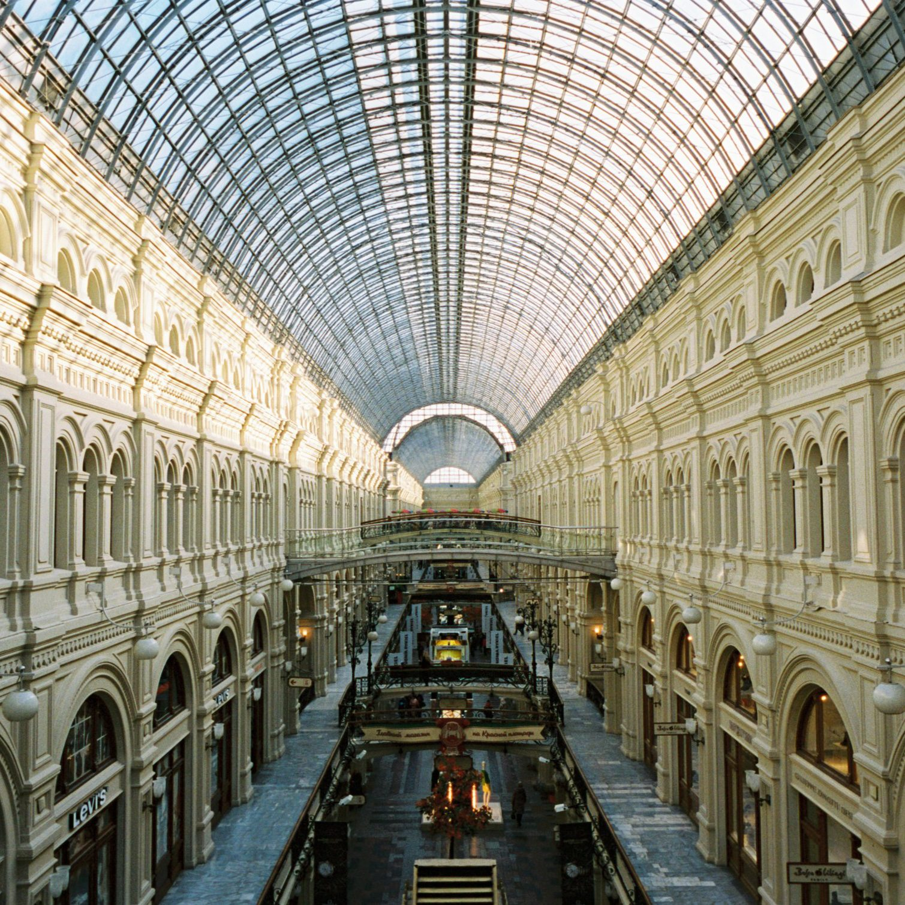
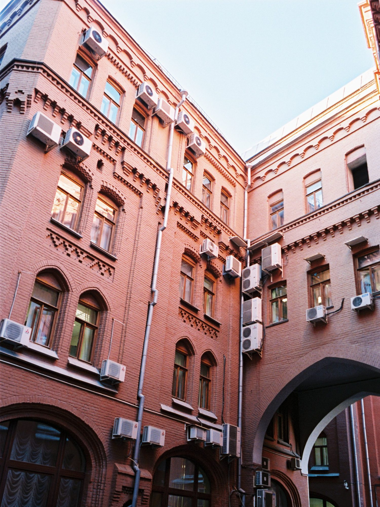

## Moskva River

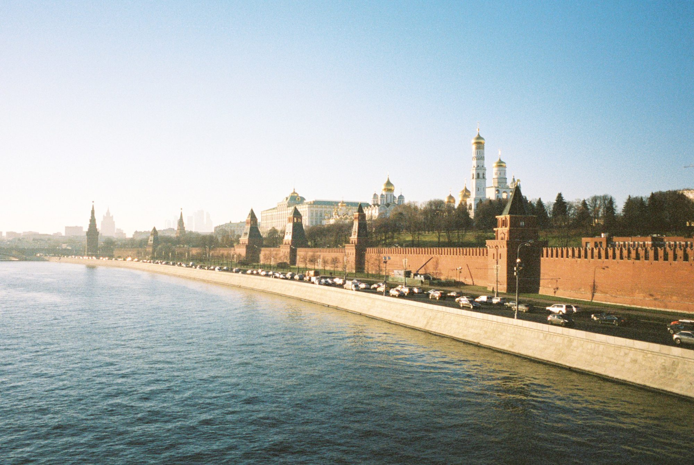
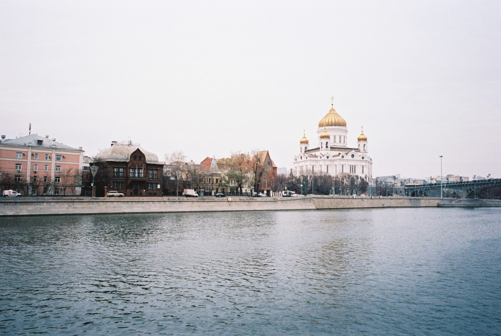
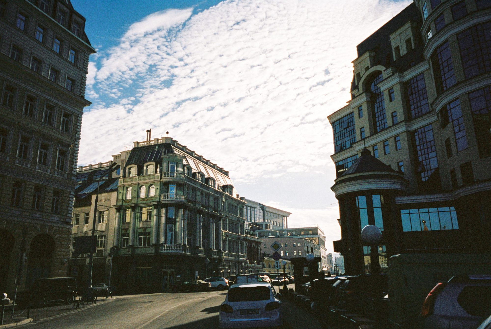

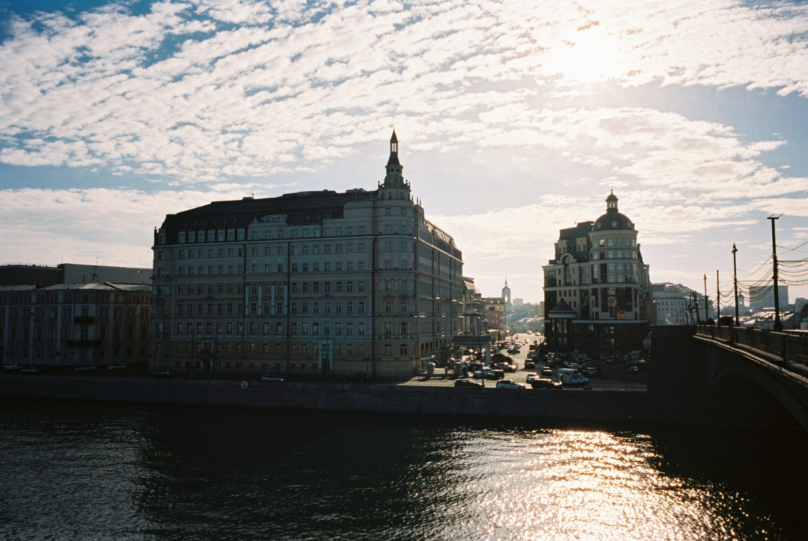

