## Parks

Minsk has a lot of green, when green is visible. I was lucky enough to visit before Winter’s big snowfall, and it was unreasonably warm for the time of year. I was able to see some really nice park areas along the river that runs through the city.

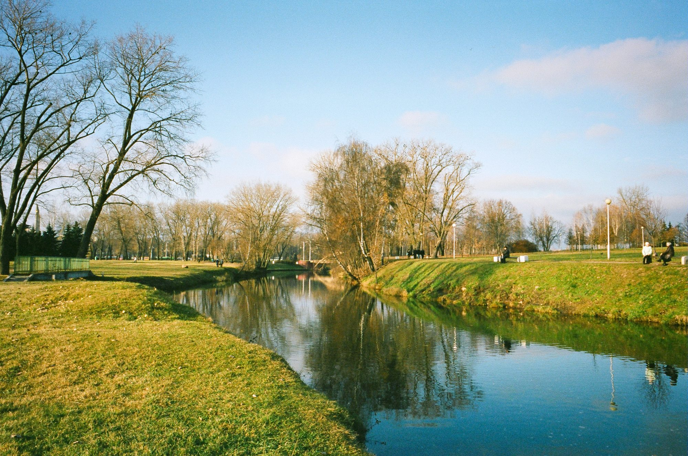
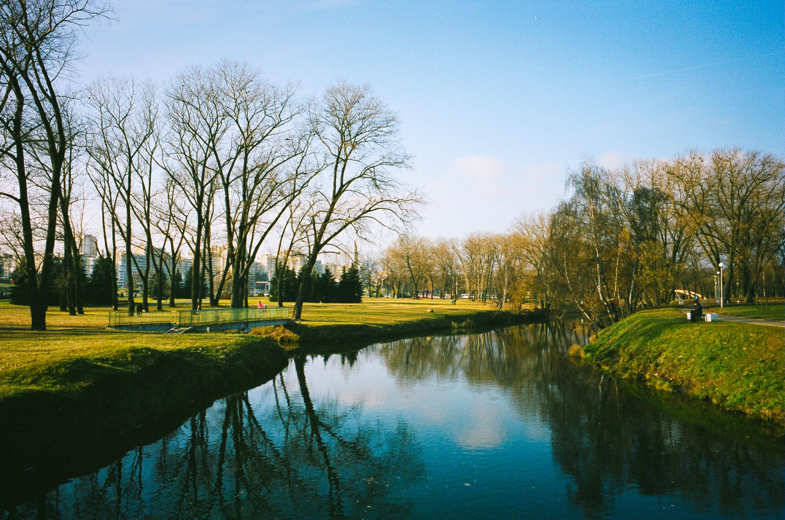

## Old Town

Most of Minsk was destroyed in the second World War, so the parts of town that don’t look like they were constructed during the Soviet era were made to look that way.

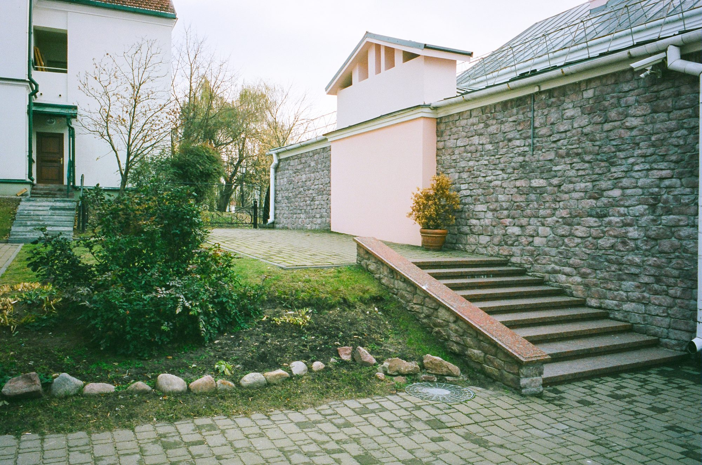
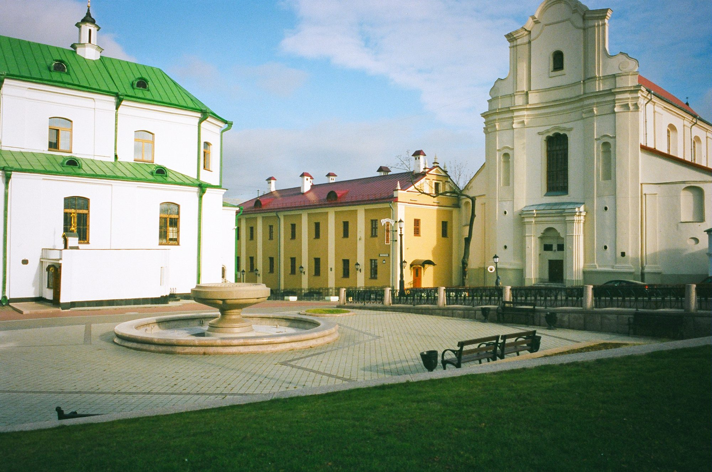

## Russian Hollywood

Minsk is a very clean city and was build almost entirely during the Soviet era; these properties make it ideal for filming stories set in the Soviet Union. There are quite a few movies made in Minsk that are set in that era, and I was lucky enough to see a film set right outside my hotel. I managed to capture this photo on my Polaroid of some awesome-looking Soviet-era taxis.

## ARchitecture

The city had some really cool grandiose architecture. It was a pleasure to walk through at day and night.

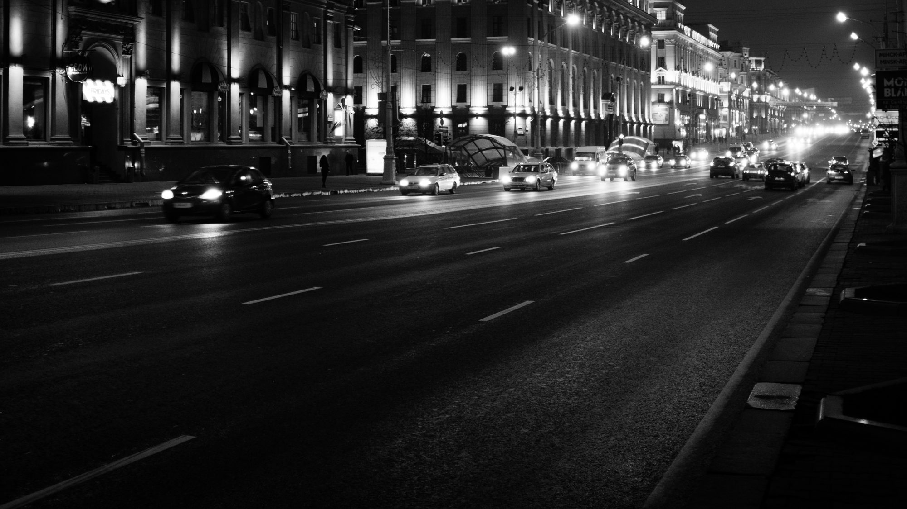
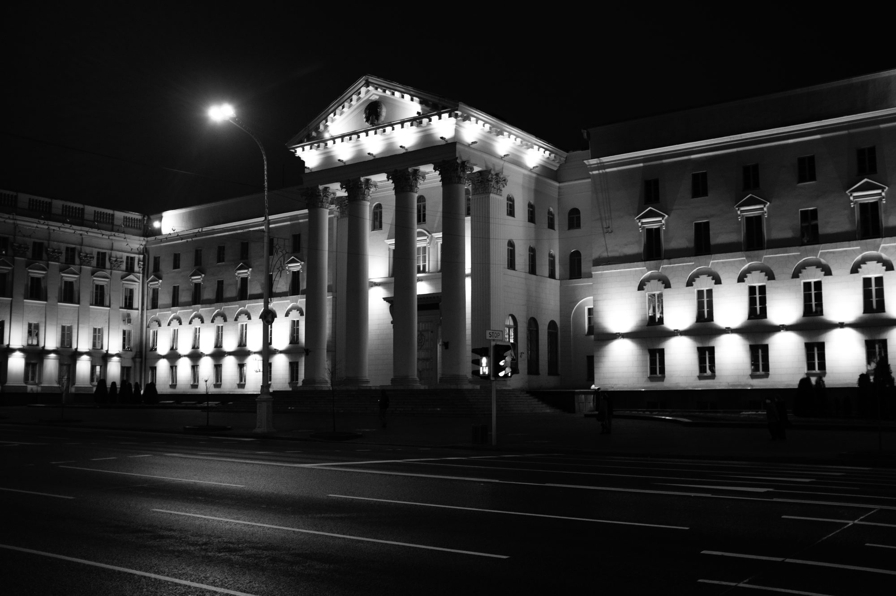

## Circus

My host asked me what I wanted to do for fun while I stayed in Minsk – she suggested the circus, even though it was for kids and completely in Russian (I had a friend accompany me to help translate). I had never really been to a circus before, especially not a Russian/Belarussian one. It was awesome to see some amazing feats of strength and entertaining animals acts. I would have more photos of the circus if I hadn’t been so captivated.

## National Library

This is quite an interesting building. A relatively recent construction, the library is a 22-story polyhedron containing stacks and stacks of books. Ever cooler was the fact that we got to take the elevator to the top of the structure.

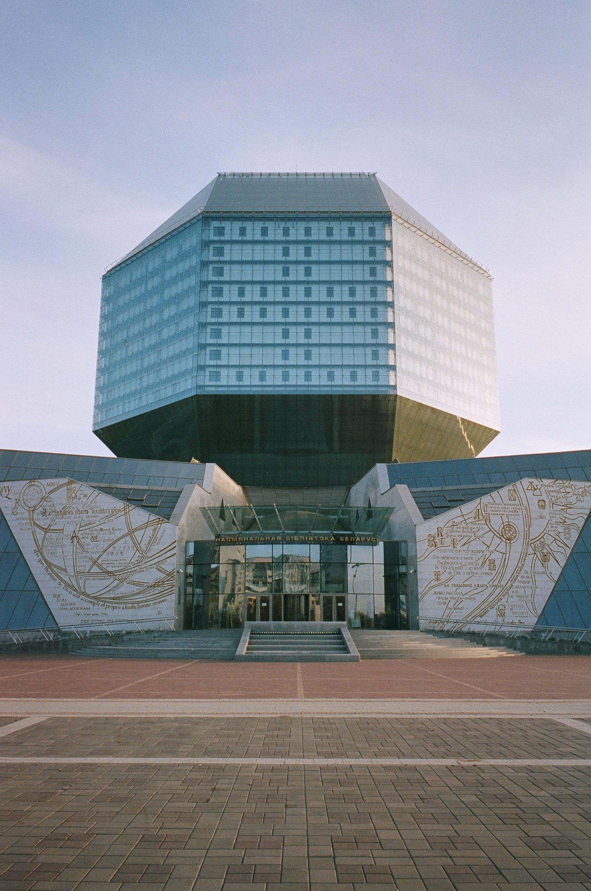
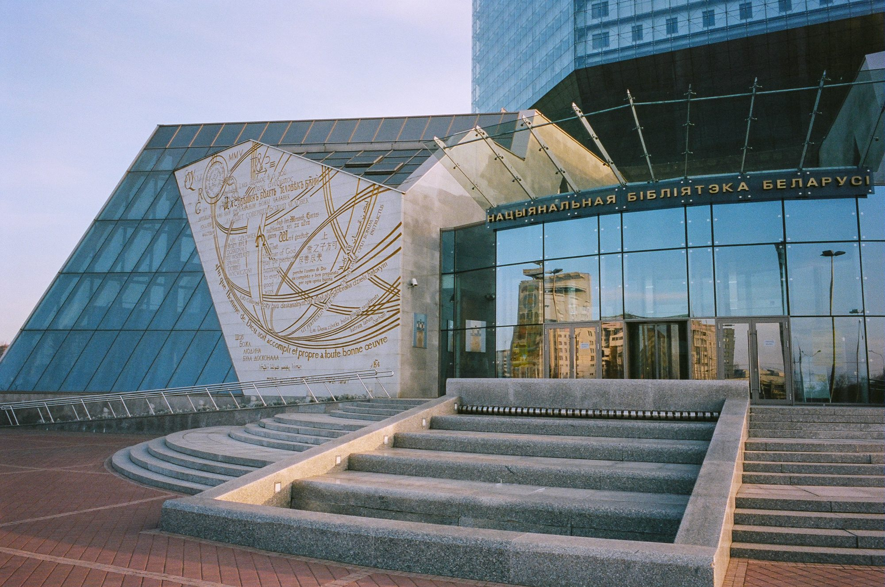

Here’s a view of Minsk from the top of the library.

## Soviet Factories

Minsk was an industrial focus point for the Soviet union and has many old factories still standing. Many of these are rented out to startups, coworking spaces, and other companies.

This factory, however, is still being used as a factory; it manufactures vodka. The odour that it emitted was very distinct – not offensive at all, but not exactly sweet, either. It’s a smell that I was told that I’ll never experience anywhere else because it is unique to this factory’s process.

Minsk is definitely a city built for cars, but it does have some bicycle paths (though these seemed more for recreation than transportation).

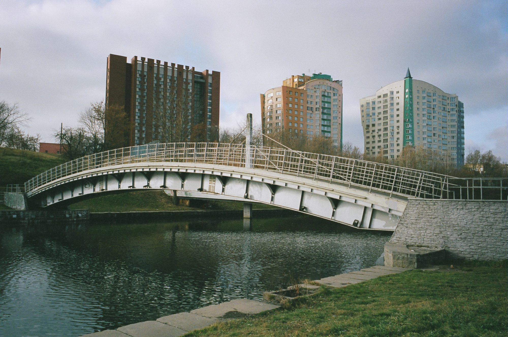
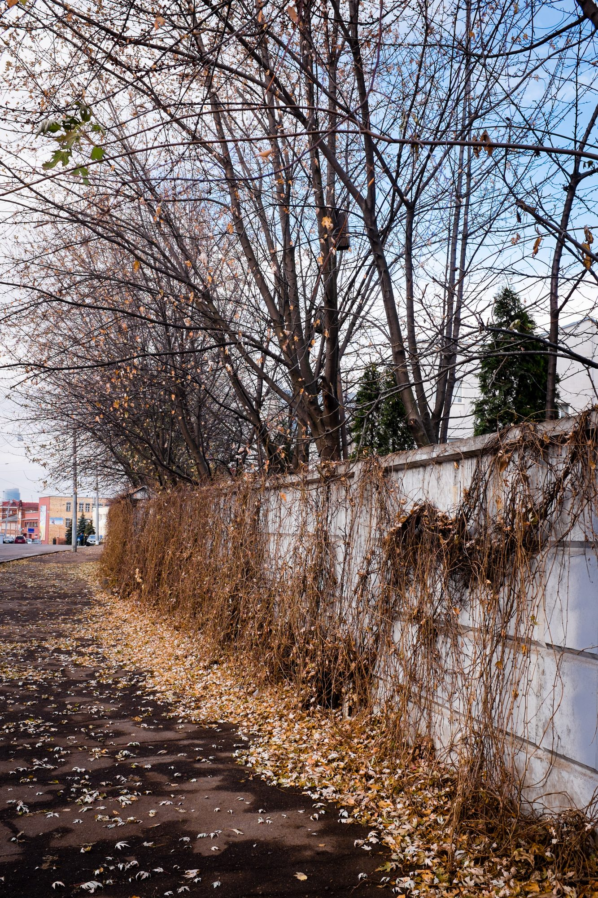

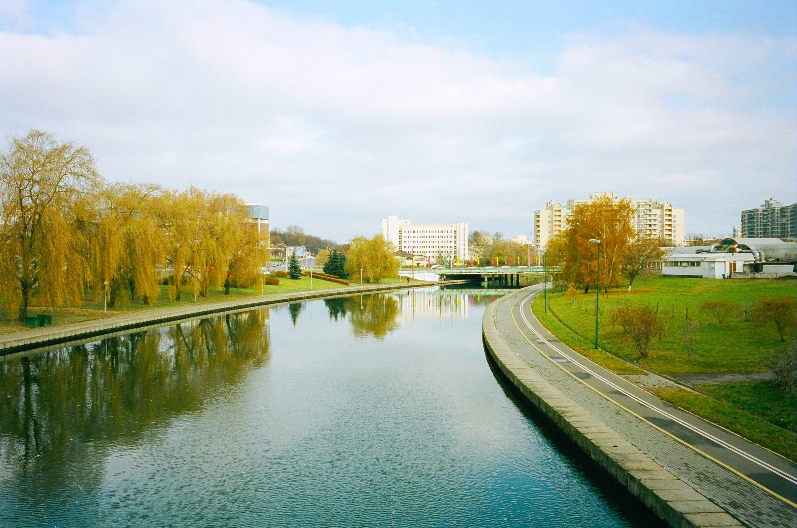
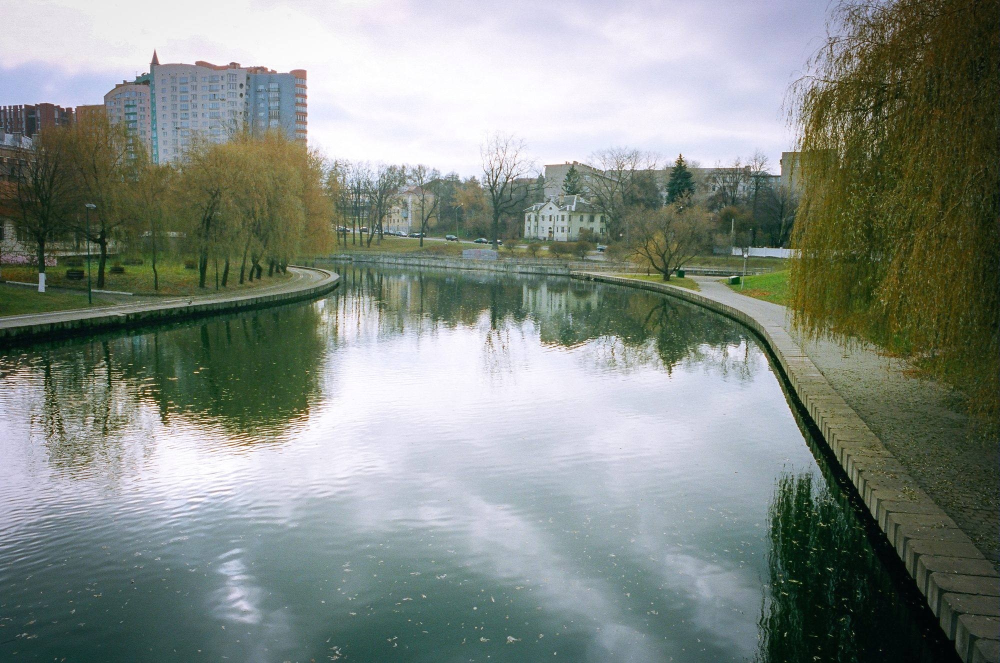
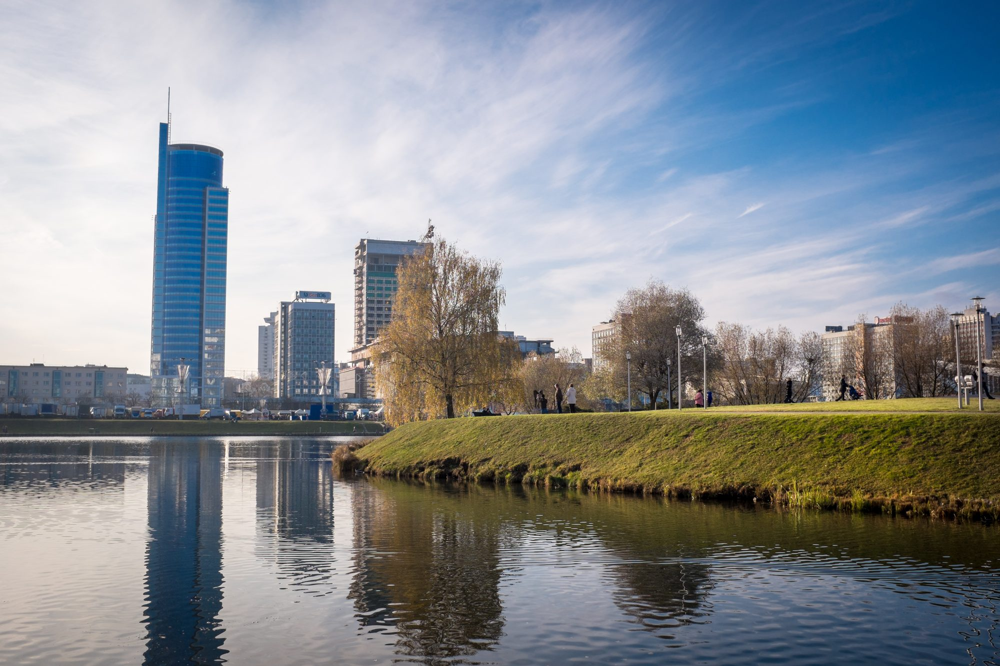
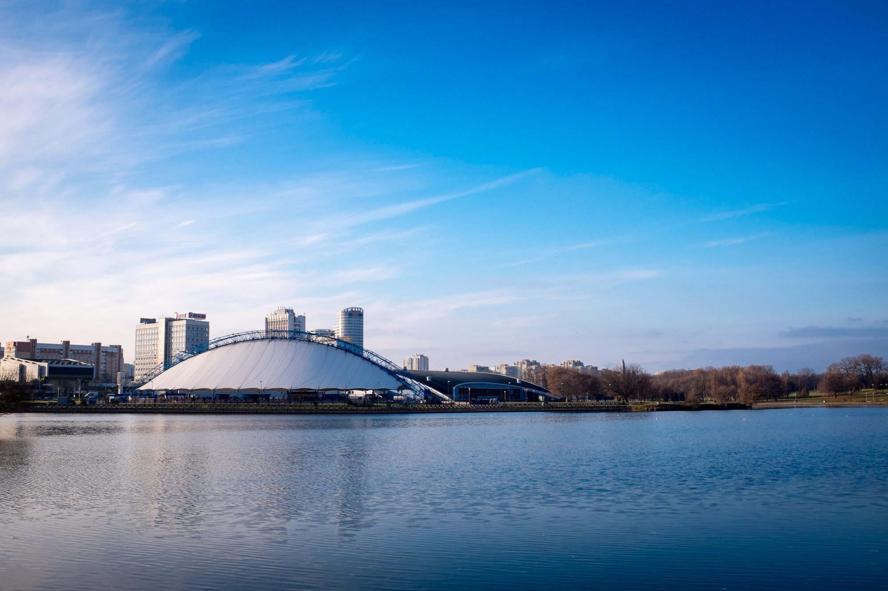

