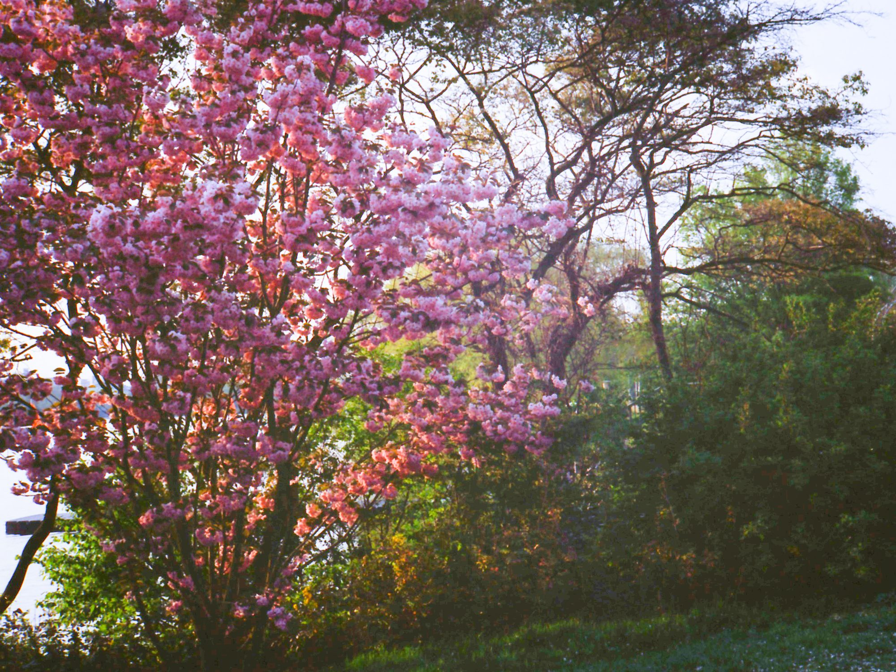
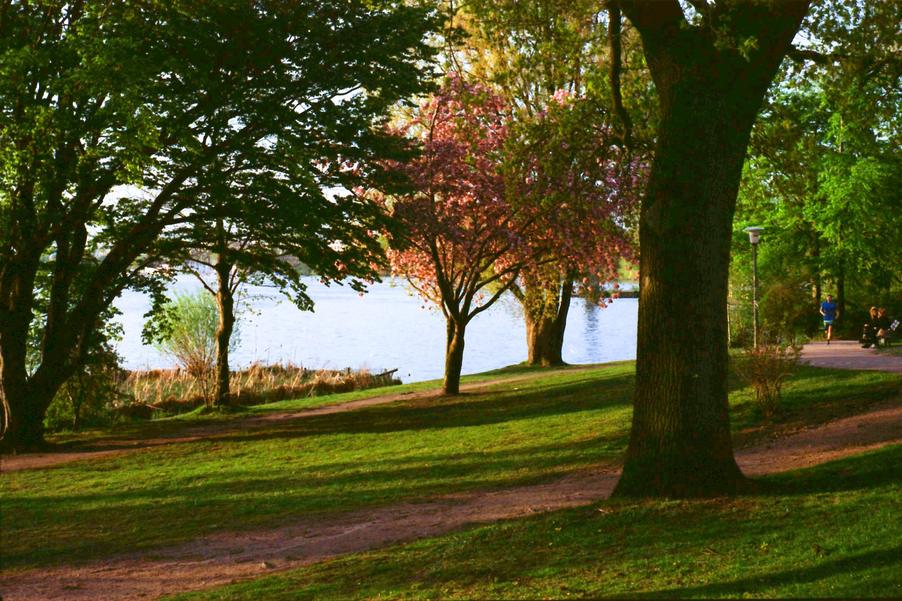
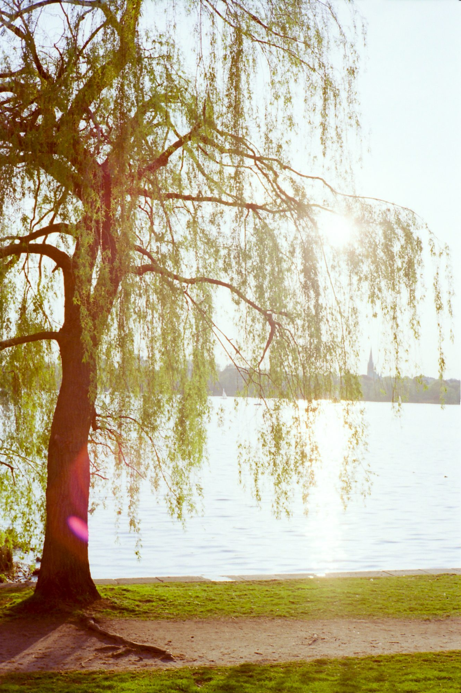
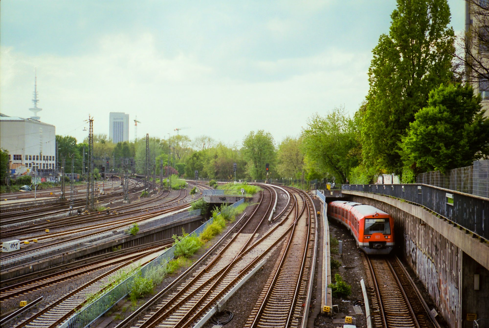
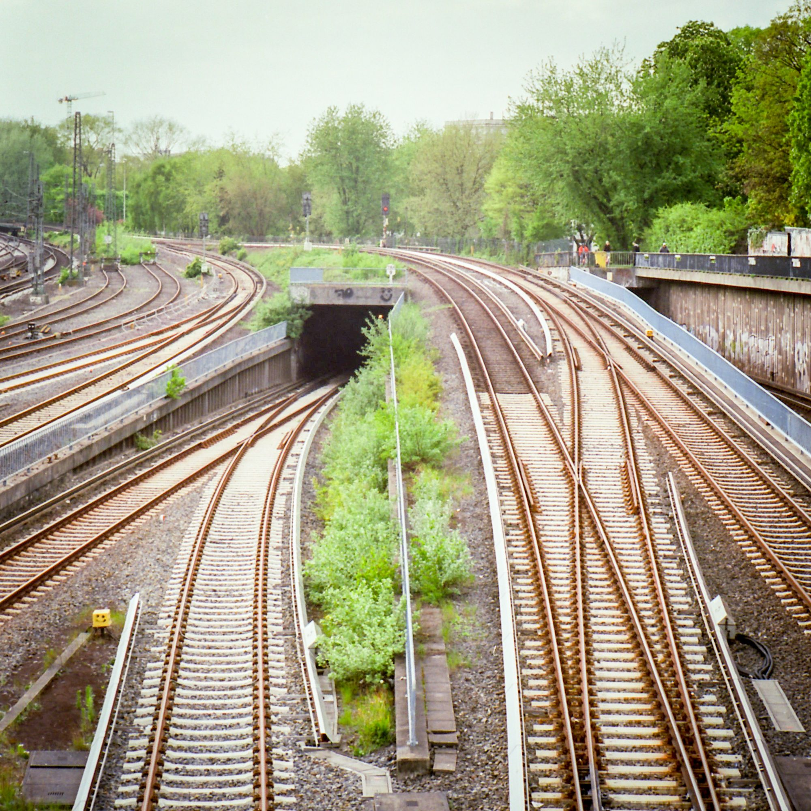
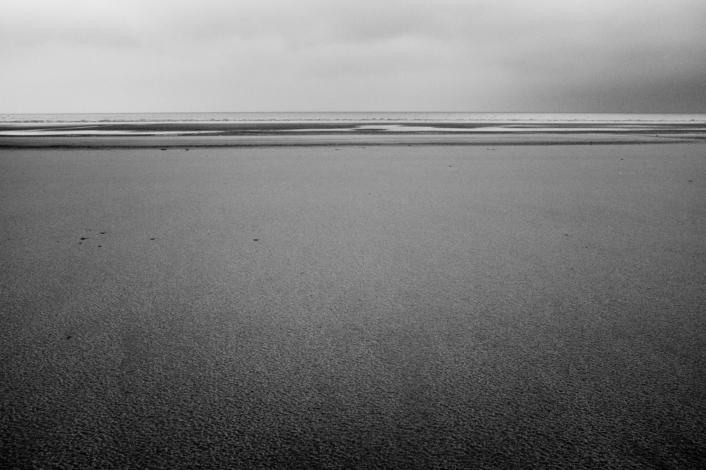
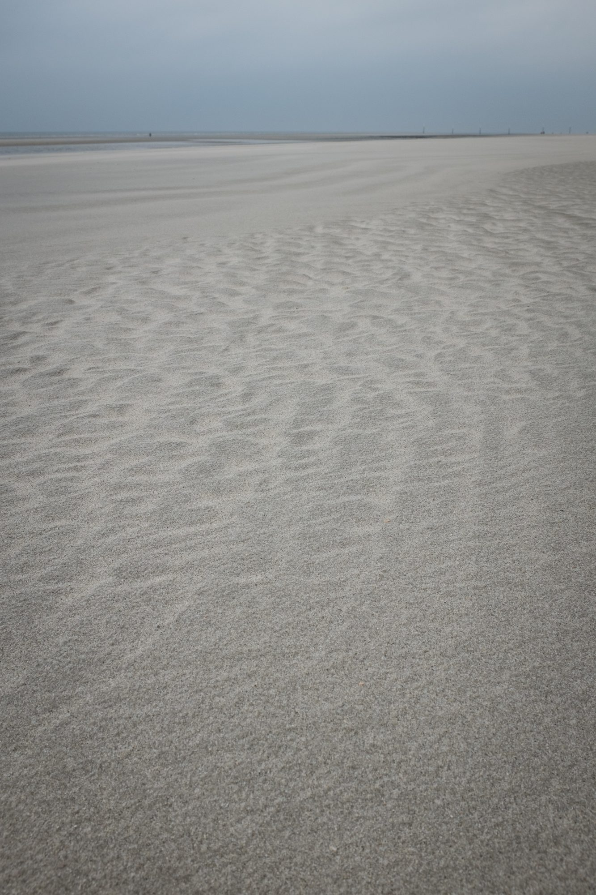
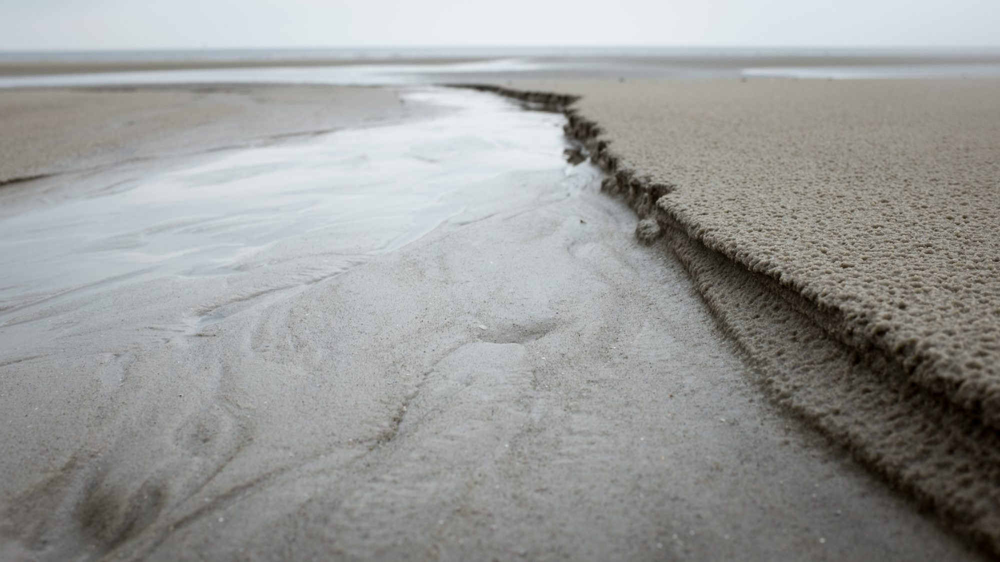
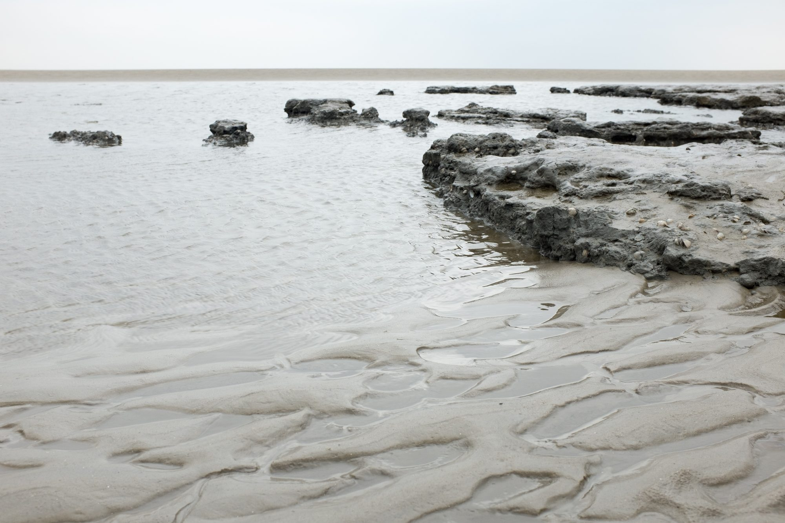
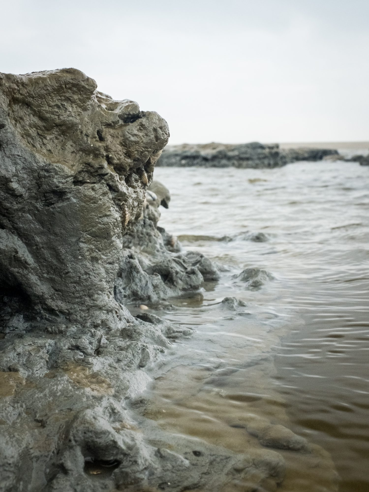

## Waterfront

Hamburg has a beautiful waterfront, and our hosts were kind enough to take us to a small beer garden. We hung out on the shore and watched the sunlight’s edge recede.

## Transport

The city exposes plenty of tracks – some cities try to hide their train infrastructure, but Hamburg seems to be a place that acknowledges and celebrates its past as a port city.

## Sankt Peter-Ording

On the weekend, our hosts rented a car and drove us to the sea. It was windy and overcast but charming in a way I can’t really explain. We walked for quite some time along the beach and were caught in something of a [miniature sandstorm](https://instagram.com/p/2eFURnjBqk/).

Normally this area would be rife with other beach goers, but it was too early in the season. The place was deserted. We held our arms out and closed our eyes, knowing there was nothing to walk into. I couldn’t do it – after a few seconds, my eyes refused to stay shut.

I took the opportunity to get a close perspective on some otherworldly terrain. From near the ground, you can see the wind and water have etched valleys in the sand and clay. Vast coastlines bordering tiny ponds.

