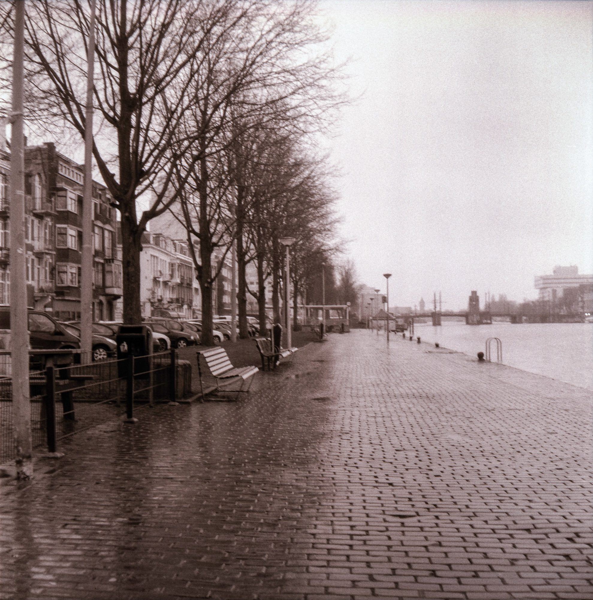
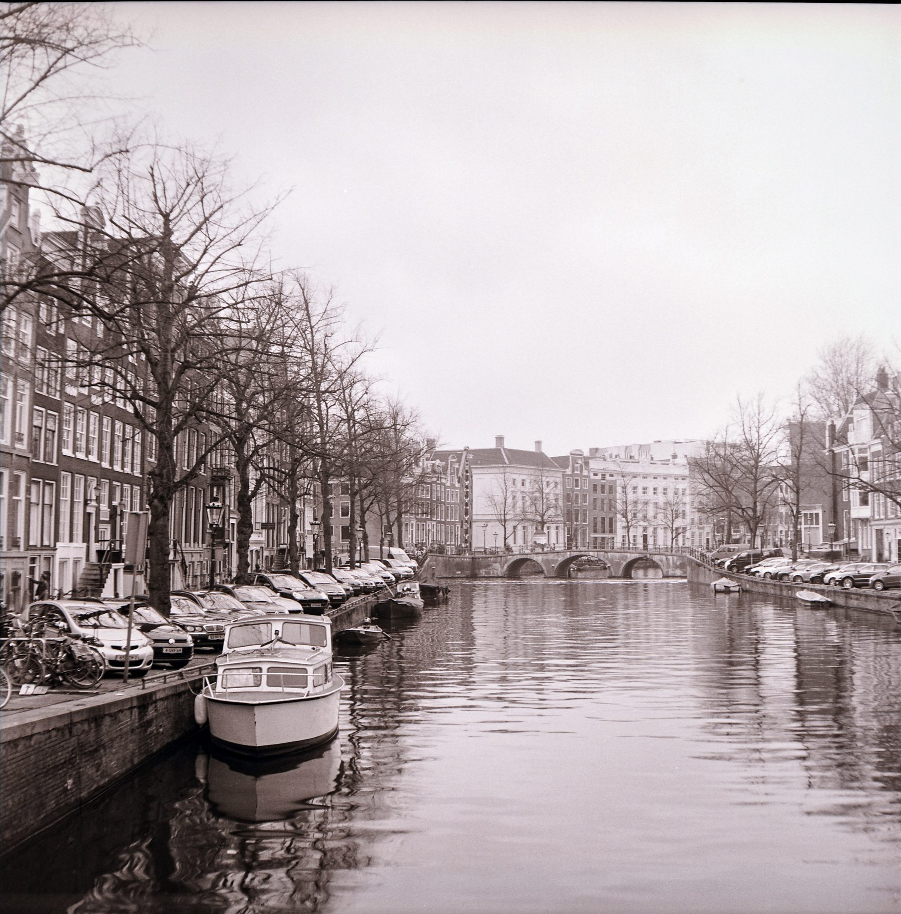
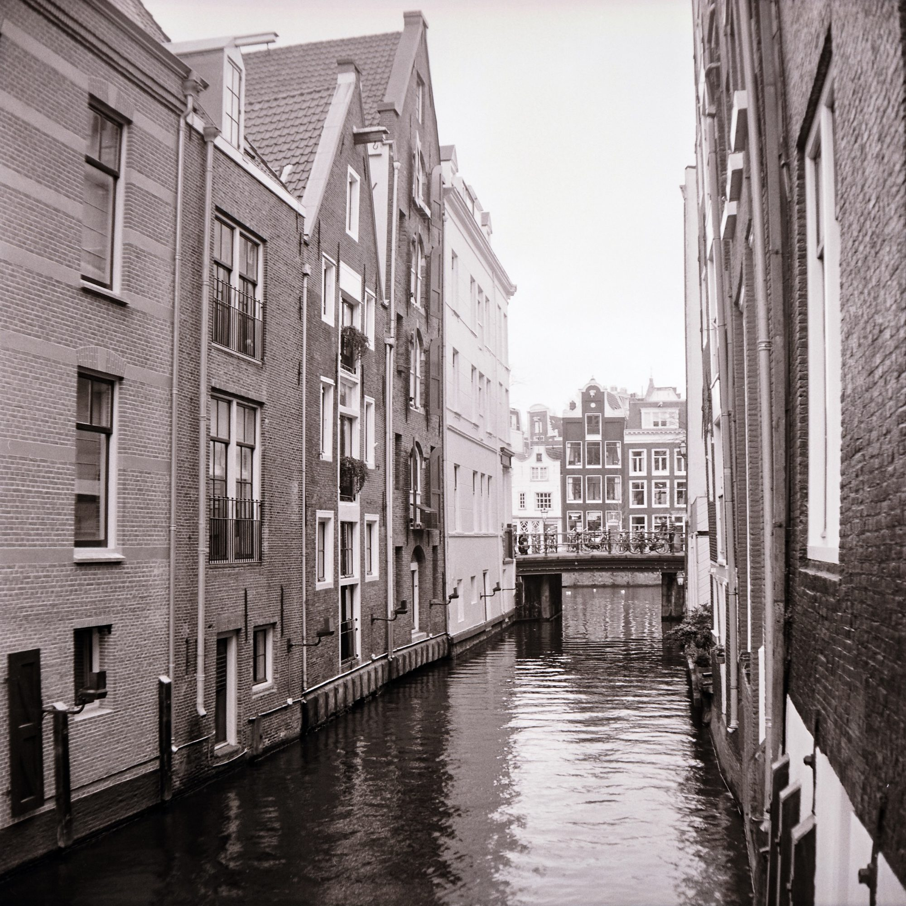
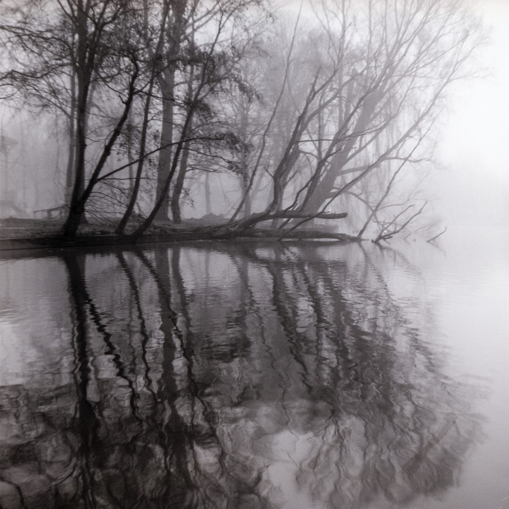
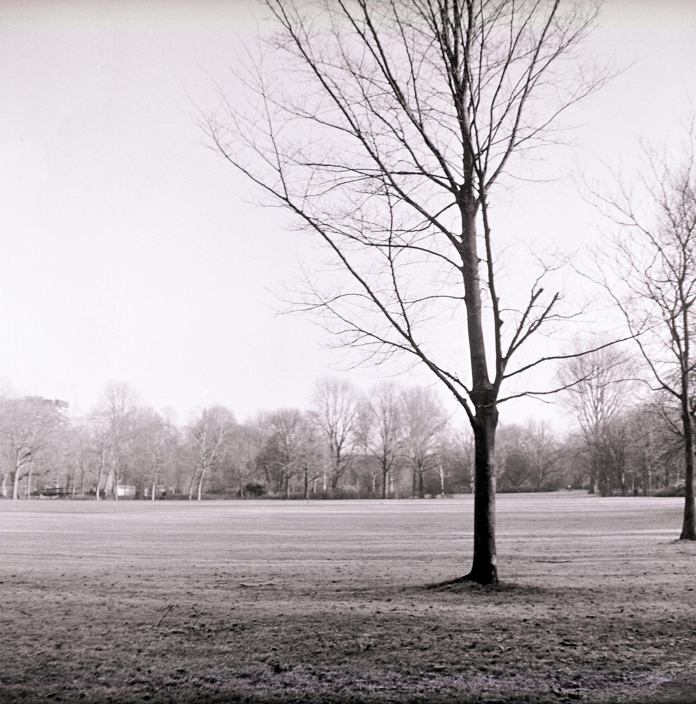
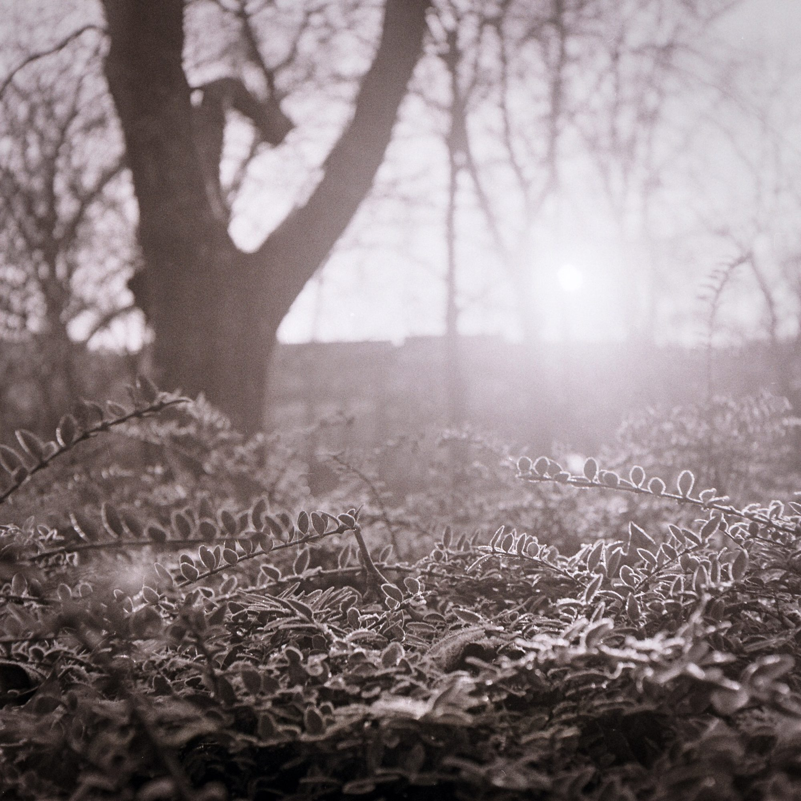
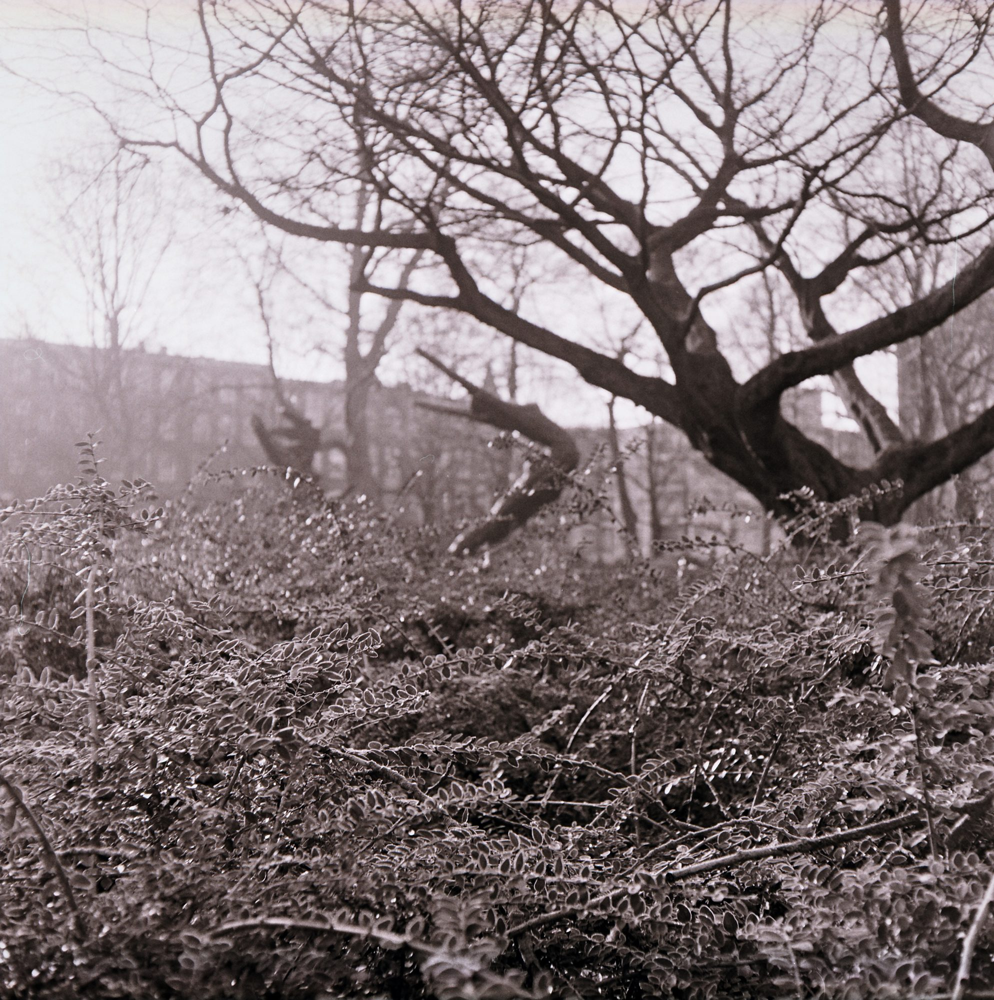

Around last November, I got really excited about larger-than-35mm photography. “Medium format” is the term used to describe photography done on negatives (or digital sensors) that are around 6x6cm (just over two inches squared). My wife picked up a cheap old [Fuji 6x4.5cm rangefinder](https://instagram.com/p/weHoZgSORU/), but it’s shutter was broken. Eventually, we [found a twin lens reflex](https://instagram.com/p/wjiqtHyOQA/) camera at a local shop on Haarlemmerdijkstraat.

TLRs typically shoot in square format. The original Instagram, I guess. As their name suggests, they have two lenses: one lens for focusing and composing your photo, and the other lens to actual take the photo. It’s one of those [old-timey cameras](http://gifs.ashfurrow.com/tlr.gif) you see.

The issue with this camera was that my scanner couldn’t scan medium format photos. I was moving to New York in a few months, anyway, and I’d buy a new scanner here. However, between the autumn and the spring, I would only see the results of any of my work on the negatives themselves.

Finally, now at the end of summer 2015, I have scanned the photos to see how things turned out. I’m quite pleasantly surprised!

I’ve scanned the (black and white) film with colour. The negatives themselves do actually have a colour, and that is reproduced a bit here. It gives you a more honest feel of what the negatives are actually like – they aren’t just black and white. Someday, when I begin optically printing my shots, I’ll definitely keep that feeling in mind.

You might wonder what the point of medium format is, for me anyway. Well, the larger sized negative increases the detail you’re able to capture, which makes sense. Bigger negatives means more picture. A larger negative also permits some interesting effects with slimmer depth of field. On my camera, this extra depth of field is negated by my slow-by-modern-standards lens, but it’s still fun.

What I really wanted was a camera that would limit me and challenge me in new ways. Shooting with a medium format camera is a very different experience from 35mm.

One of the biggest differences between 35mm and medium formats is the number of photos you can take on a roll. 35mm rolls are easy to change by comparison, even on my old M3. And mostly you don’t have to worry about changing 35mm canisters in a dark place. You’ll get 36 shots at least on a roll.

But on my TLR only takes 12 photos on a roll. The 120-format film it takes is loaded in spools, not canisters, so I need to be careful about where I change the film – too much ambient light, and I’ll fog up the negatives.

I actually look down through the camera to frame my subject. And when I look through the viewfinder, everything is reversed, like it’s in a mirror. Right becomes left, and vice-versa. Panning the camera left makes the picture move toward the right. It’s such a surreal experience when you first start, but now it feels like second nature.

When I have to focus on what I see in the viewfinder, I feel detached from the scene around me. The rules of photography no longer apply – I can shoot anything I want, any way I want.

My editing process has also changed. I’ve never held the belief that film photography is more real than digital – they’re both different artistic tools. Every photographer chooses for themselves what tools to use in order to realize their vision. Unbound by the ideologies of film-vs-digital, I’ve incorporated digital editing techniques into my film photographs. A “hybrid” approach to photography that recognizes the value that analogue and digital each have to offer.

After the new year, I noticed [this monstrous camera](https://instagram.com/p/w3-Q92SObJ/) in an run-down shop. I asked the owner if the camera worked, and he said he didn’t know. I bought it.

The camera is a folder – it has bellows that collapse when not in use. It comes from pre-WWII Germany and has a simple lens with a very simple focus mechanism – just a scale that goes from “portrait” to “group” to “mountains.” You look through a metal rectangle to get an idea of your composition, but you never really know what the camera is seeing. It’s a joy to shoot because I never know what I’m going to get.

When I carry a ridiculous camera, people react differently to it. It feels somehow less invasive, maybe because the camera is too obtrusive to be used covertly. To be honest, I felt a little silly at first, but I’ve only ever received smiles from people who notice it.

The TLR, and the wide-format folder, are only tools. I’ve grown to appreciate them, and I think it’s time that I focus more on the form and practice of photography itself. It’s a wonderful hobby for me, and I feel so grateful for the friends who have helped me learn and grow.

As for digital, well, I haven’t used my digital camera in months. Mostly because I’ve been using film, and when I’m not using film, my iPhone usually suffices.

Actually, I take that back. My iPhone doesn’t just suffice, it’s a damn nice camera and I love it. It’s a constant companion, always ready for a [quick snap](https://instagram.com/p/6-lQmmDBmQ/) or something [more considered](https://instagram.com/p/2LdngkDBvq/). As I said, I appreciate the tools I have and the processes they offer. I’m looking forward to learning more about the practice of photography with a variety of tools, and I’m looking forward to having fun, too.

