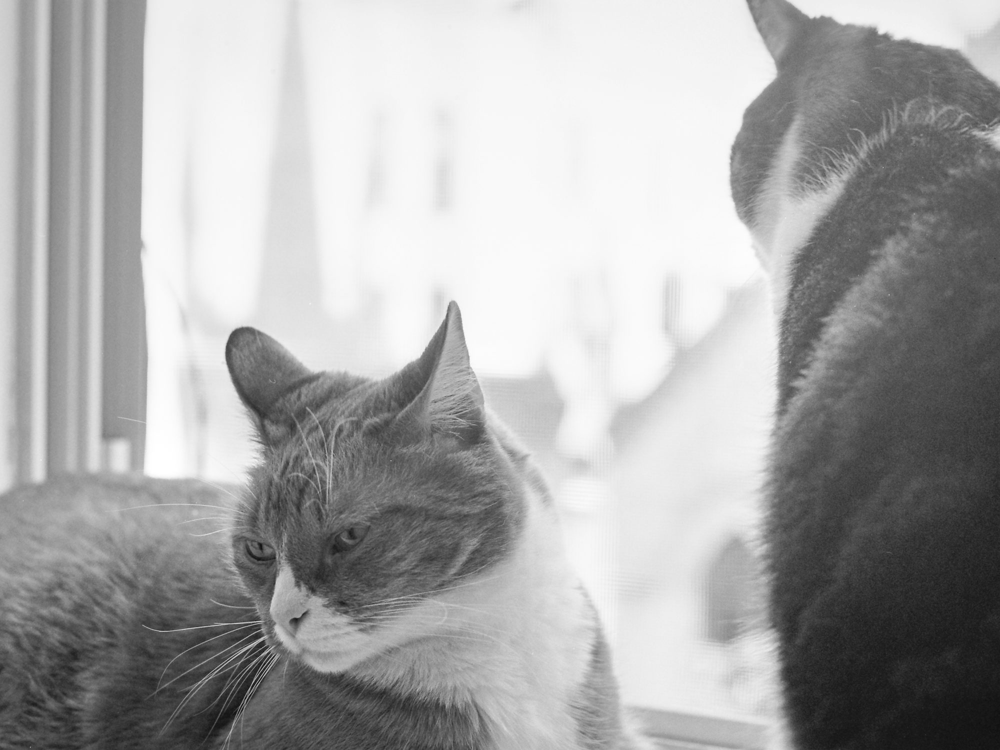
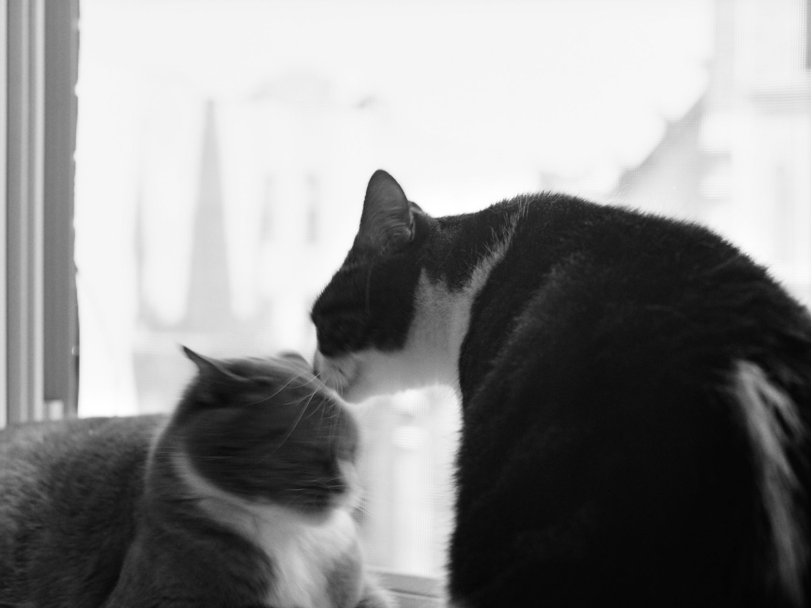
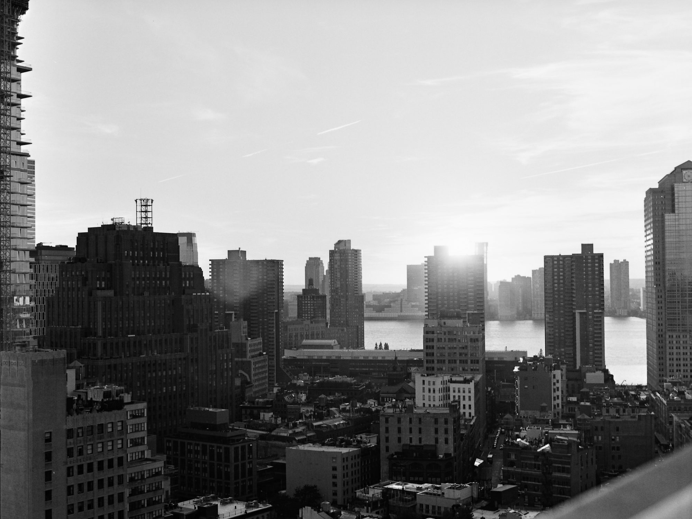
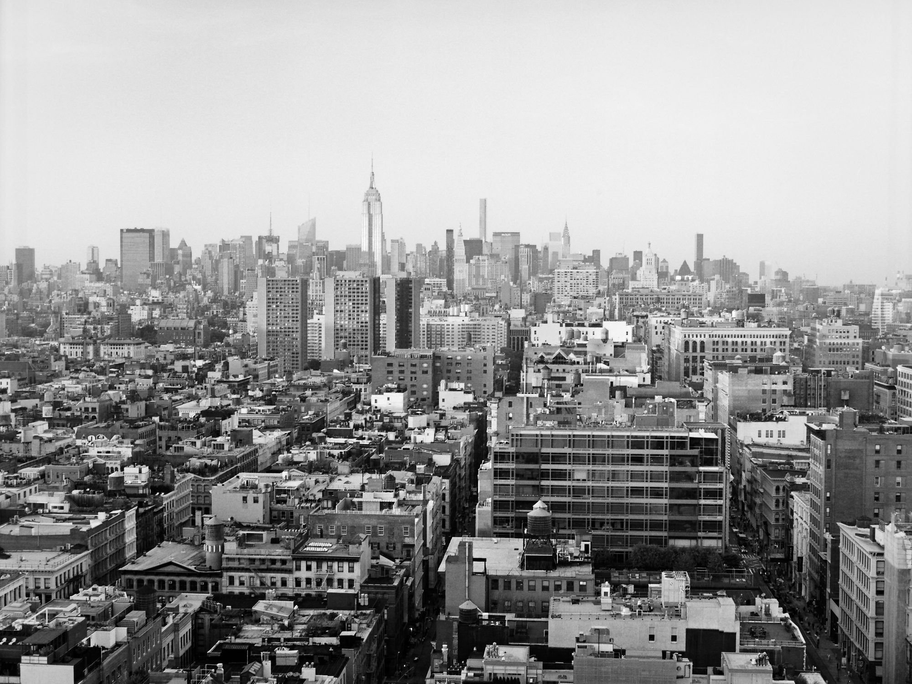

## Cats

Last week I received an old, beat-up Bronica ETRSi that I had found on eBay. The camera is medium(ish) format, producing 6x4.5cm negatives, and included a normal lens. In order to make sure everything worked, I pumped a test roll through it as quickly as possible (it still took three days to shoot 15 frames). These are all shot on TMax 400 and developed in DD-X.

I managed some indoor shots of the cats at a wide aperture of f/4 and a low shutter speed of 1/30s. Quite impressed with how the window’s screen makes the rooftops behind the cats look pixelated. The cats have only recently started tolerating each other on the windowsill – glad I managed to capture what might be the dying breath of Dave’s power struggle against Bandita.

## Manhattan Bridge

Since the camera doesn’t have a light metre, I used the Sunny 16 rule to guess the exposure settings for the remaining photos. They were taken from my workplace, on the top floor of our Tribeca office.

The detail rendered from the lens is spectacular – I can see individual bricks, air conditioners, and windows from across the East River. The sky is a bit flat – I might try to find a yellow filter to add some dynamism.

## And more Manhattan

This is the part of the test roll I got lazy and decided to just shoot the remaining frames from the office. It doesn’t hurt that our view is pretty spectacular, especially at sunset.

The details in the shadows when shooting directly into the Sun are remarkable – you can make out individual clouds, too. But then I suppose that’s just because film is so awesome (⌐■\_■)

The second photo looks North, up Broadway, to expose the organized complexity of Manhattan. It reminds me why I really dig New York.

