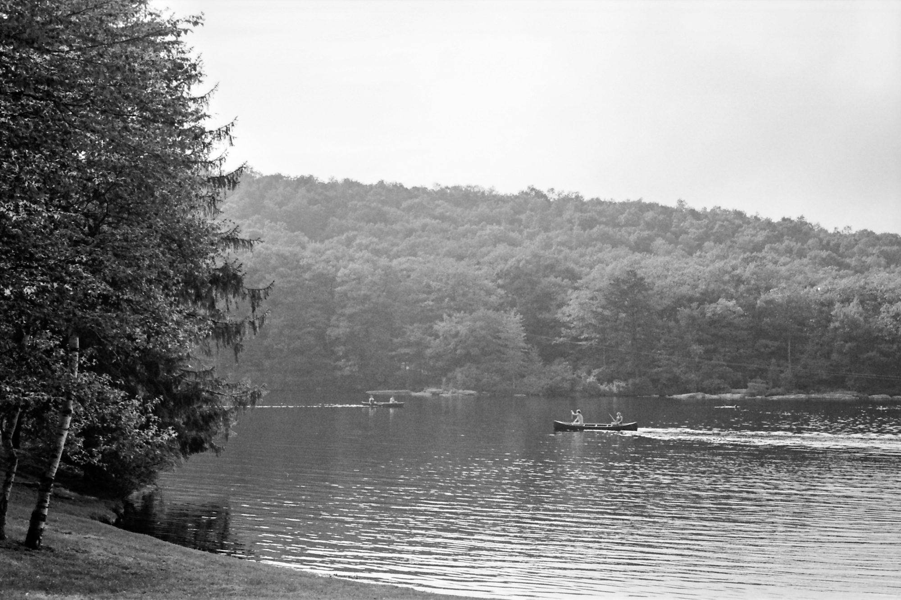
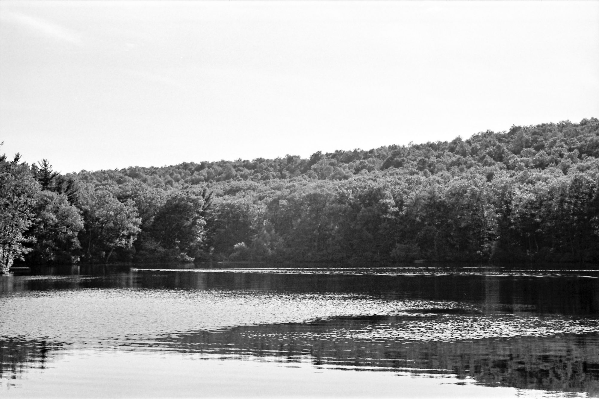
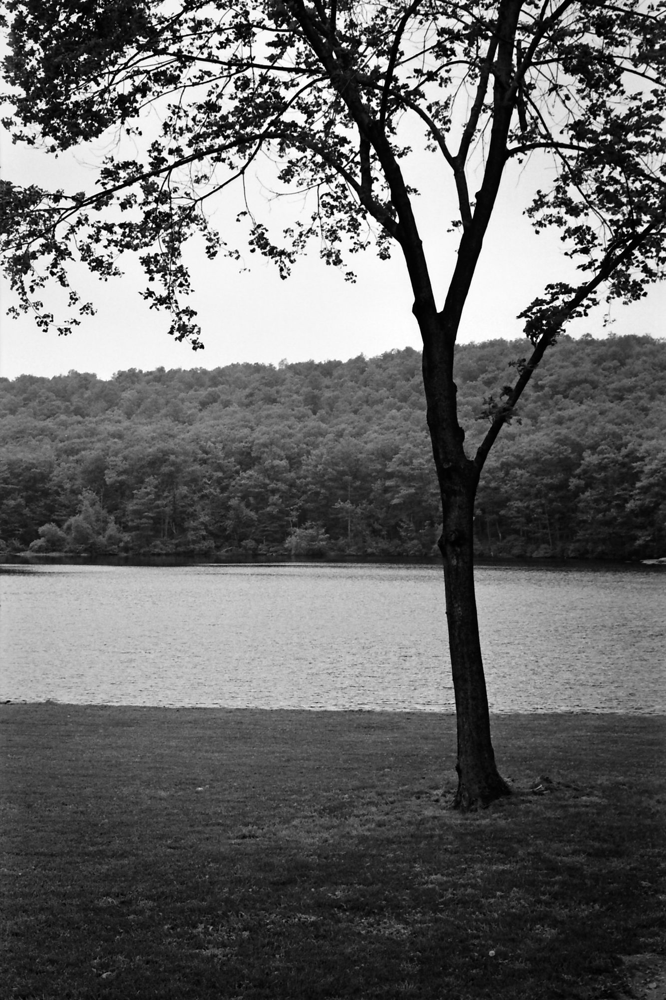
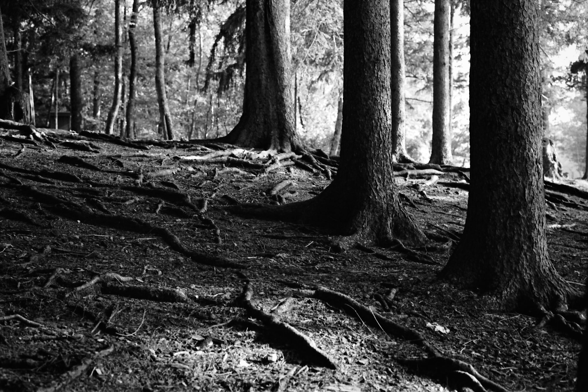
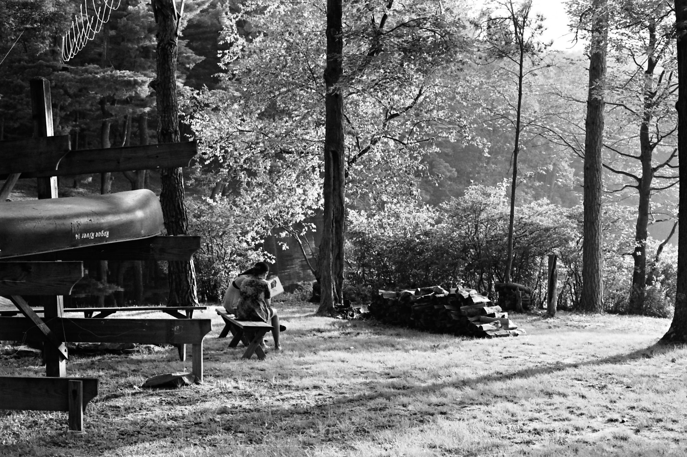
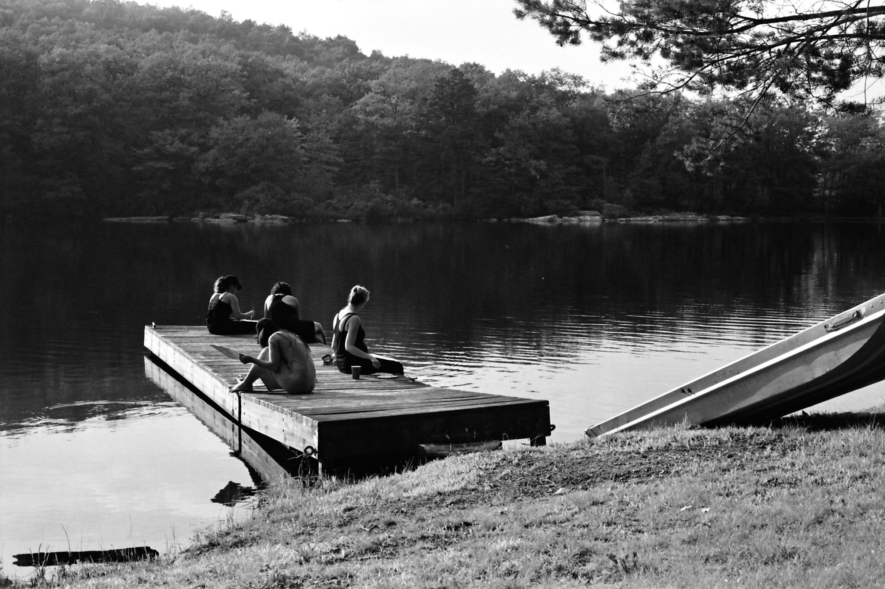
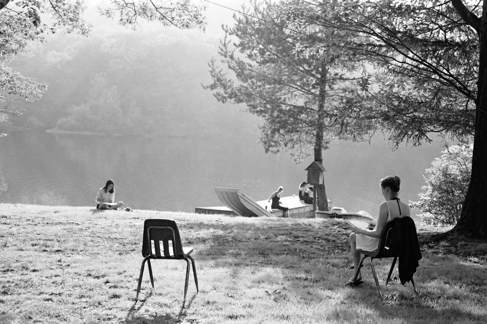

## Cedar Lakes

Artsy takes a very awesome approach to the company offsite. I missed last year’s and was quite excited to participate this time. While [some](https://observer.com/2015/08/artsys-wet-hot-american-summer/) appear put off by the idea of a corporate retreat that doesn’t suck, I had an amazing time.

All of these photos were taken on black-and-white 35mm film. For less monochromatic shots, [check out Instagram](https://instagram.com/explore/tags/artsyoffsite/).

I brought my [pinhole camera](http://ondupinhole.com) for some wide-angle shots, which cooperated well with the lake. It was great to take advantage of my time outside Manhattan to get some photos of nature.

Another pinhole shot – not as awesome maybe, but this is a five-minute exposure after sunset! The long exposure gives my colleagues ghostly silhouettes, and makes the little party lights really stand out.

One of my favourite parts of the offsite was the watercolour painting workshop – I hadn’t painted anything since high school. After having fun with the workshop and listening to a colleague discuss discomfort and art, I [started to learn to draw](http://ashfurrow.com/blog/drawing/).

