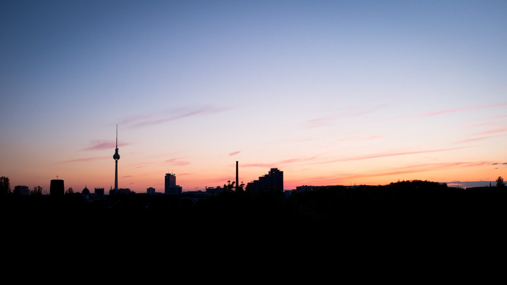
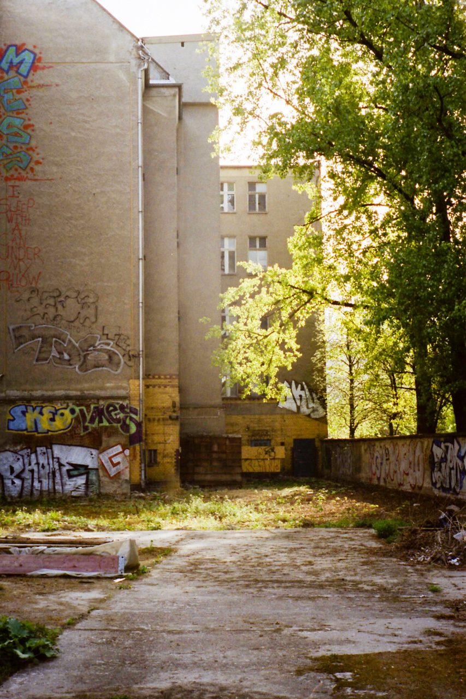
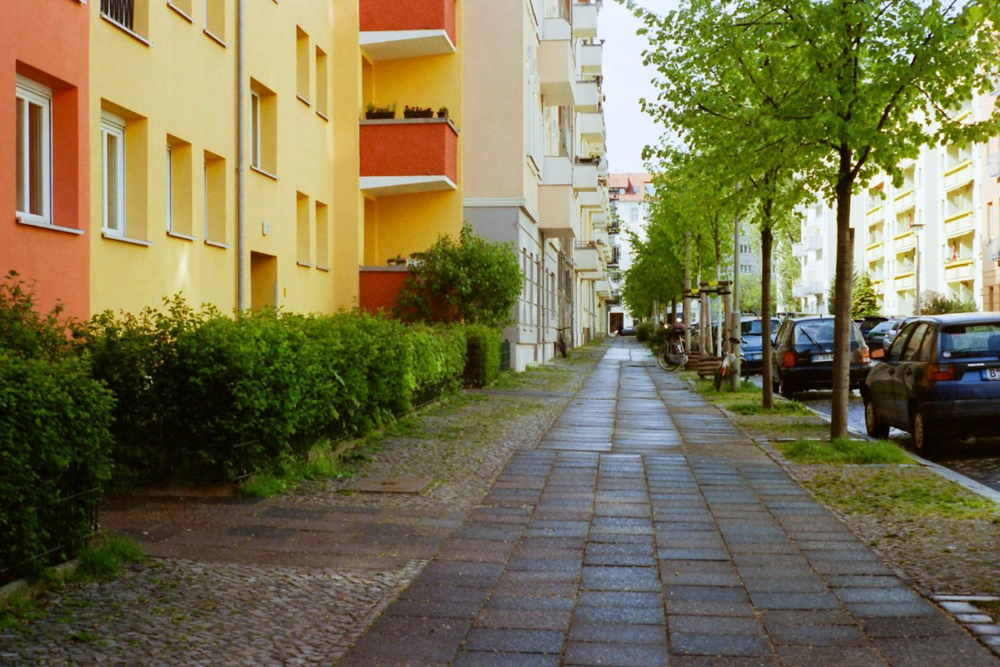
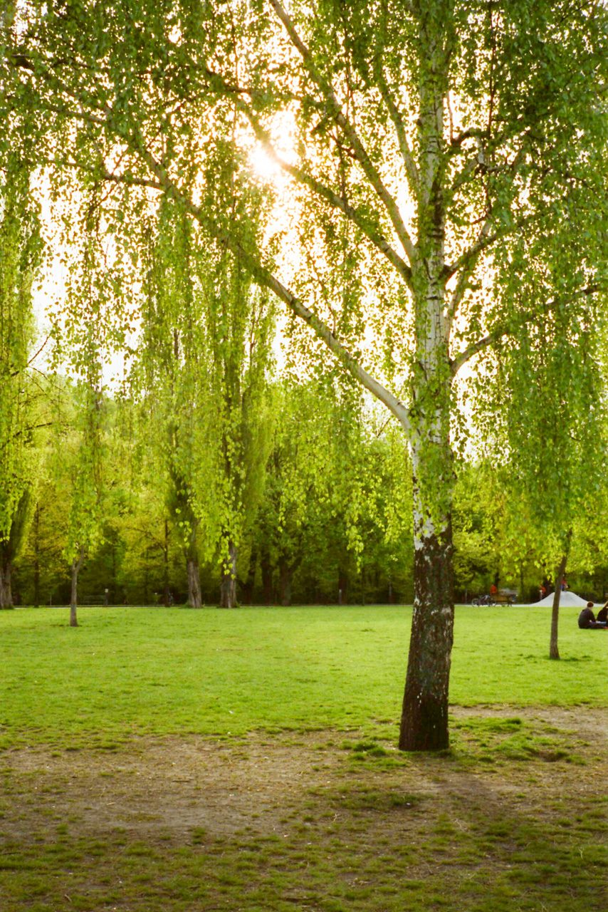

My wife and I spent May touring through Germany, couch-surfing at our friends’ places. We had two weeks in Berlin, with [Hamburg](https://photos.ashfurrow.com/hamburg) sandwiched in the middle.

I had my M6 and X100, but mostly shot on film. Only two of the photos in this post were taken on digital.

One friend we stayed with had a fantastic view of the classic Berlin horizon. I had a lot of fun shooting from the rooftop of his apartment.

We were really lucky to get to experience cherry blossoms in New York before we left, and again in Berlin.

Happy accident, took this as I dropped my camera (attached to my wrist). I nearly deleted it initially, but I like it’s style. It might become something more refined later.

