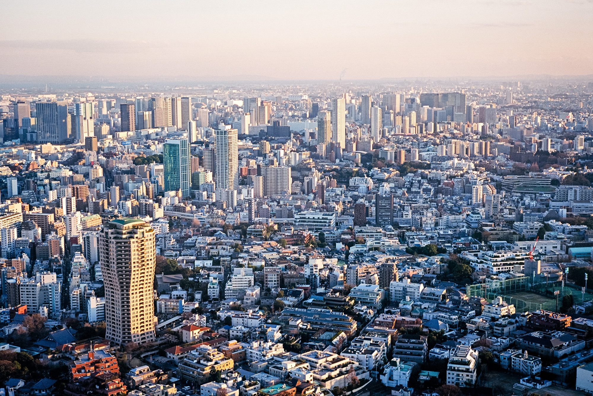
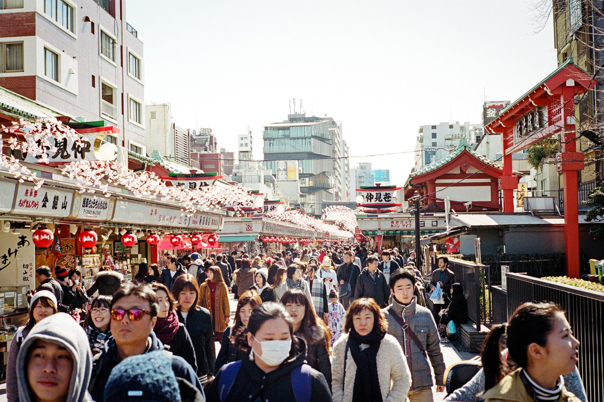
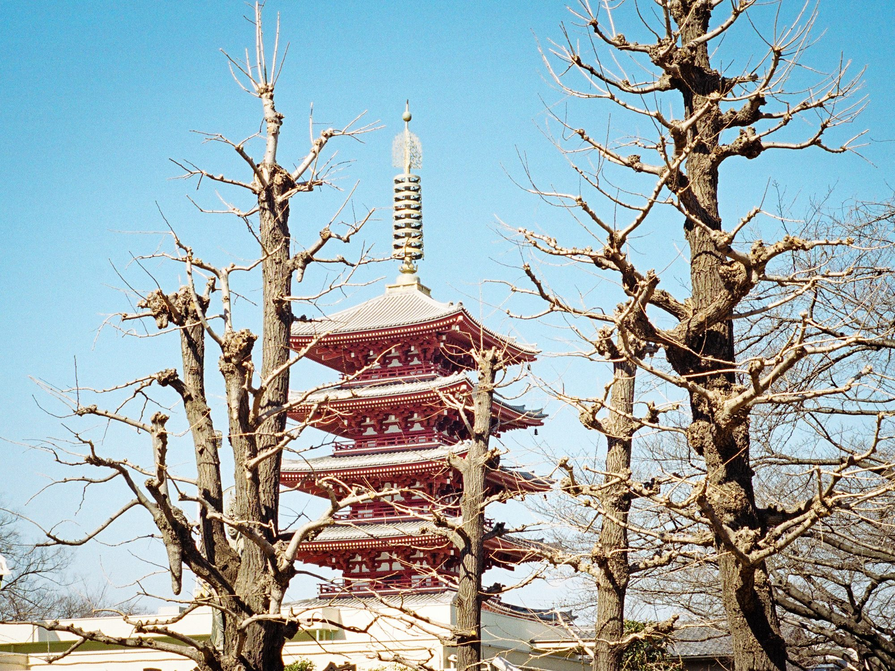
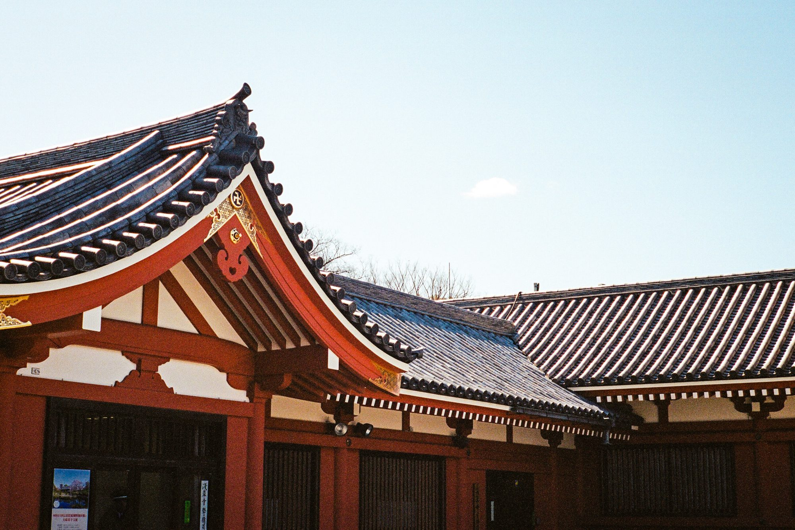
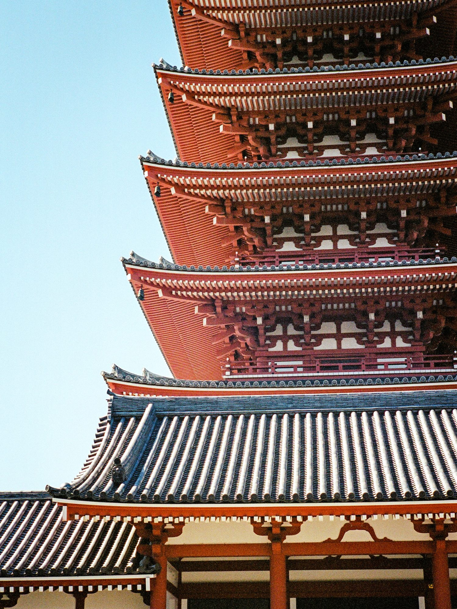
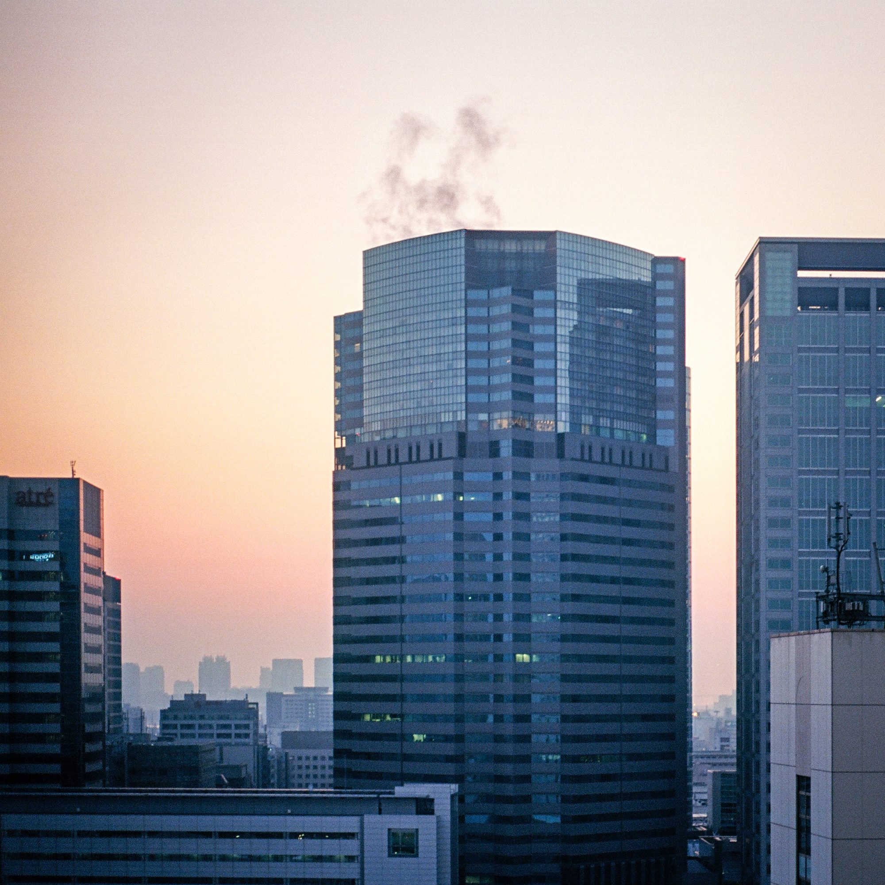
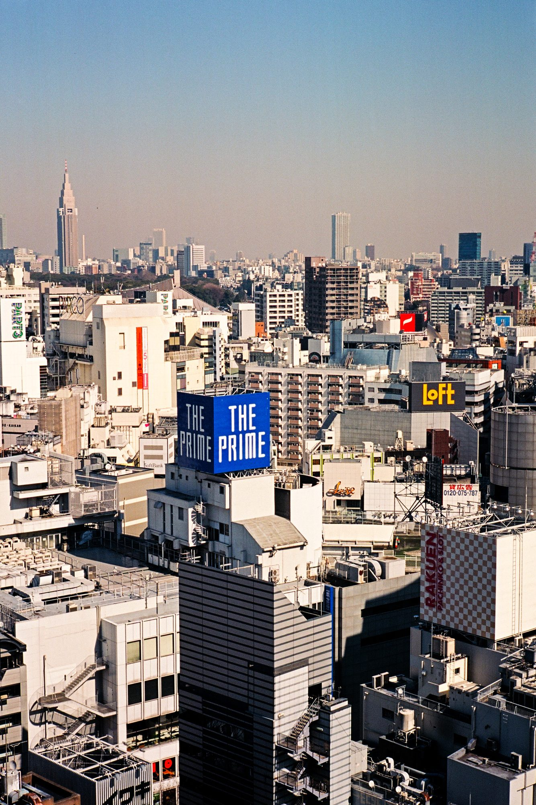
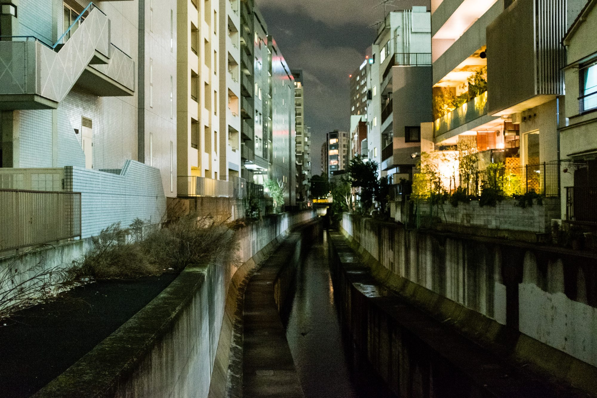

Every day I have to navigate the sidewalks of New York on my way to work. Not so much navigate the sidewalks as navigate the obstacles: garbage cans, sandwich boards, and – of course – tourists.

Tourists bother me more than they should; while I’m busy walking to work, these tourists are standing – completely still! – in the middle of the sidewalk. They’re taking up valuable space and creating pedestrian traffic jams, and for what? Just to look at New York? Big deal.

But if the tourists back home feel about New York the same way that I felt about Tokyo, then maybe they’re right after all. Maybe we should stop, and we should stare, because the cities we find ourselves in are amazing.

