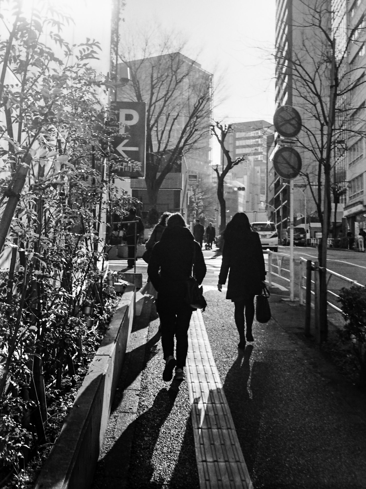
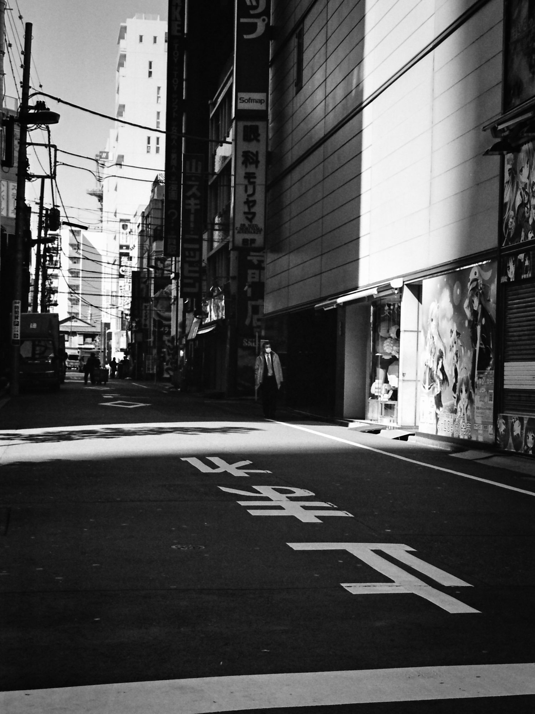
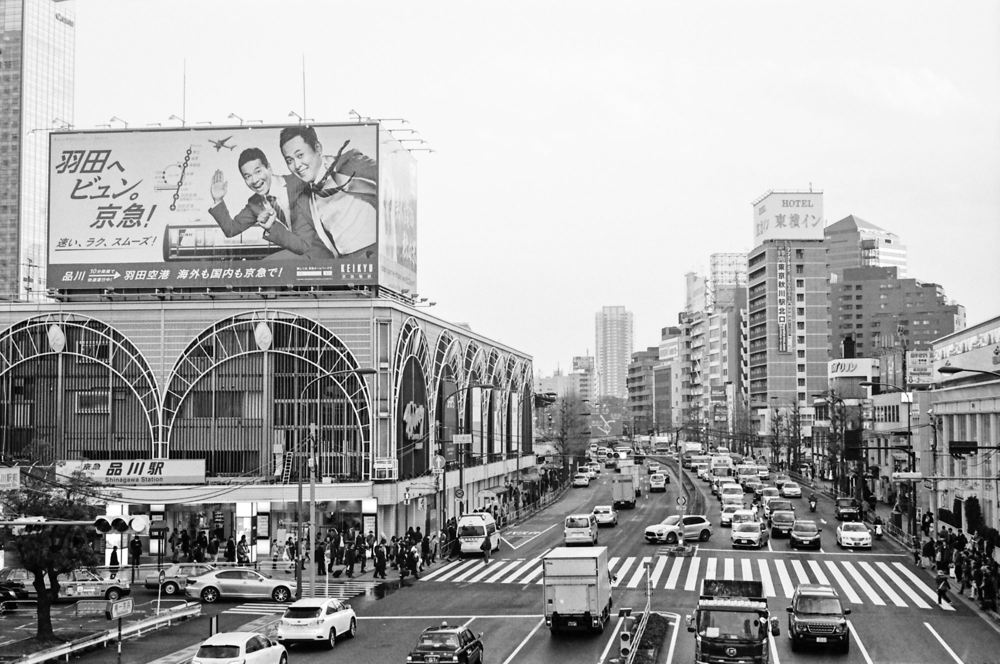
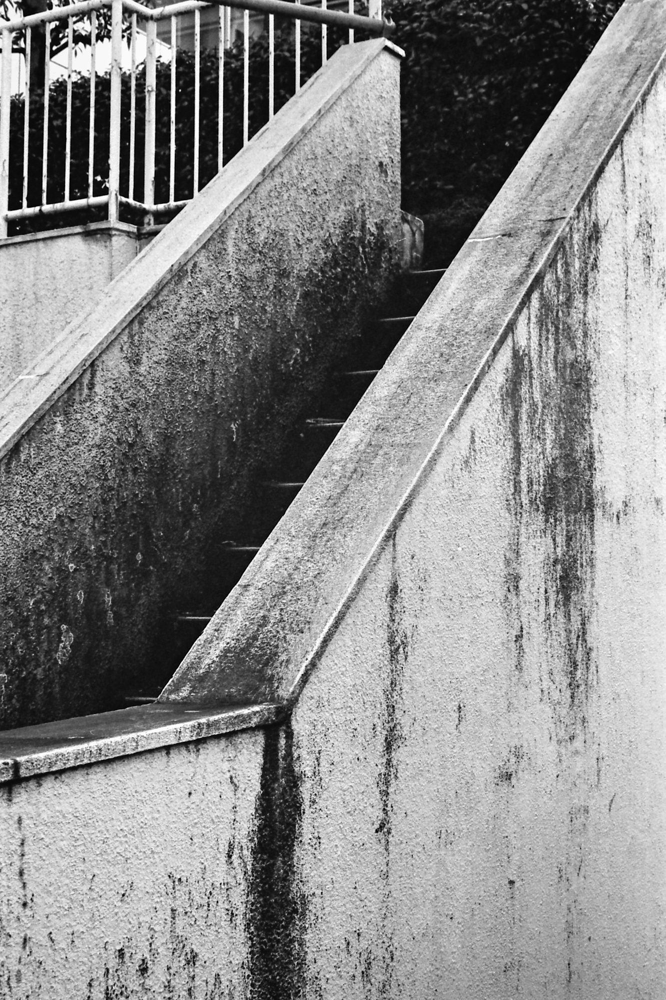
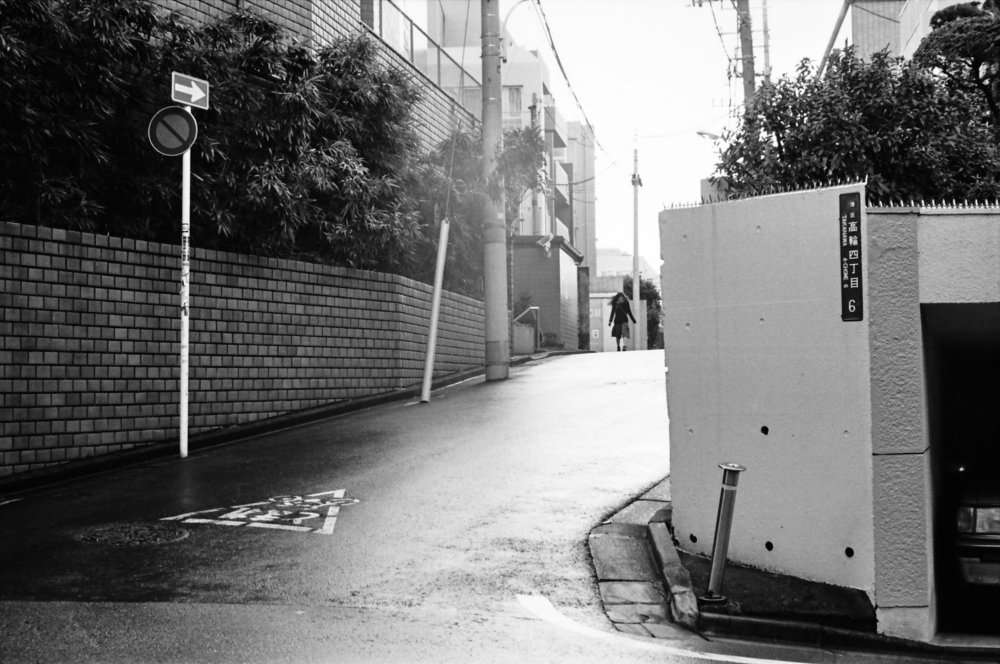
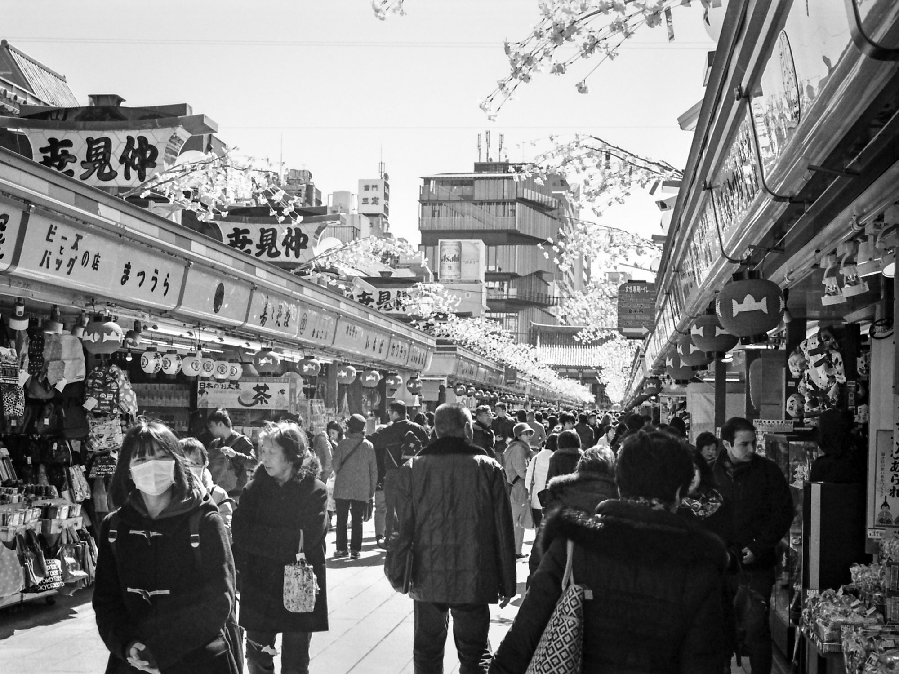

I’ve [previously posted photos](https://photos.ashfurrow.com/losing-myself-in-tokyo) from my trip to Tokyo but this post is something new: my film shots. I didn’t know what kind of photos I was going to make in Tokyo before I arrived, so I took a walk around Shinagawa. After a while, I started to get a feel for how to frame the city.

Streets ebb and flow with cars and people, all set to a common rhythm. There is structure and order to how people move; other cities may have distinct styles of disorder, but walking through Tokyo felt like swinging back-and-forth from a lazy pendulum.

Tokyo is a juxtaposition: an industrial city that moves with a subtle breath, like how foliage will grow towards the light. This city is alive.

Japan isn’t an island. I mean, in the literal sense yes it is an island, but it’s not isolated from the world. We’re all connected, and we all influence each other. Tokyo has braided traditional Japanese culture with the contemporary such that it feels familiar yet distinct.

