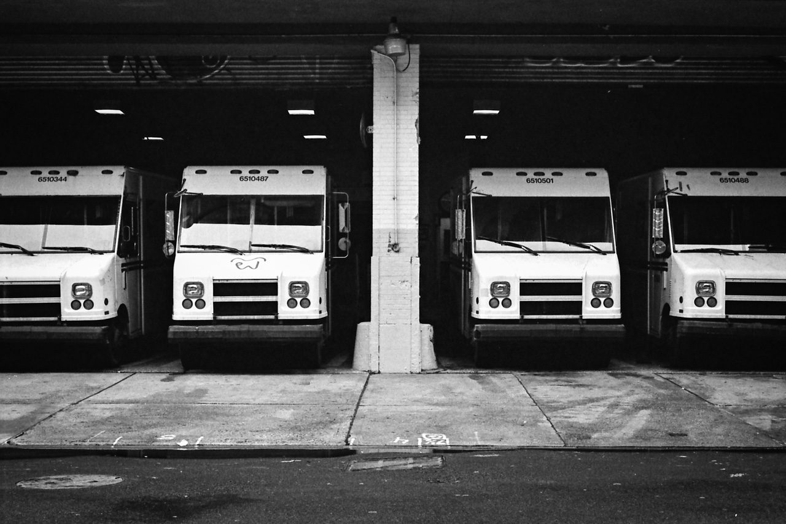
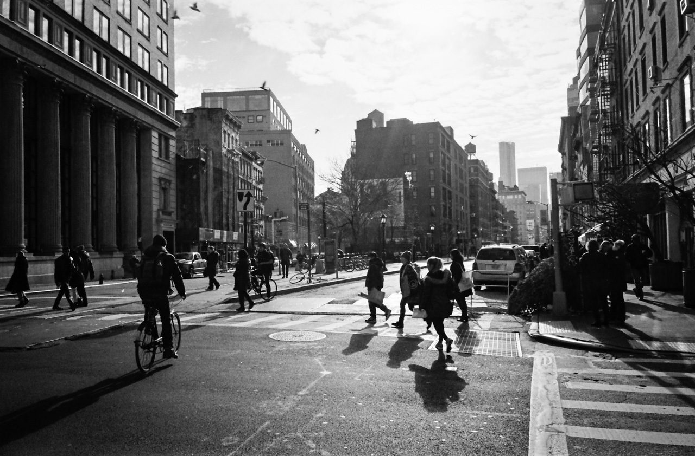

Serious street photographers get really upset when I call what I do “street photography.” Photos like mine, they insist, are more of an… urban geometry than they are street. For a while, this really bothered me. But then I realized, if what I do is urban geometry, then I should explore what that means and become better at making urban geometry photographs.

That was about six months ago. Here’s what I’ve got so far.

I’ve got an upcoming project surrounding slanted architecture, it’s gonna be awesome. Here’s a taste:

Symmetry is really powerful in photography, but the thing is, you have to get it perfect or else it looks terrible. A lot [of](https://500px.com/photo/7202893/code-red-by-ash-furrow?ctx_page=12&from=user&user_id=213451) [my](https://500px.com/photo/8798674/wwdc-2012-hyperwall-er-table-by-ash-furrow?ctx_page=11&from=user&user_id=213451) [early](https://500px.com/photo/9838873/yorkville-by-ash-furrow?ctx_page=11&from=user&user_id=213451) [work](https://500px.com/photo/13536485/hart-house-archway-by-ash-furrow?ctx_page=10&from=user&user_id=213451) used symmetry, and I messed a lot of photos up. Eventually, I realized I was leaning on symmetry too heavily and was using it too often. After a few years of working on composition, I now find myself dipping back into symmetry in the urban landscape.

I’ve learned that shadows define as much – or more – of a geometric subject than its edges do. I’m loving this kind of “long shadow” approach, reading a lot about Paul Strand, and I’ve started using more shadows with people. This brings me full circle back to street photography.

I guess what I love about urban geometry is how it takes my favourite aspect of photography (seeing from new perspectives) and applies it to my everyday life. I always have a camera with me, and I’m always looking for a new way to look at my world.

