A few times a year, the Brooklyn Navy Yard is opened to the public to walk around a tour, to take photos. The photos can’t be used commercially, but it’s a distinct opportunity to see parts of the yard that aren’t normally accessible to the public.

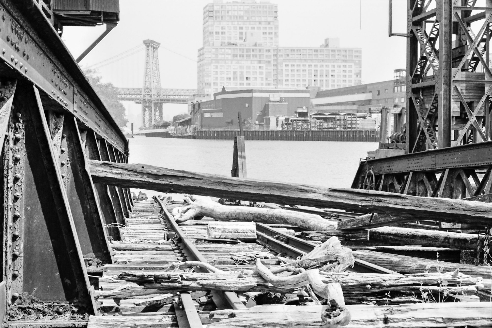
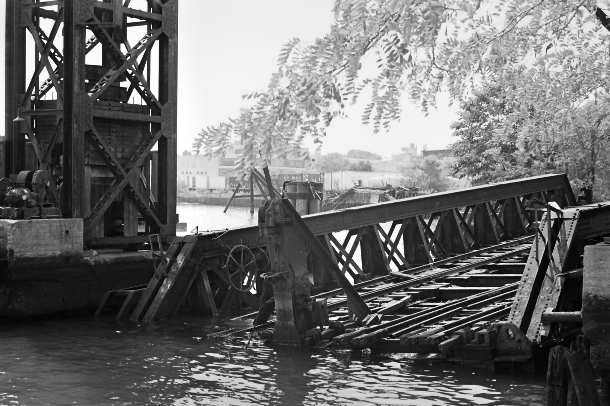

Once bustling, the shipyard was closed in the 1970s before falling into disuse. Today it’s fifteen years into being repurposed as an industrial park.

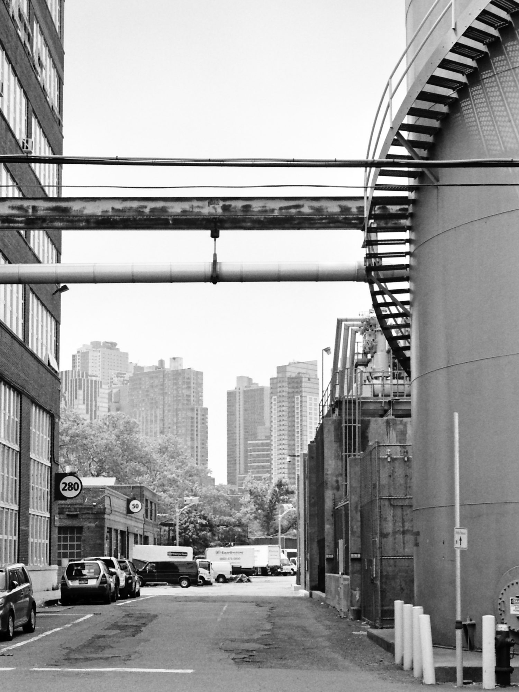
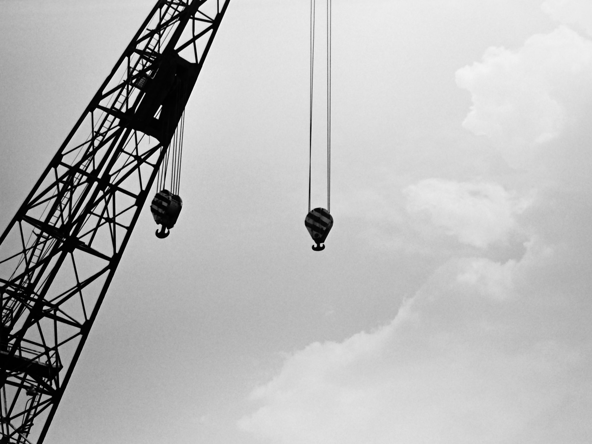

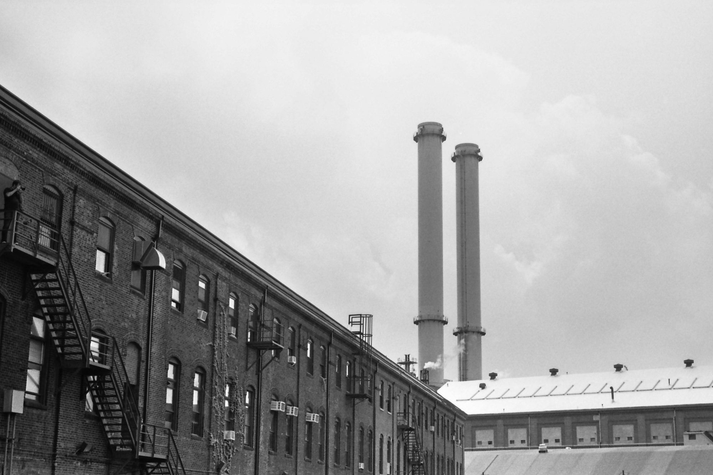

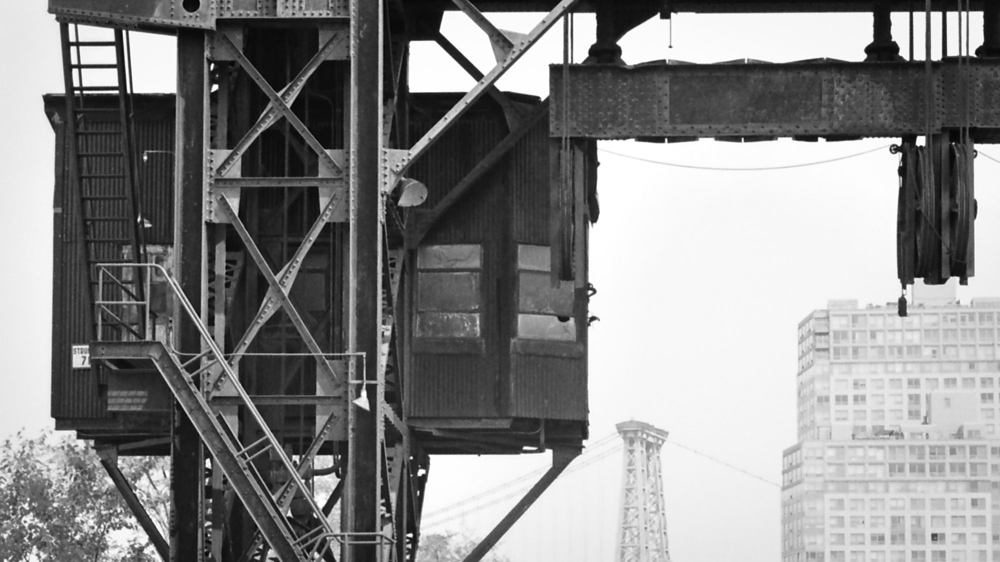
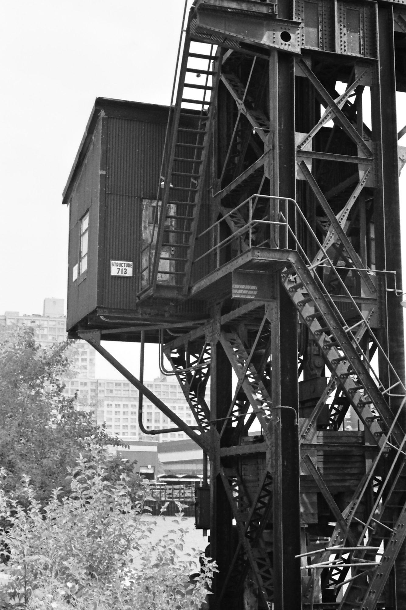

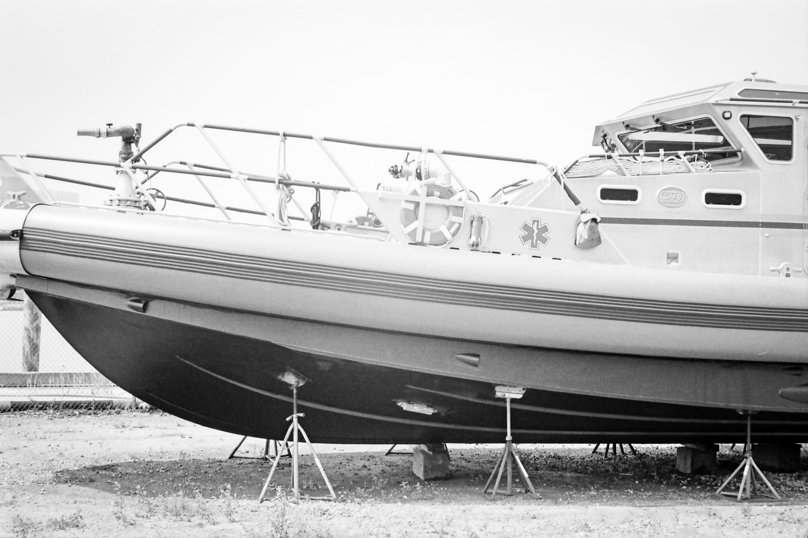
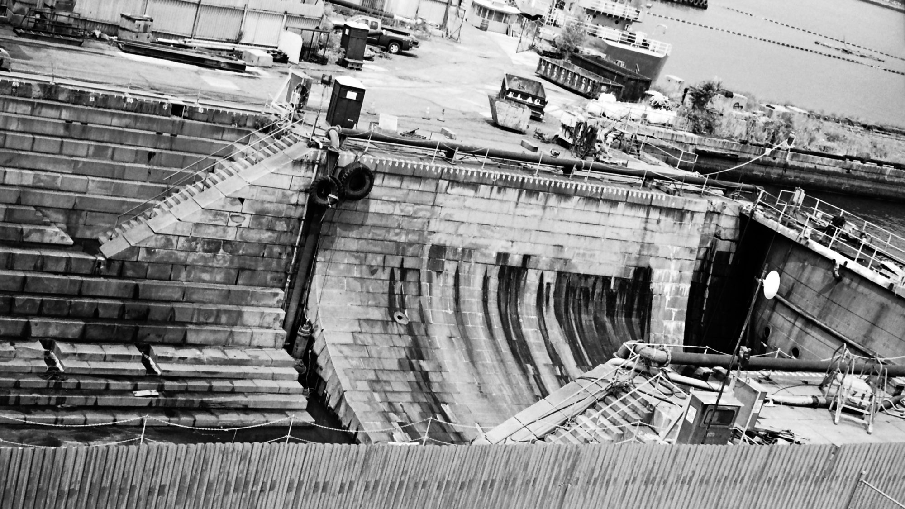

The yard is littered with reconstruction. Maybe someday it’ll be a more public space than it is, but for now it’s home to some offices and industrial work.

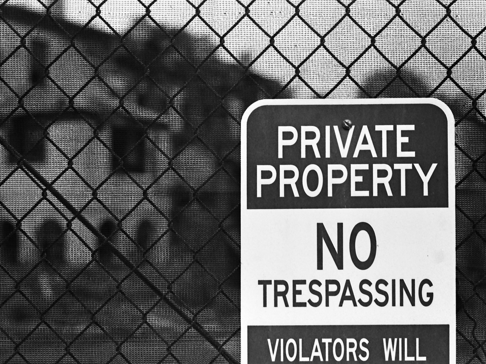
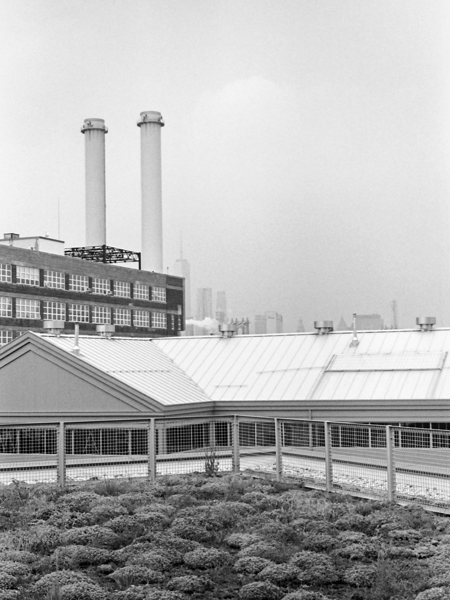
