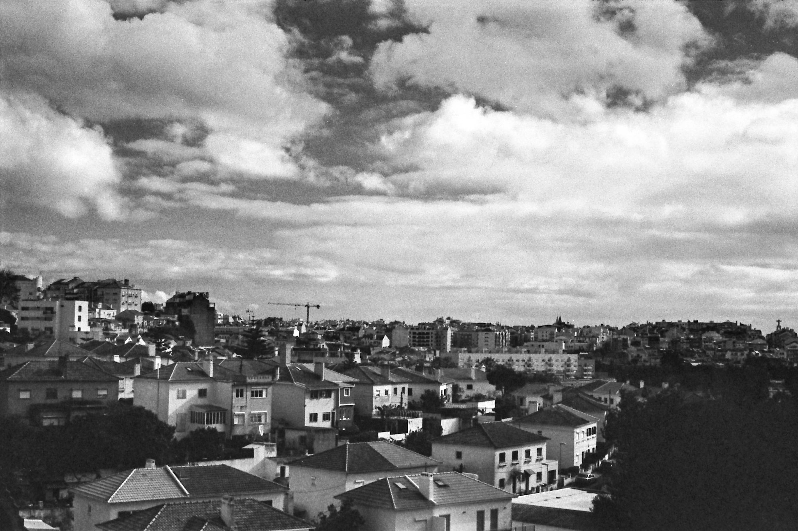
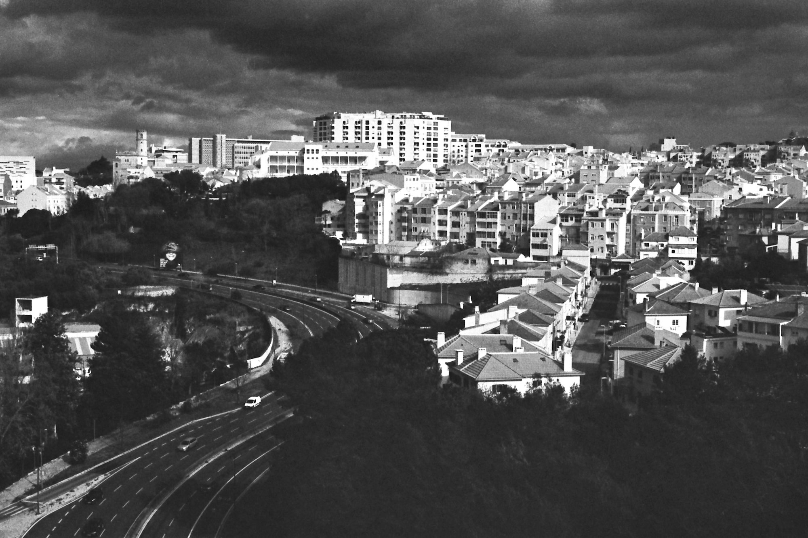
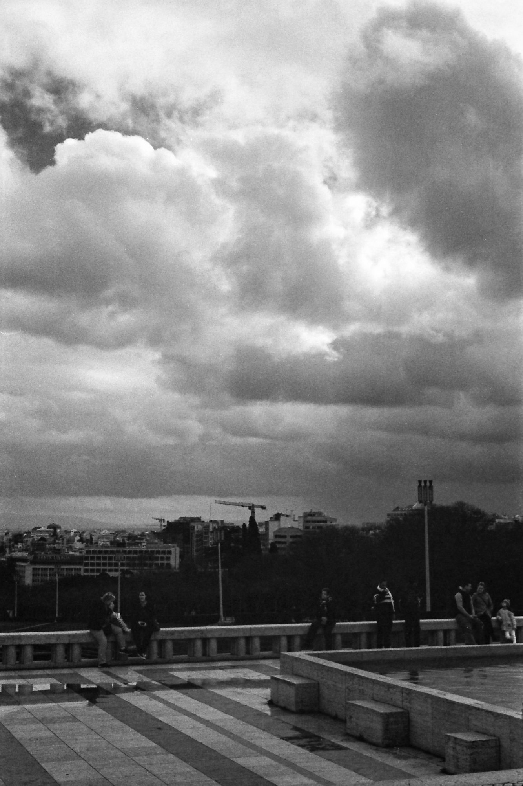
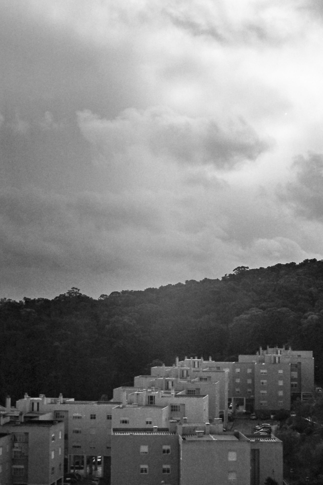
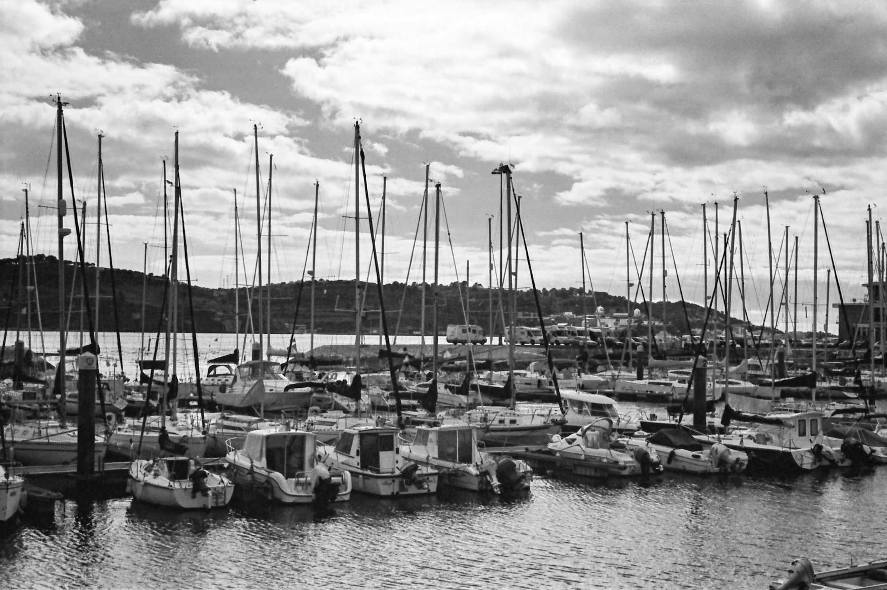

I’ve [posted before about my trip to Portugal](https://photos.ashfurrow.com/lisbon-in-springtime), but I’m back now that my film shots have been developed, scanned, and edited. It’s been really fun to revisit my trip from a different perspective – in black and white film – and with more hindsight.

I fell in love with the clouds hanging above the city. It rained sometimes, but never for too long. The clouds were gorgeous and begged for a red filter, to really make them pop against a darkened sky. Well it worked! But ended up underexposing the whole frame a bit. That’s okay, I like the effect anyway.

