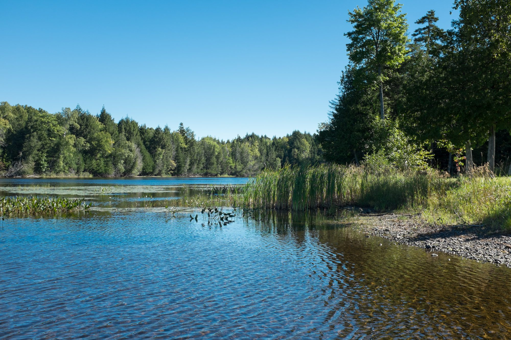
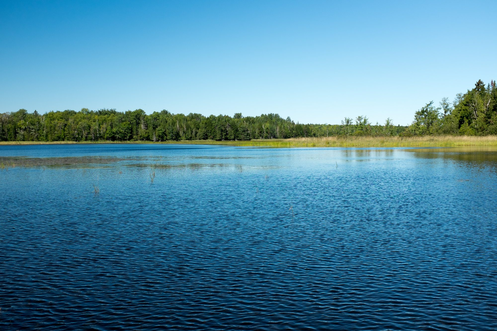
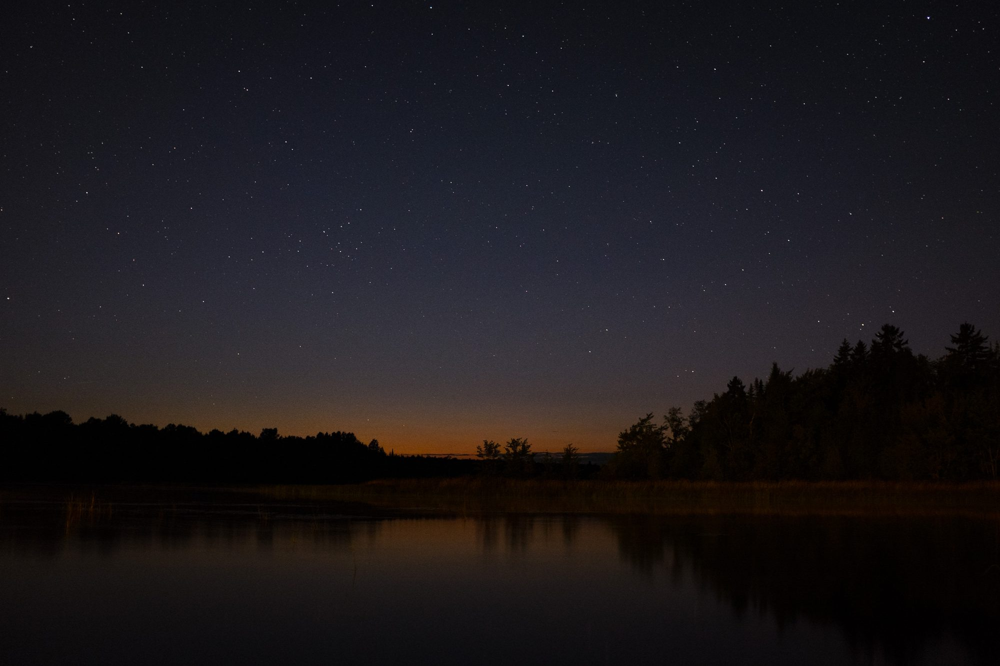
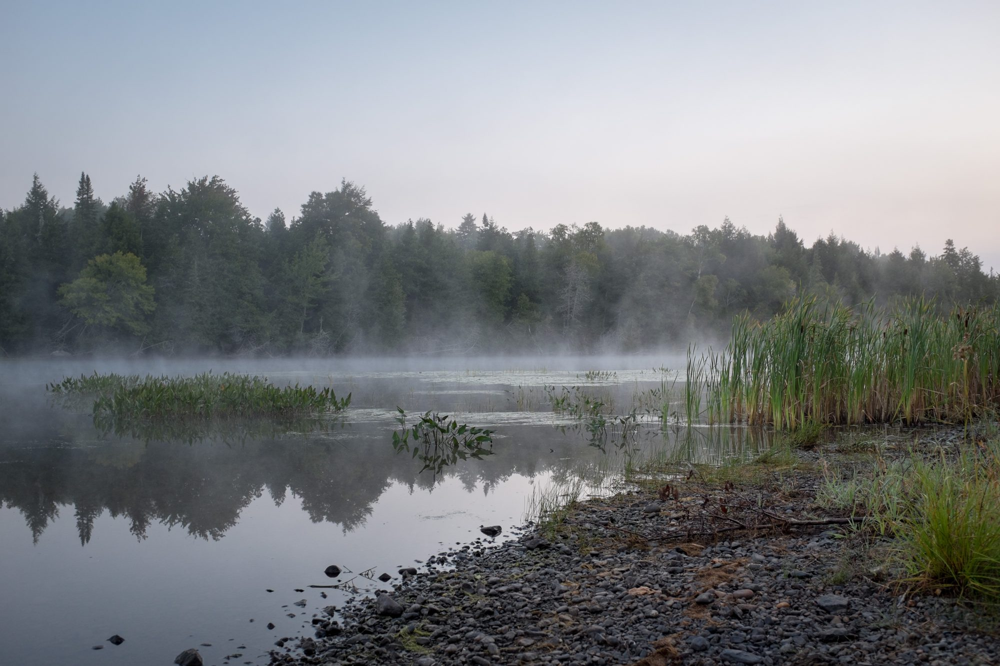

It had been nearly two years since I saw my family – since I was in Canada at all. But my sister was getting married, so we finally had a kick-in-the-pants to go home and see everyone!

I wanted to enjoy myself without pressure to take photos, so I didn’t bring my camera to the wedding. But there were lots of fun opportunities to make some awesome photos. Living in New York, we don’t get a lot of nature. This was like a city detox.

These are photos from our 36 hours home. Film photos will be coming later, these are all digital.

