I only had a few days to see Seattle, but I was lucky enough to have some cooperative weather. The city plays nature and concrete off each other, which was a lot of fun to photograph.

These photos are from August, and it’s pretty cool to compare to my current photos and to see how my style has evolved. I played a lot with shadows and focused on shapes, which I’m still pretty into.

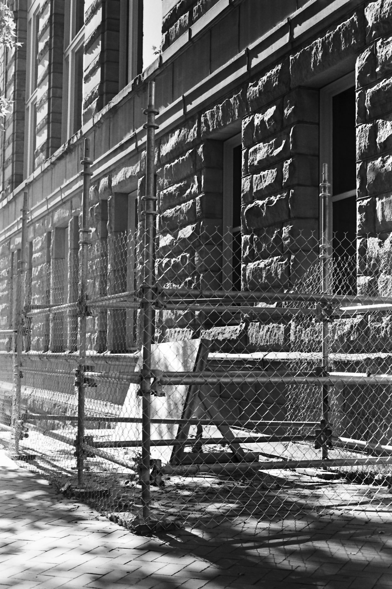
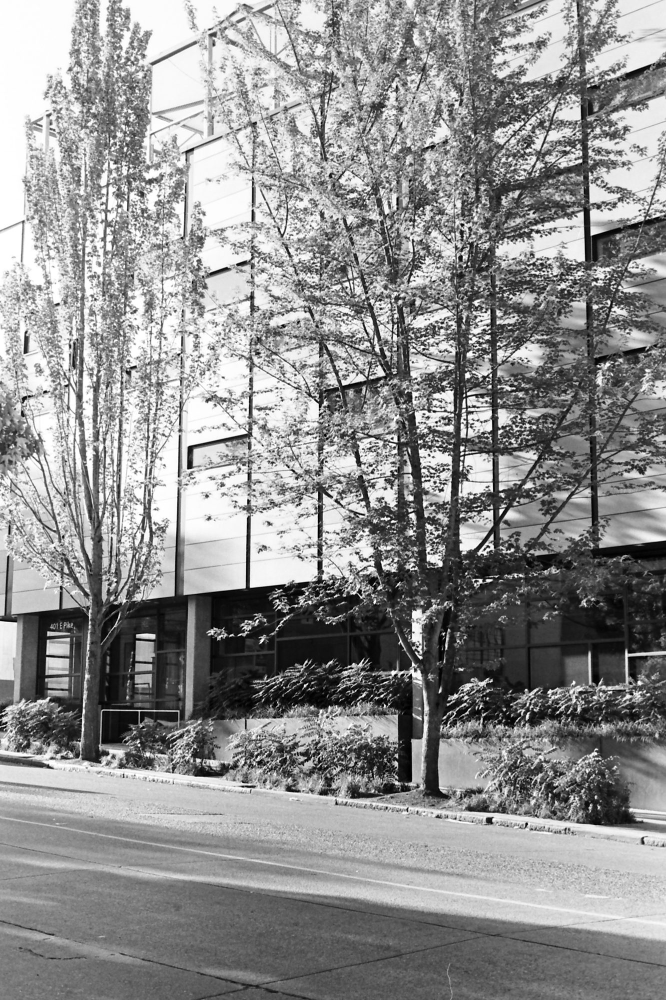

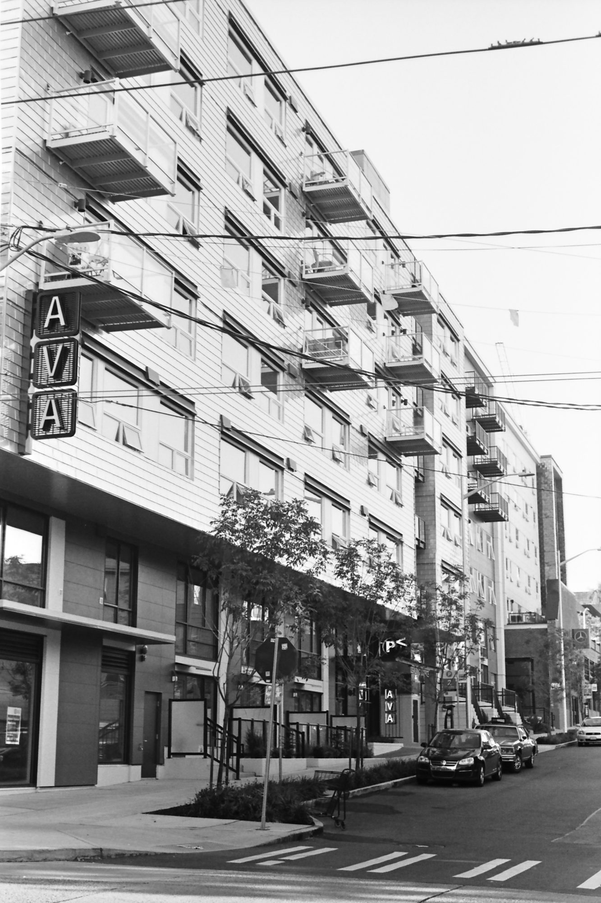
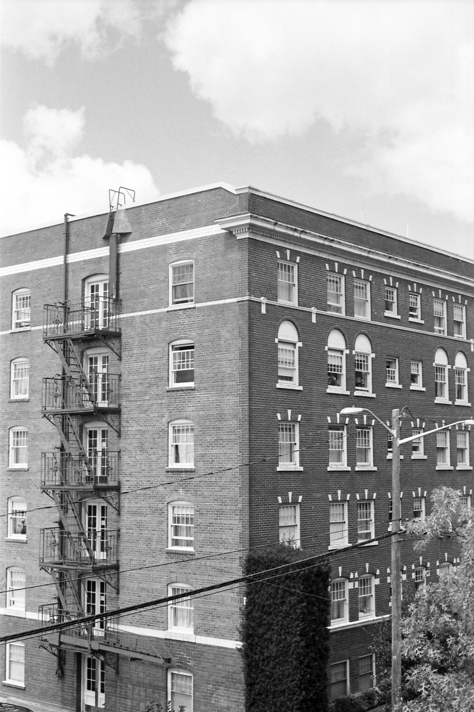

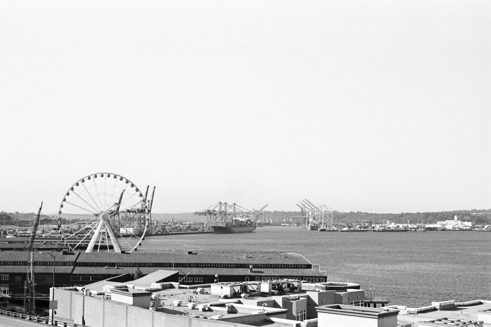

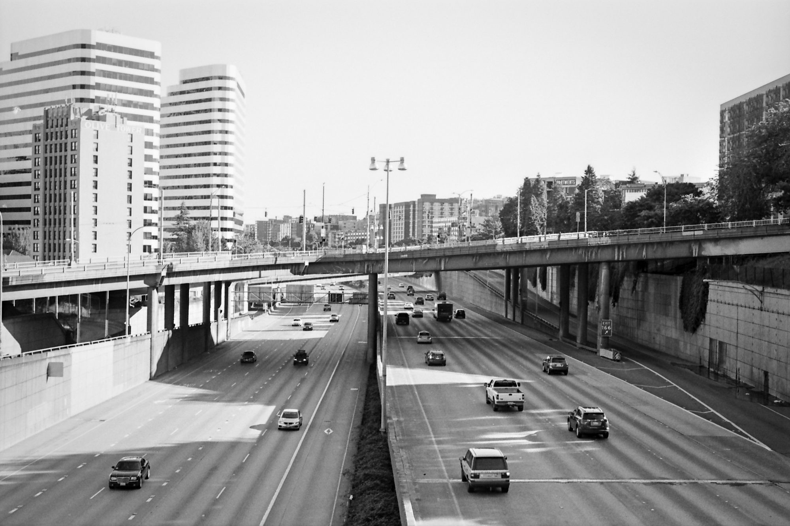

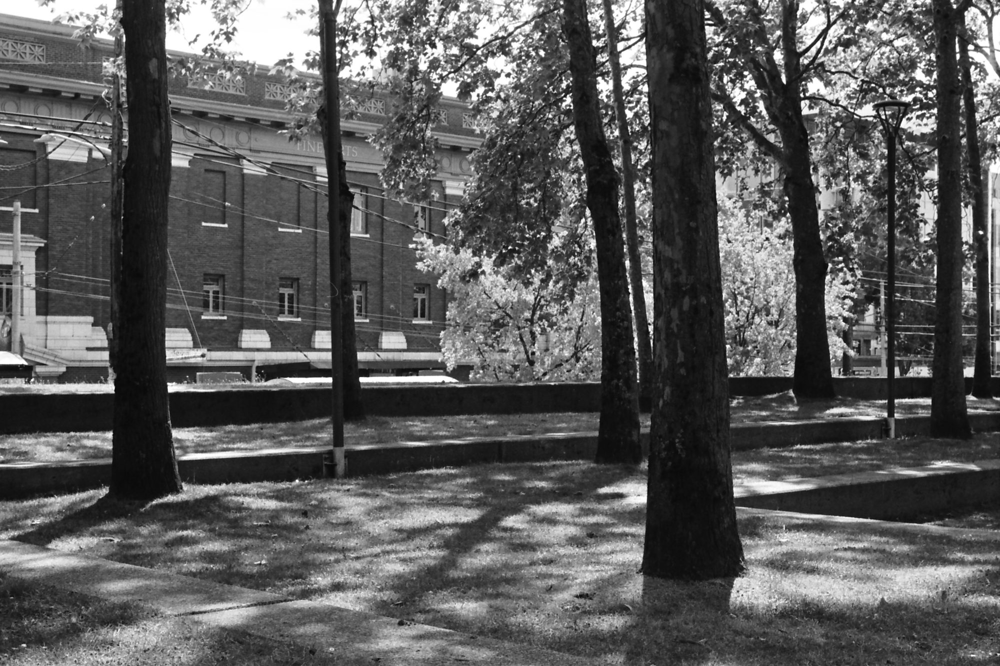
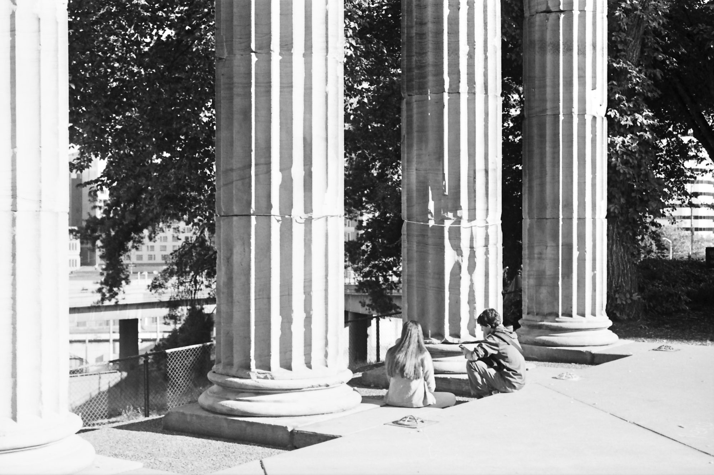

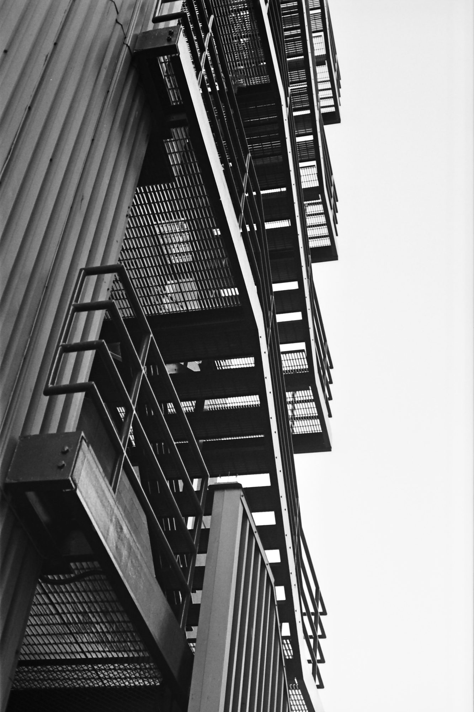
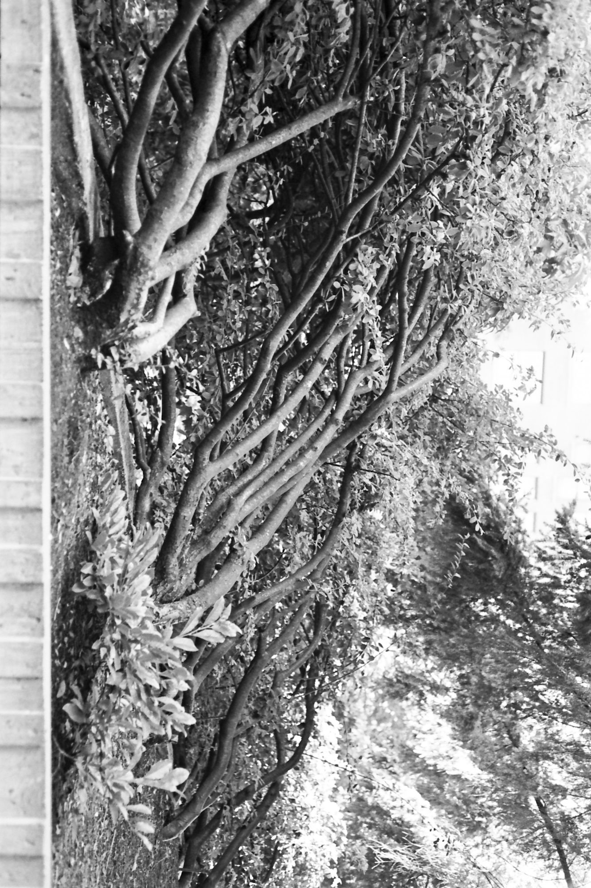

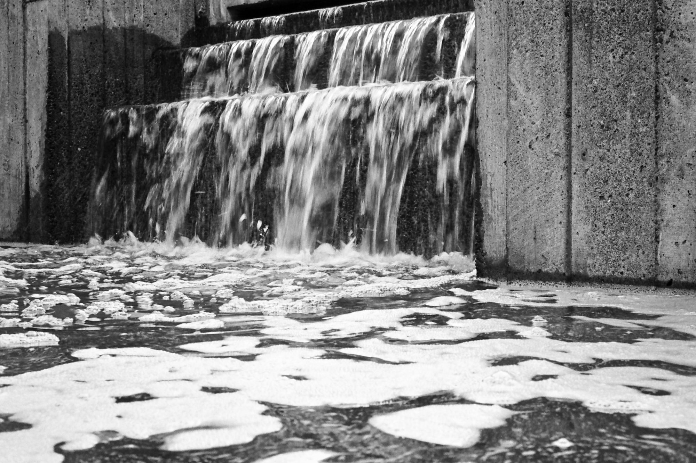
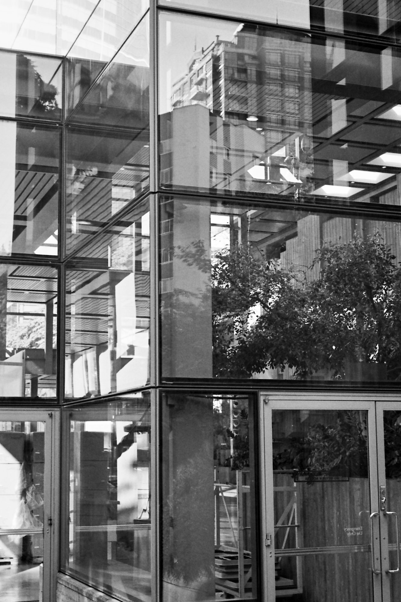
