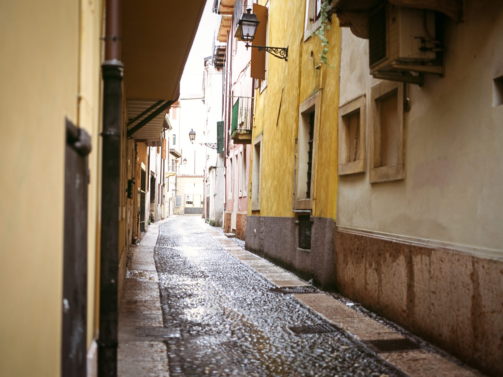
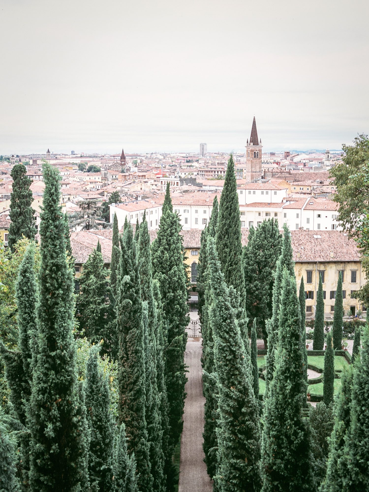
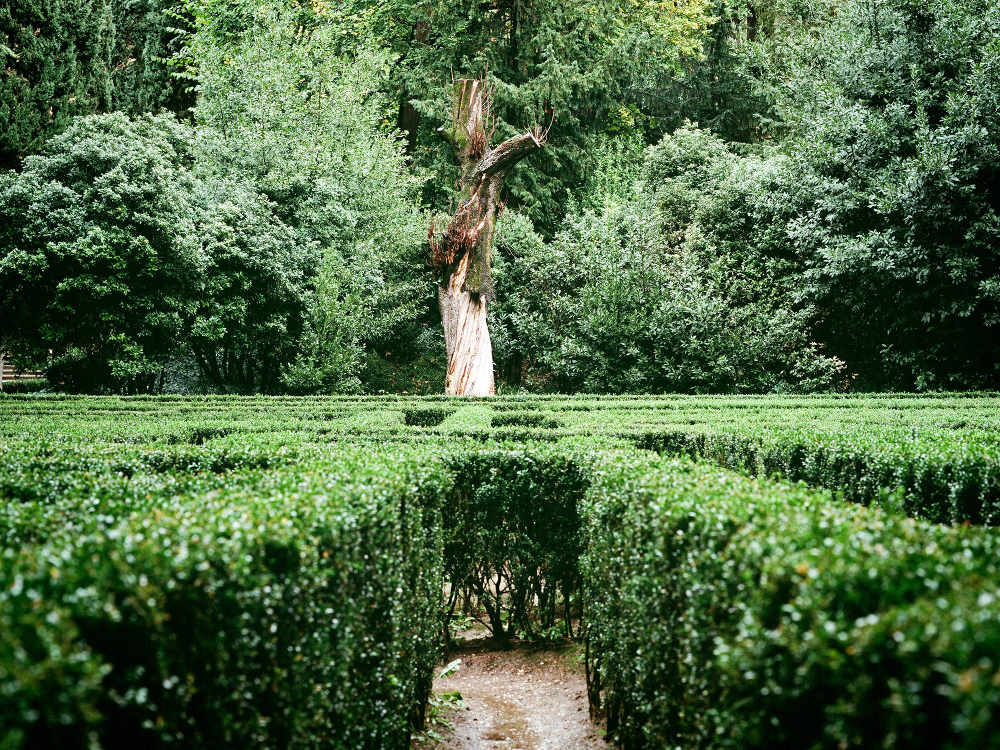
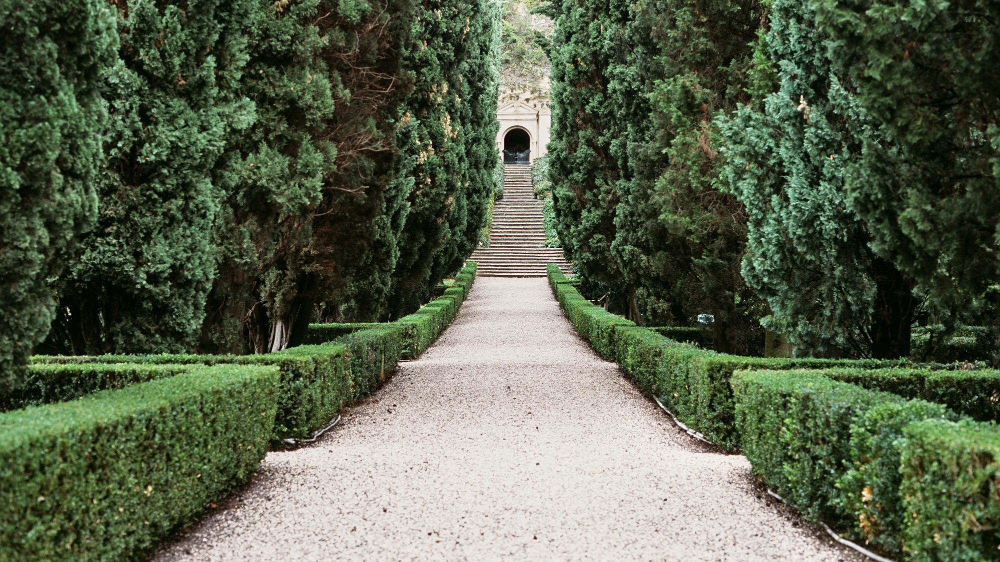
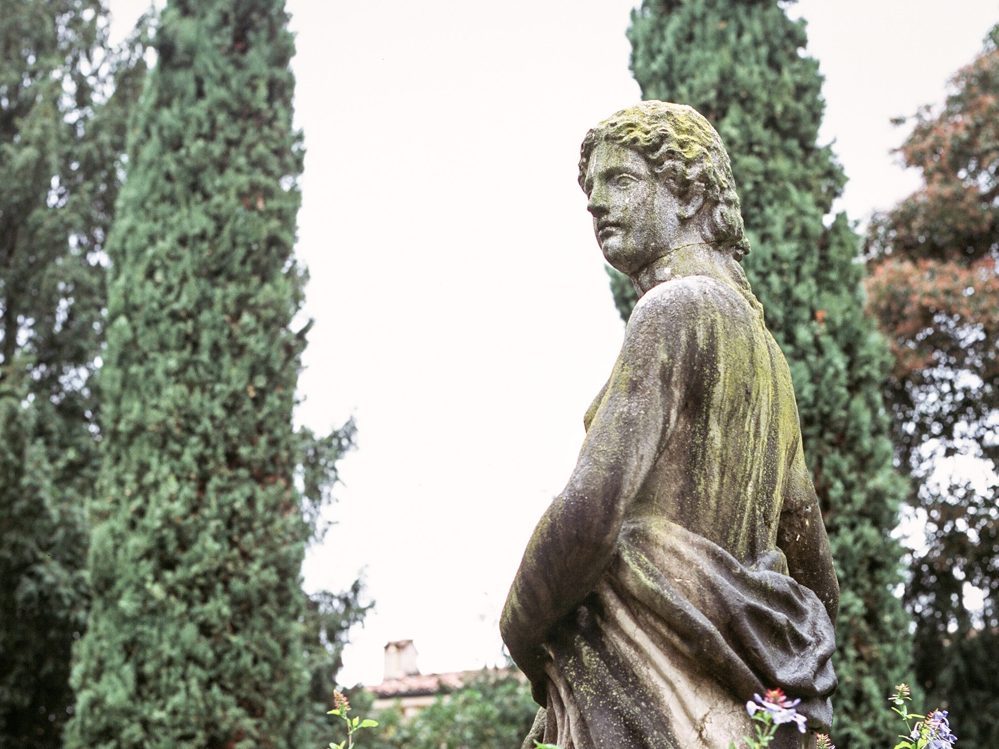
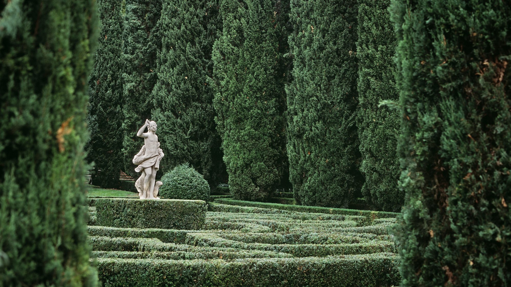

So what happens when you accidentally buy slide film instead of regular negative film? I got a mixed bag, but over 75 shots these were some of the best. The colours, when exposed correctly, look fantastic.

Lots of blown out highlights, loss of details in the dark, some colour shifts. I still had fun, especially shooting on medium format. Maybe someday I'll figure it out, but I'm shooting mostly black and white these days anyway.

