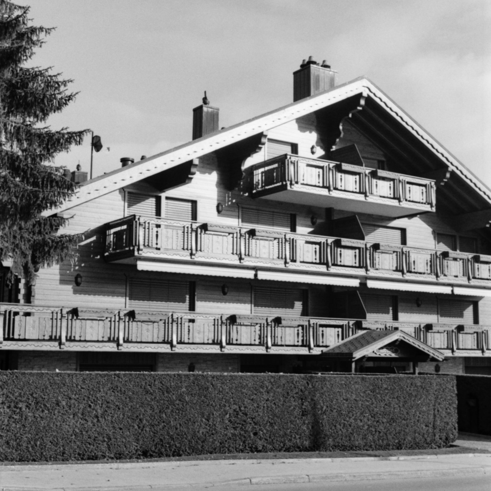
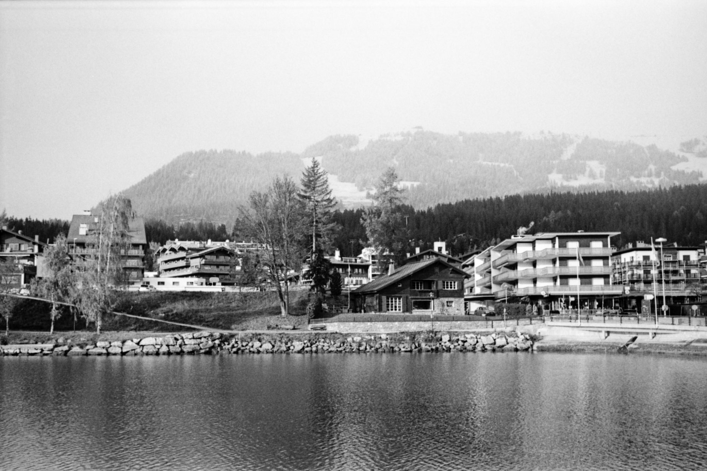
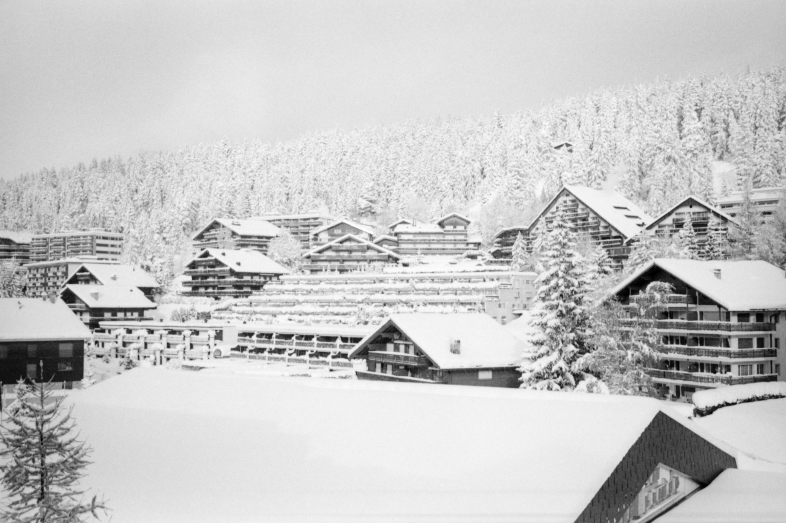
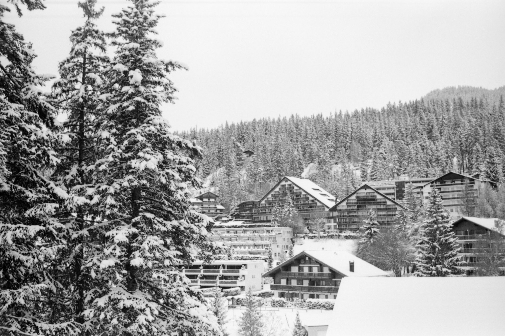
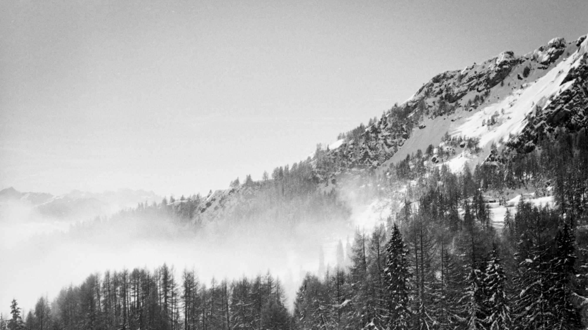
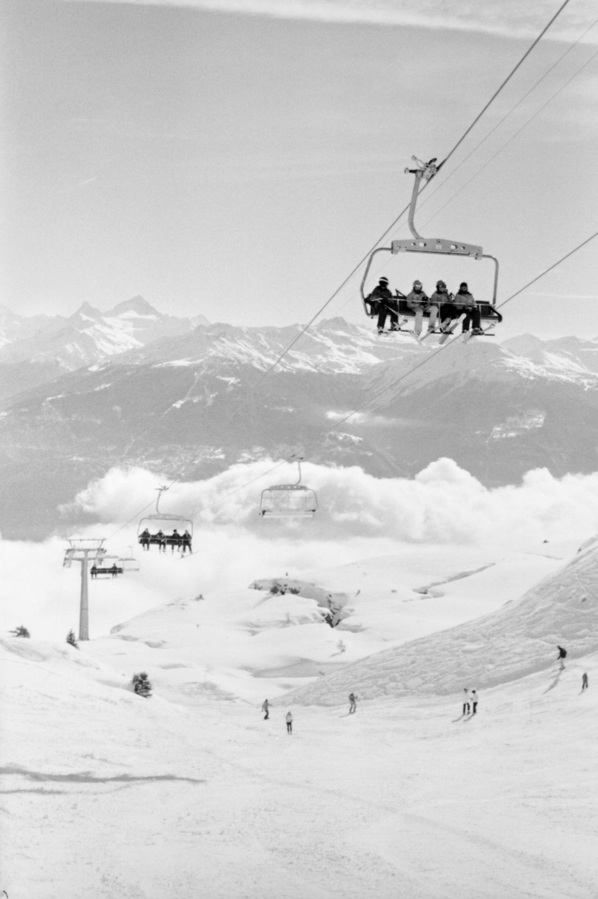
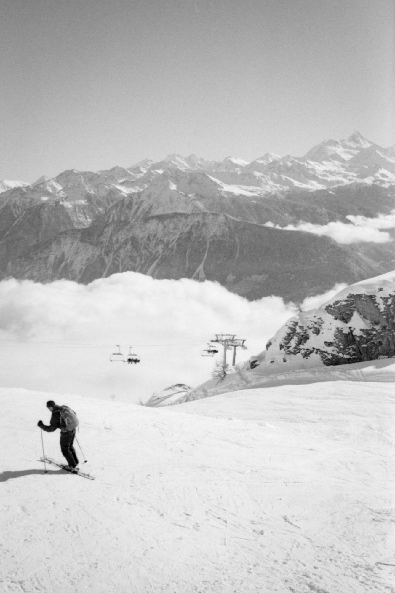
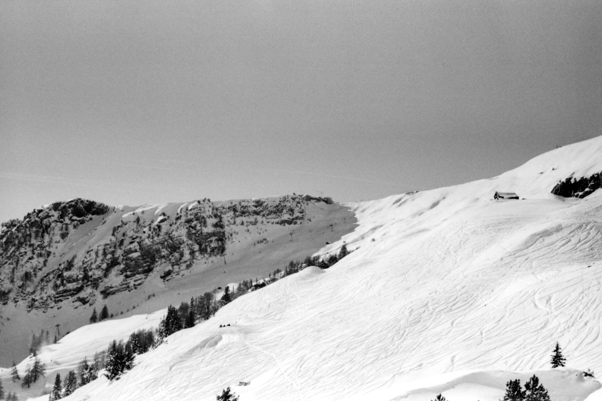
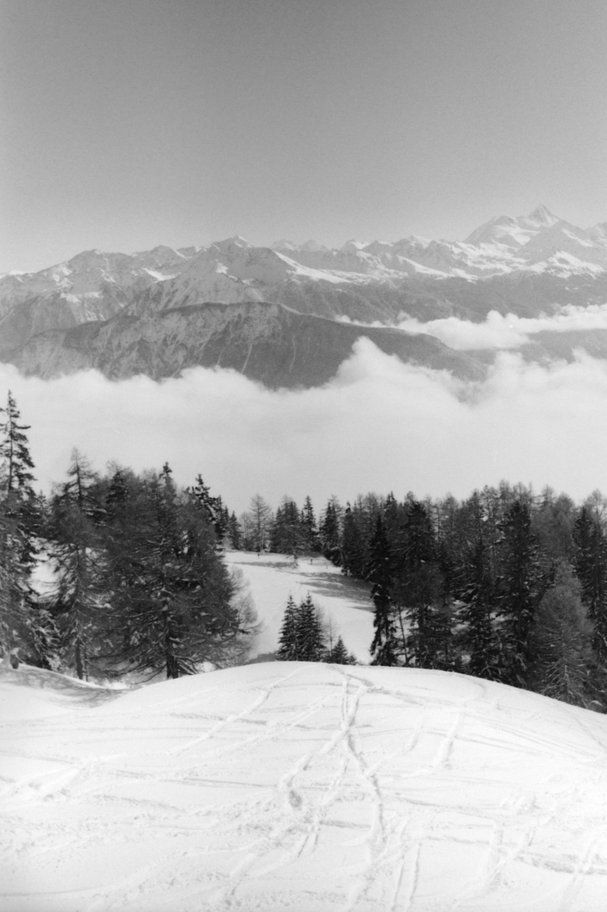
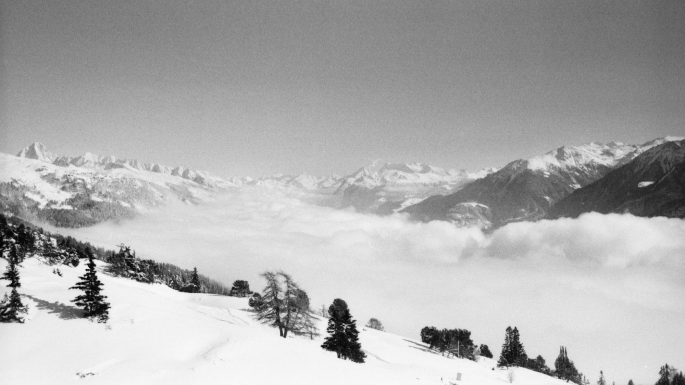

I recently travelled to [a conference](http://theswiftalps.com/) in Crans-Montana, Switzerland, and got to see the ski resort town before and after its first snowfall of the season.

The camera I brought with me, a Rollei 35, is designed to be compact and lightweight. I chose it because it collapses to fit in my laptop bag, and while I normally use it for street photography, it performed pretty well in snowy conditions.

Despite the metre or so of snow that fell over three days, I had an amazing time. My hosts were very accommodating: "even in an emergency, the Swiss are polite."

Really wish I would have bracketed more shots, it was hard to recover details because most of the shots were so overexposed. Things worked out, I might try my luck with these negatives in the darkroom next.

I'm no skier, but I was really excited to visit the top of the mountain, just for the view. Even the ride up was amazing, eventually reaching 1500 metres altitude.

I love the feeling of being above the clouds, descending back through them was magical.

