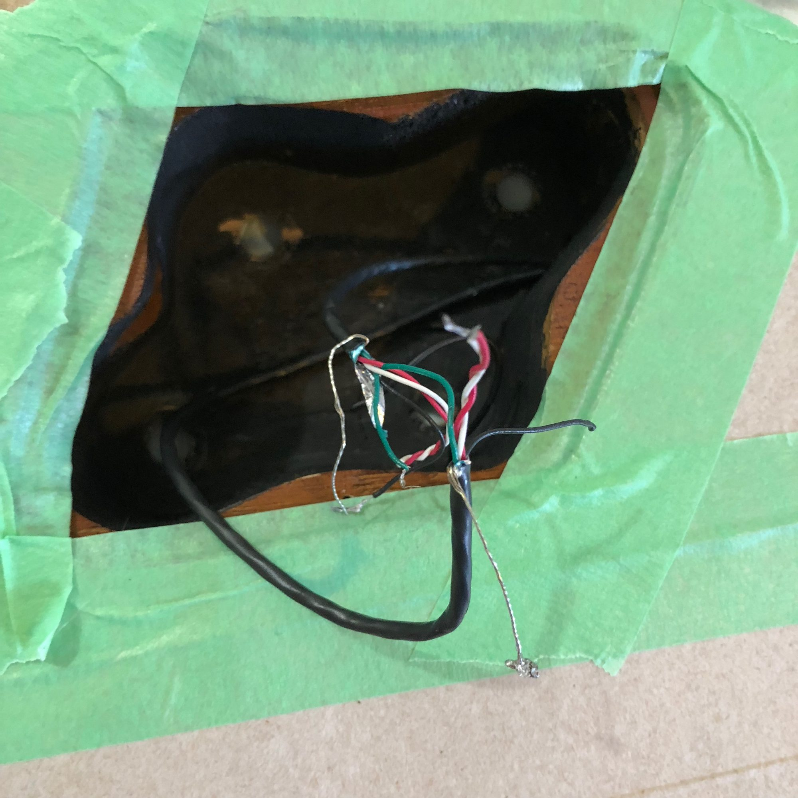
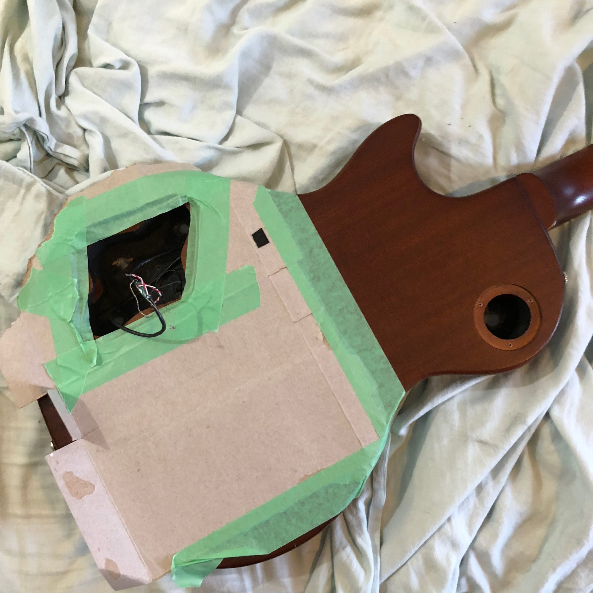
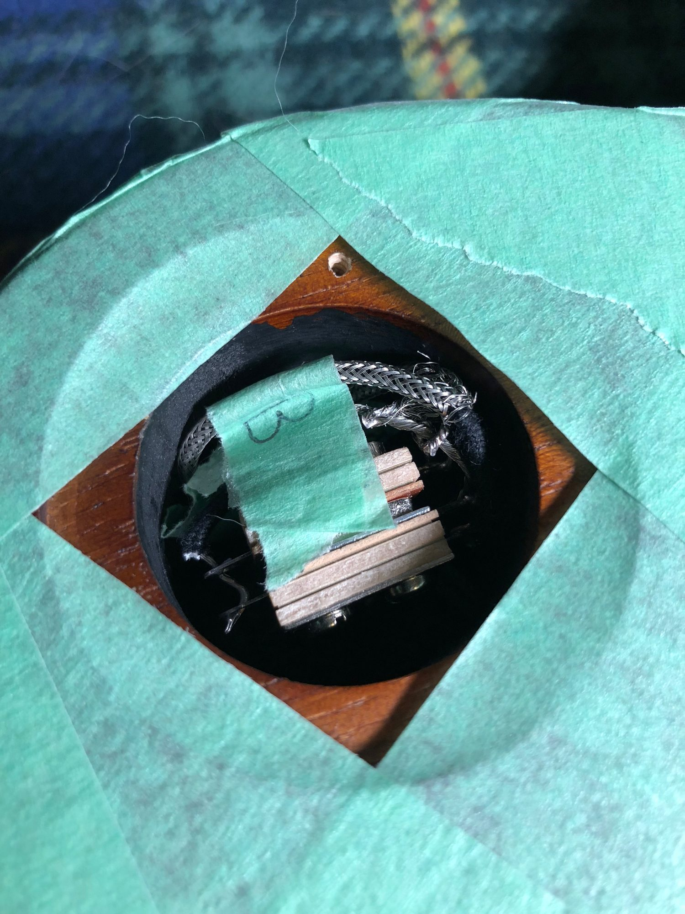
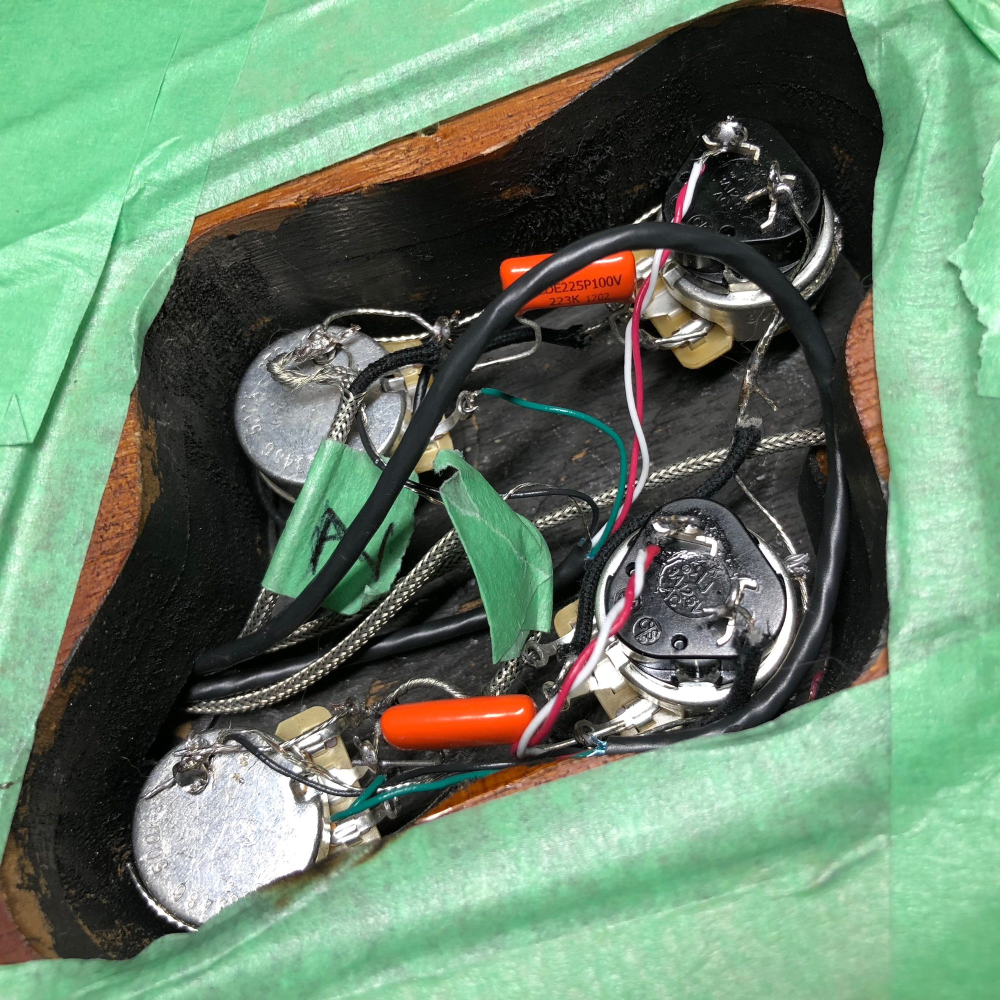



Sometime last summer, I bought a used guitar from Guitar Center. An Epiphone Les Paul. There were three of the same model at the store, and I picked this one because it had locking tuning heads and appeared to have split coil selectors. As much as I love [the looks of my Telecaster](https://www.instagram.com/p/BQln1qUA8FV/), the Les Paul quickly became my favoured of the two because it feels _so_ good to play.

But there was a problem: after a few months I noticed that whenever I wasn't touching the strings, there was a loud hum. I investigated and realized that my guitar had _four_ push-pull knobs instead of the two I'd expect. I cursed myself for not noticing within the warranty from Guitar Center and unscrewed the back of the guitar to inspect the circuitry (I have no experience with electric guitar wiring, but a _lot_ of experience with digital circuits).

I found a really bad soldering job, like _really_ bad. Hmm. I ignored the hum and turned the gain on my amp down really low to avoid it. And I used a Rocksmith USB guitar cable to remove the noise with software. But the problem was still there, and it bothered me.

But then a few months ago, I got more interested in playing with the sound the guitar. To experiment more with gain, tone, voicings, that kind of stuff, I would have to fix it. In the meantime, I used my Telecaster, but I pined for the Les Paul.

And so over my holiday break, I had some more time to investigate. It looks like the previous owner had set up some kind of Jimmy Page-style wiring, but it didn't work because the wires had come loose from the solder joints. And I found the source of the hum: none of the wiring was shielded.

So I bought a new wiring kit from StewMac and started investigating how guitars were wired. From far too many teenage hours hunched over a desk with a soldering iron, I wasn't too worried about the technical parts of connecting the components. My problem was that a guitar is very different from the digital circuits I'm used to working with.

Assembling a circuit according to a diagram (like the one that I used, pictured here) is a lot like writing a program. You have a spec in your mind (the diagram) and you just need to assemble the code (guitar components) in the right order and with the right connections between everything. Assembling a circuit you don't understand is like trying to write code to solve a problem you don't understand.

And so I learned about how analogue guitar circuits work. Researching online, I was able to find answers to most of my questions, and I pieced together the rest. The utility of capacitors in an audio circuit still baffles me, but I understand in principle how they work and should be wired.

And so with new wiring and components in-hand, I stripped down the guitar and left only its pickups in place. I also covered different parts of the back with painters tape, to protect against getting scraped up by a component or having molten solder drip on it.

So at this point, I realized I needed to make sure I get the pickups wired correctly. There are four wires, plus a ground. Well technically there are two grounds. Well, technically there can be three? I had to research more about how humbuckers work.

In the process, I realized I should double-check to see if the previous owner had upgraded the pickups (I needed to make sure I use the correctly-coloured wires). I unscrewed the pickup housing and was pleasantly surprised to find a nice pair of Seymour Duncan, Made-in-America pickups that cost nearly as much alone as I paid for the whole guitar. I guess I can forgive Guitar Center for not noticing the crappy wiring after all.

Okay so I also saw around that you can buy wooden harnesses for soldering the components together. Attaching everything to a board and wiring it is a lot easier than mounting the components in a guitar and soldering them there. I didn't feel like spending more money (I already had to buy a soldering iron, wiring, pots, switches, and a jack) so I bent a piece of cardboard in two and taped the edges. It worked perfectly.

I also learned more about how the split-coil circuit works, which essentially grounds the output from half the humbucker. Again, this is real different from a digital circuit.

Of course I also had to feed the new, shielded wiring through the body. That was probably the most frustrating part of this whole project. There's probably a trick to make it easier, but I got it through sheer determination and gritted teeth.

At this point, the guitar was mostly wired up. I just needed to attached the three-way switch (that selects which pickups to use) and attach the pickups to the pots.

The thing is, I was a bit rusty with soldering (and I had never soldered shielded wire before). I improved my technique as I went and double-checked everything before moving on to the next step. The biggest problem was making sure the metal shielding around the signal wires didn't touch and short-circuit any of the switch lugs or capacitor leads.

There's probably a lot wrong with how I wired it up, from a professional perspective. But, after plugging in the guitar to an amp, it sounded beautiful. No hum, no buzz, just a nice, fat tone. Looks like the new shielding helped! The new volume pots also worked well and didn't crackle when being adjusted (a sign the previous owner overheated them when soldering, I'm told by the internet).

I'm trying not to be too hard on the guitar's previous owner, whoever they are. They had their own goals and tried getting the tone they wanted to the best of their abilities. Eventually, I'm sure I will no longer own the guitar and I'm sure it's future owner will curse me, too. But I learned a lot and I feel way more connected to my instrument, which makes it only more satisfying to play.

It's possible I might continue working on it or mod the guitar further, but I doubt it. I like playing a lot more than I like soldering, but it was fun to dip my toes in.

