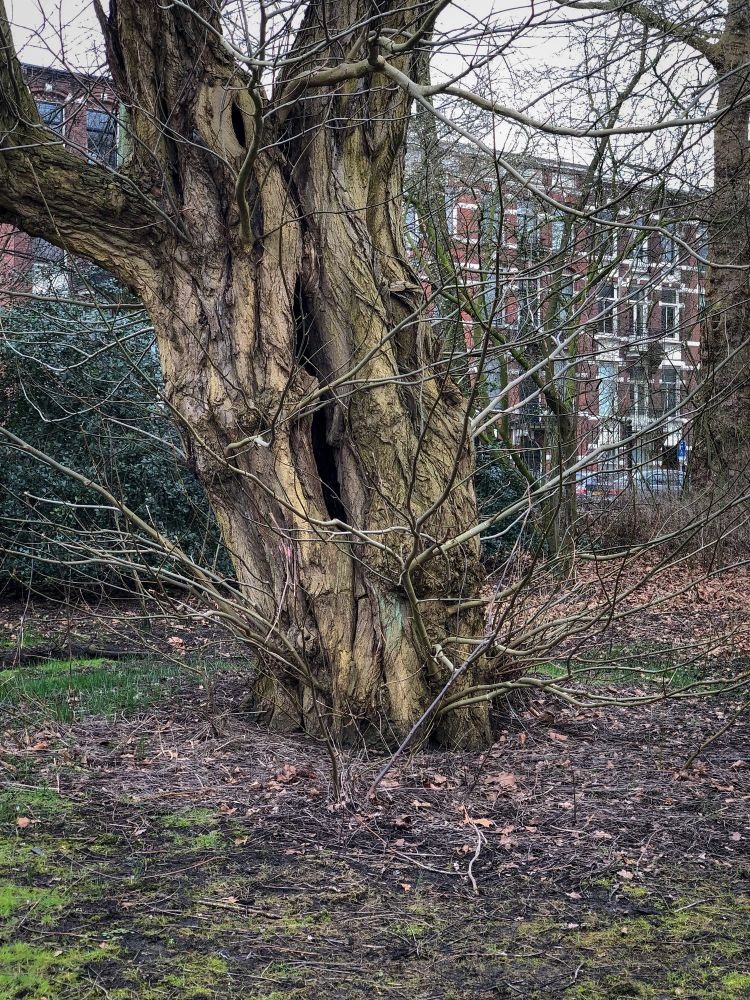
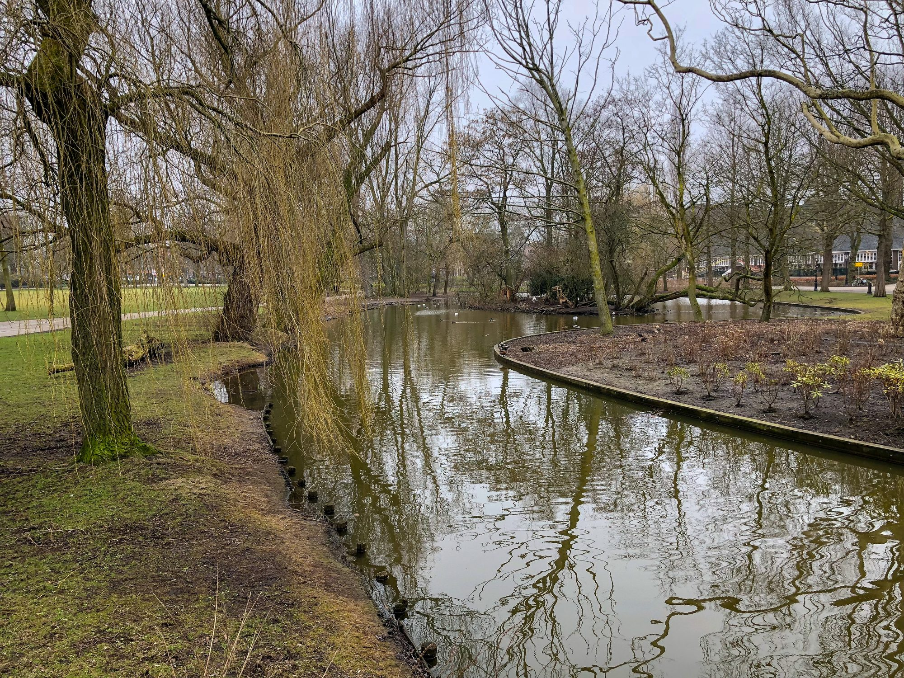
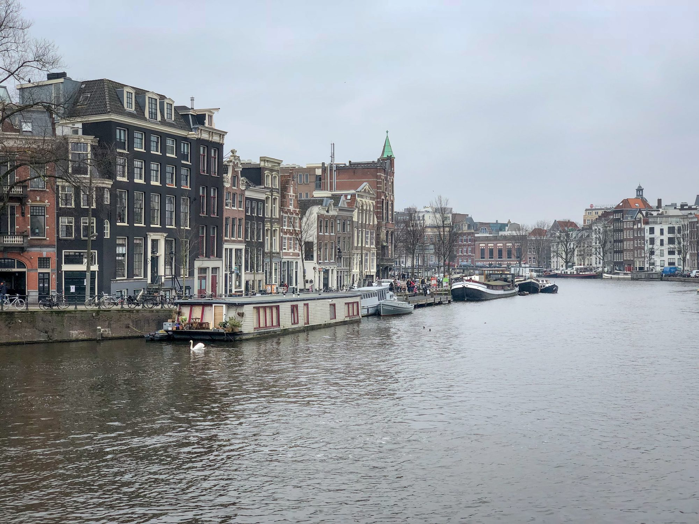
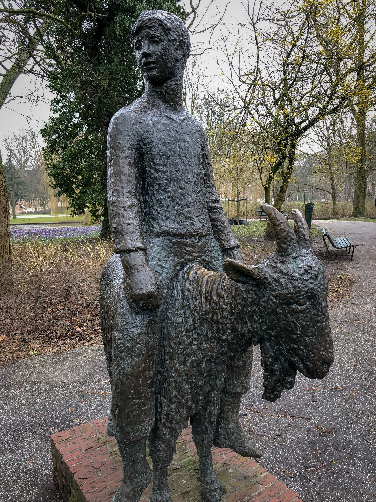

I returned to Amsterdam for just a few days to [present at a conference](https://ashfurrow.com/blog/building-better-software-by-building-better-teams/) back in April. These photos of are the spring, so hopefully it will remind you what is at the end of the incipient winter.

My wife and I [moved to Amsterdam](/blog/amsterdam/) in 2014, and I hadn't been back since we left to move to New York. My flights and the conference schedule only afforded me a few hours to walk around the city, so I did some quick wandering through my old neighbourhood.

Oosterpark was a nearby park that my wife and I often went to for walks. It's a dreary place in the sprint, but that's kind of why I like it. The construction that had been underway while we lived here completed.

This photo below was taken aboard a street car that is turning to the left. With a slower shutter speed, it gives a really cool blur effect where the picture seems to rotate around the radius of the streetcar's arc.

Of course, a trip to my old neighbourhood wouldn't be complete with a stop by Coffee Bru, my favourite café. It's weird how a lot of the neighbourhood buildings had changed, but there were many that looked the same.

