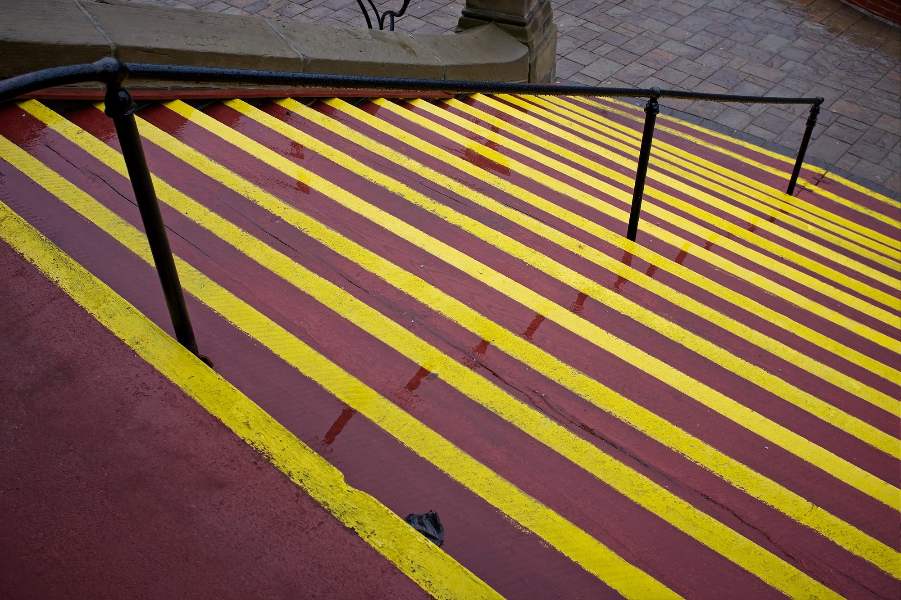
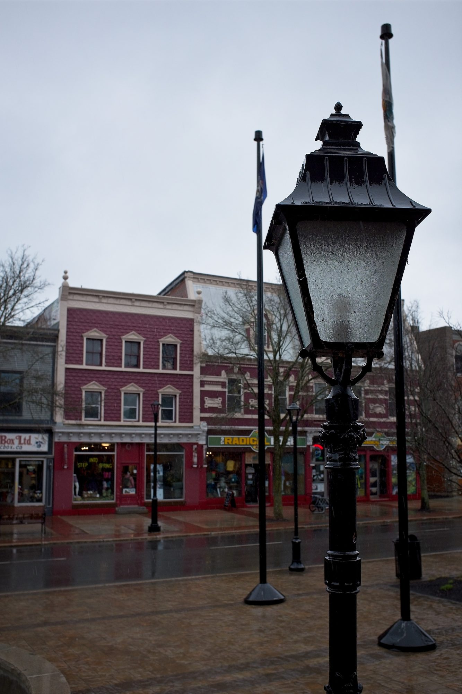
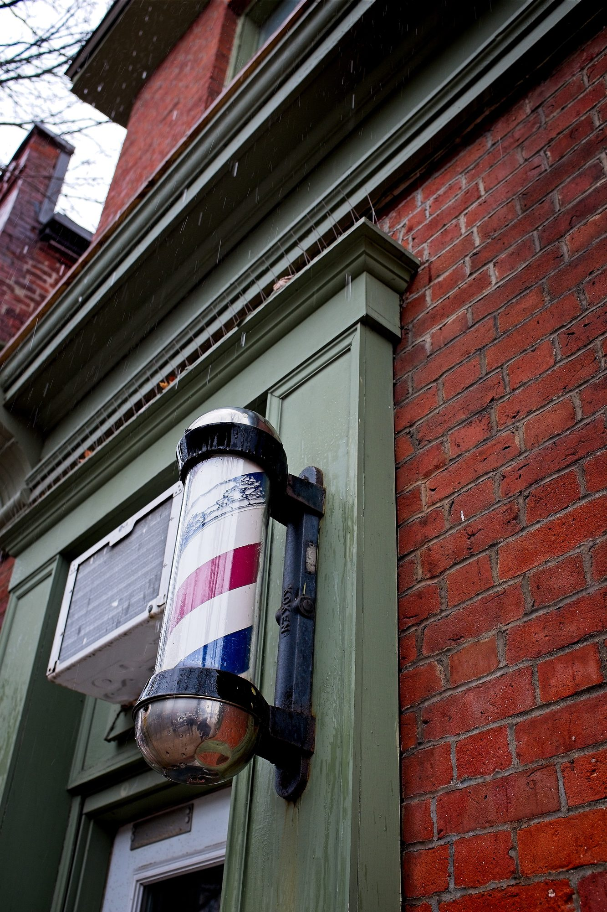
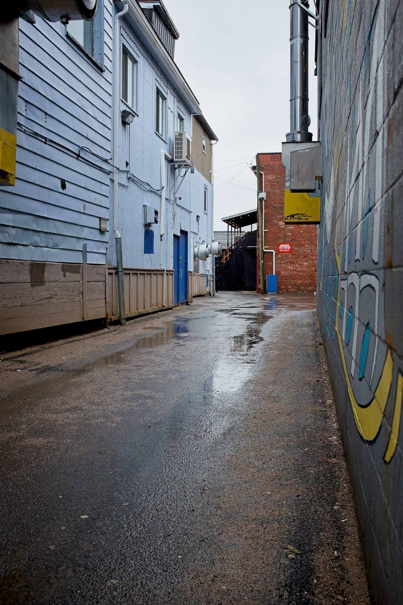
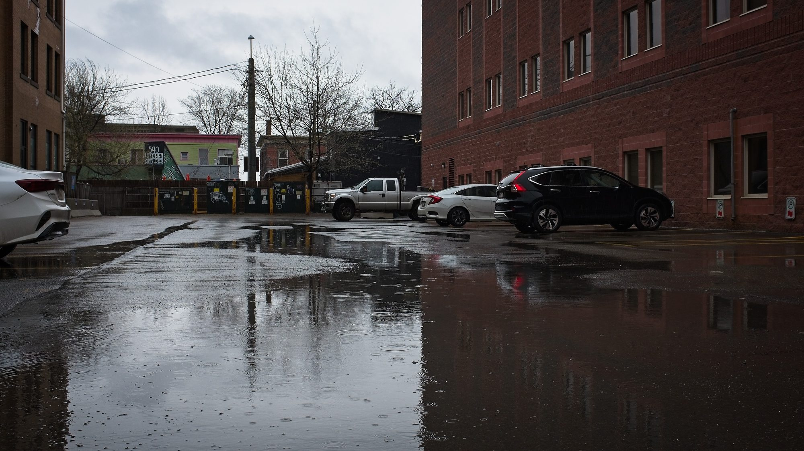
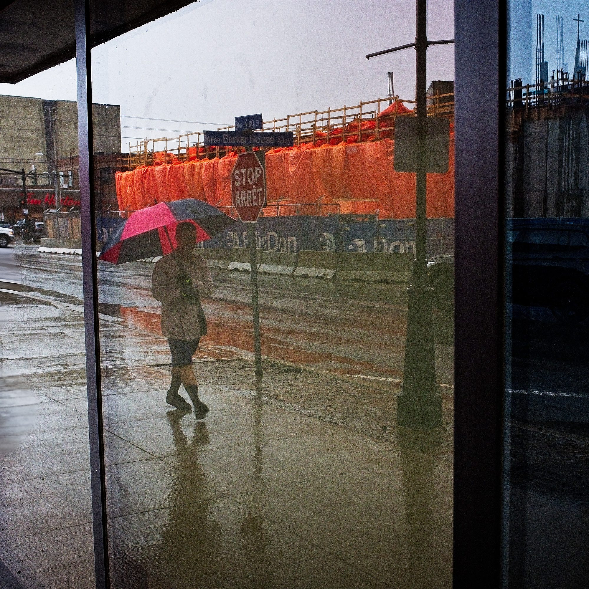
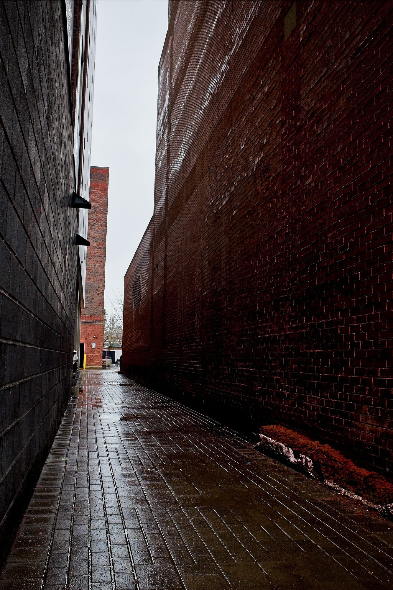

At one point in my life, years ago, I would take photos **every** day. I always carried a camera with me, my walks to and from work in lower Manhattan were great opportunities to make interesting photos. My interests shifted over time; after I learned guitar, music became by main creative pursuit. Since moving home to New Brunswick in 2020, photography hasn't been a practice of mine at all. I'd take photos on my phone, but it's not quite the same

I've been stuck in a rut lately and I wanted to get out of it. I wanted to do something creative, but, I also struggled to create. I was intimidated. I tried music, but it just wasn't giving me the sense of satisfaction that I was looking for.

So I started taking photos again. On my iPhone to start. Then I got out my old film cameras – I found they still had film in them so I finished the rolls. Then shot a few more. It was fun, but it'll be "a few months" before the local lab will have the developed and scanned negatives.

I got out my digital camera.

I'd been looking for local photography groups when I found another local photographer who was interested in going for a photo walk. So we made plans to meet downtown on Saturday.

I don't like these first few photos. But I'm also trying to lower my bar for creative output. I think one of the reasons that music wasn't clicking for me was that I could easily hear how out of practice I was. It feels fine to take "bad" photos in a way that it doesn't to play a song poorly.

Now we're cooking! I love looking for contrast, details, patterns.

I used a hybrid approach to my film photos. I would shoot them on film, scan them, and then edit them digitally. But it was a very light kind of editing. Shooting on digital for the first time in a while let me push things further in the edit. It was fun, getting to tune everything in just right.

I can't emphasize enough how much it was raining.

I've met a lot of people through this hobby over the years and it was fun to meet someone new today. I had a great time, took some fun photos, played with a new editing tool, and made my first photo blog post in years! We'll see what happens next.
