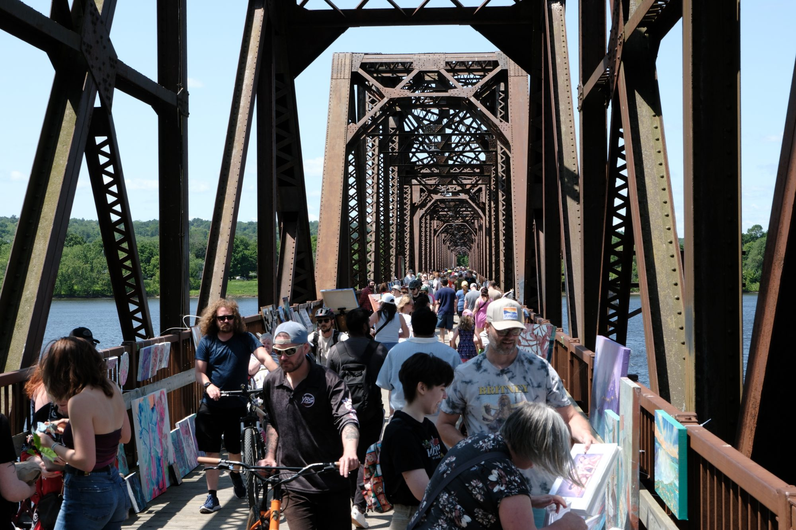
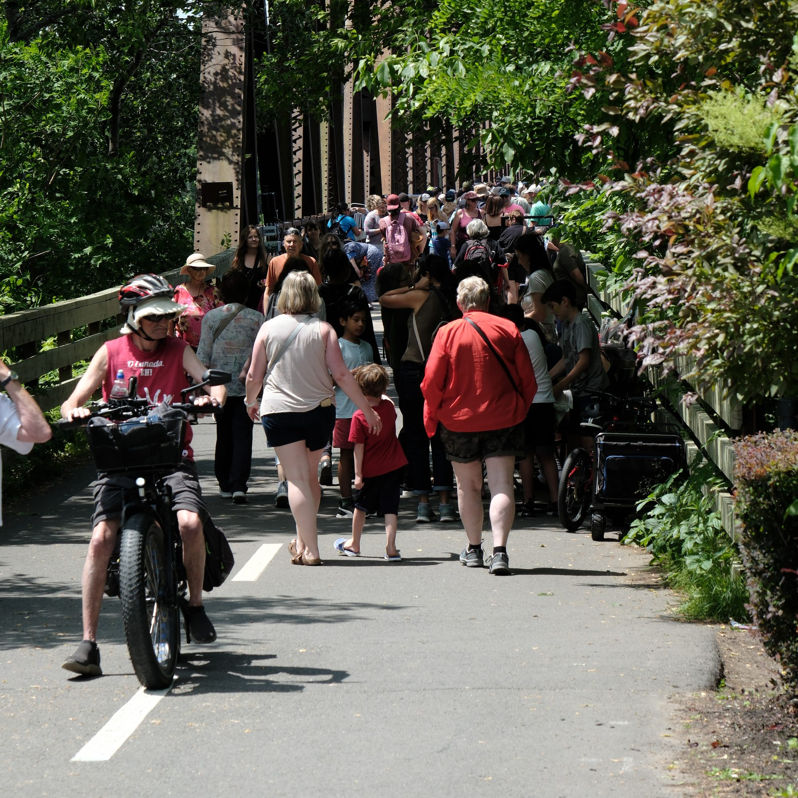
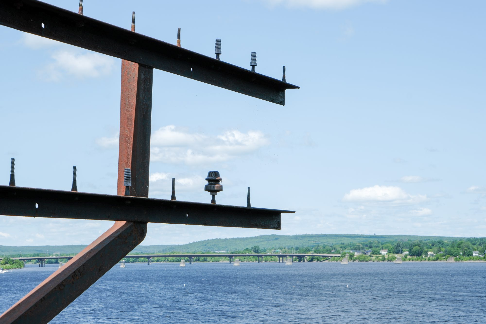
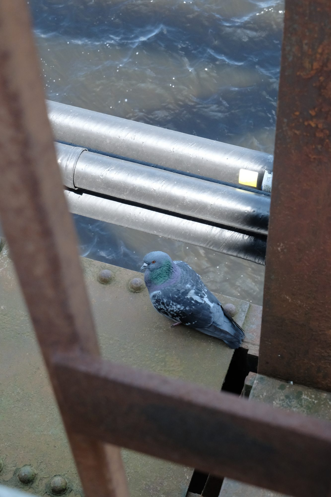
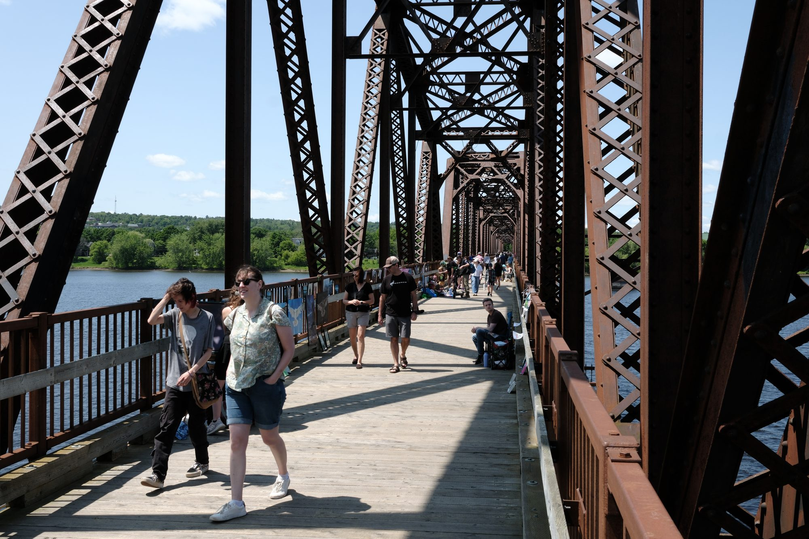
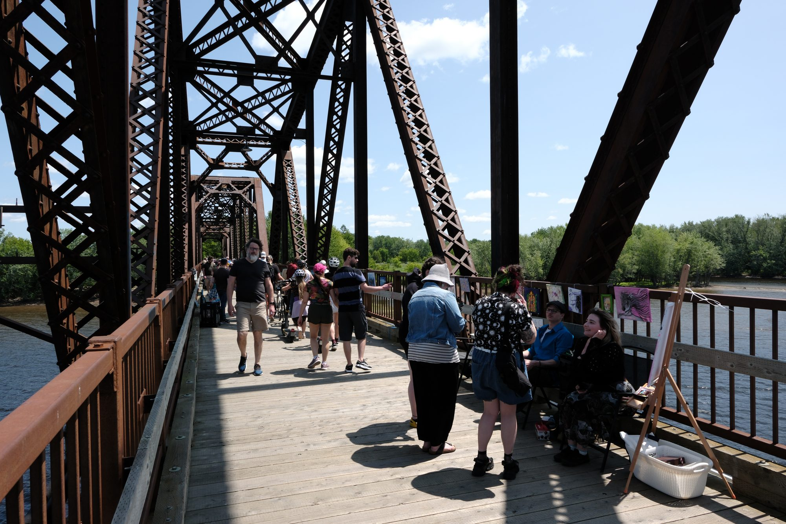

One of the things I've been looking forward to about summer has been all the local events in and around Fredericton. Taking photos at events is always fun and, without Manhattan's population, events are now one of the only ways I can find a local crowd. Juxtapose walking to work down Delancey with walking along a rails-to-trails gravel trail.

Yesterday, Ashley and I attended [Art on the Bridge](https://www.fredericton.ca/en/about-fredericton/calendar-events/art-bridge-2025) for the second year. Unlike last year, the weather was beautiful and windy. All the art had to be tied down.

I tried shooting in JPEG with a film simulation of my beloved, discontinued Pro 400H. I liked the workflow much better (less work editing) and the results are fine. Good, even. It helped me "lower my creative bar", which I need. Getting into a creative hobby, or getting back into it, is all about the volume of work.

I'm out of practice shooting crowds. I didn't get close enough. The light was harsh. But I had a lot of fun.

