I have been to [summer camps in the woods for a corporate retreat before](https://photos.ashfurrow.com/artsy-offsite-2017), [a few times](https://photos.ashfurrow.com/artsy-offsite-2016), [okay a lot](https://photos.ashfurrow.com/artsy-offsite-2015). But this was a first for me in in a long time, in Canada, at this stage of my career, with _this_ team. It was special. There were surprising, unexpected parts. I have a feeling of pride from this event that is distinct from any I can remember.

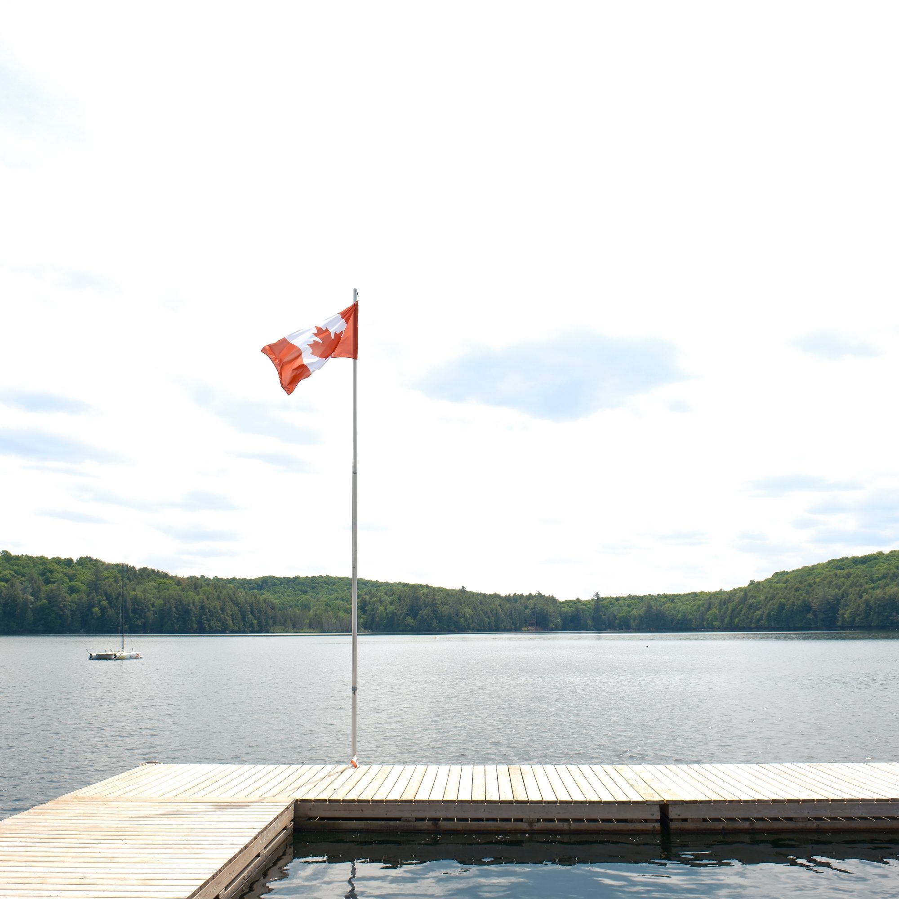
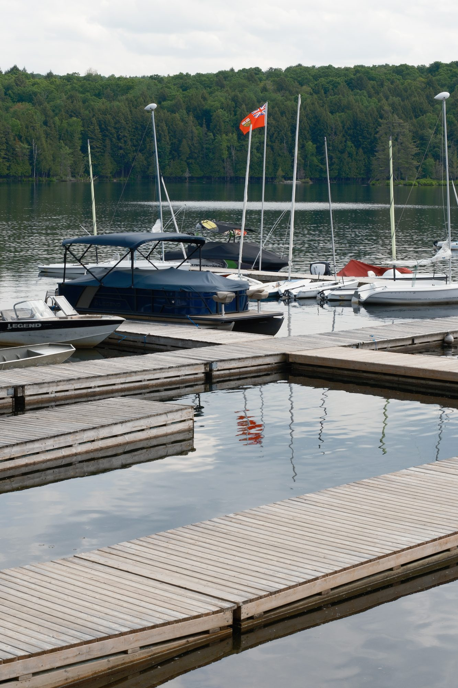
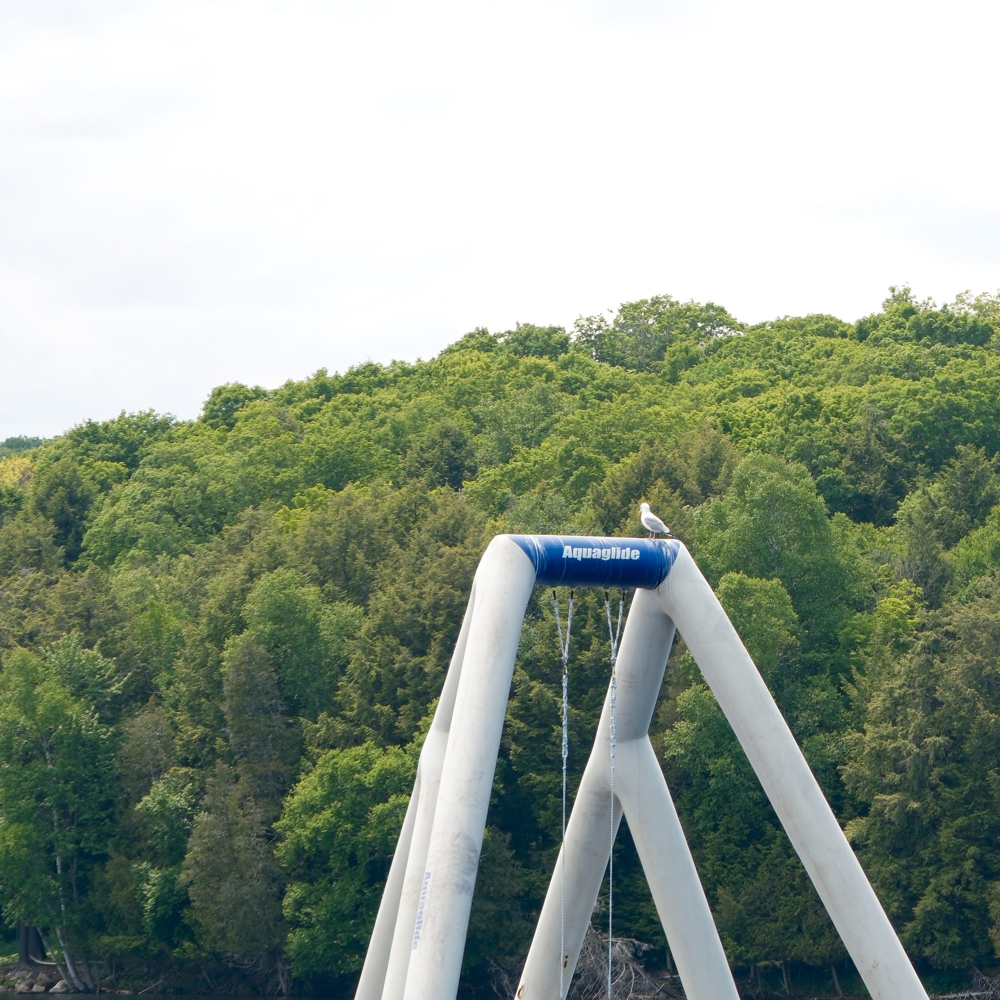

After arriving, I had an hour or two to myself. I got my camera and wandered around the camp ground. Since I arrived with the earliest group, the camp grounds were still mostly empty. It felt like the camp was waiting.

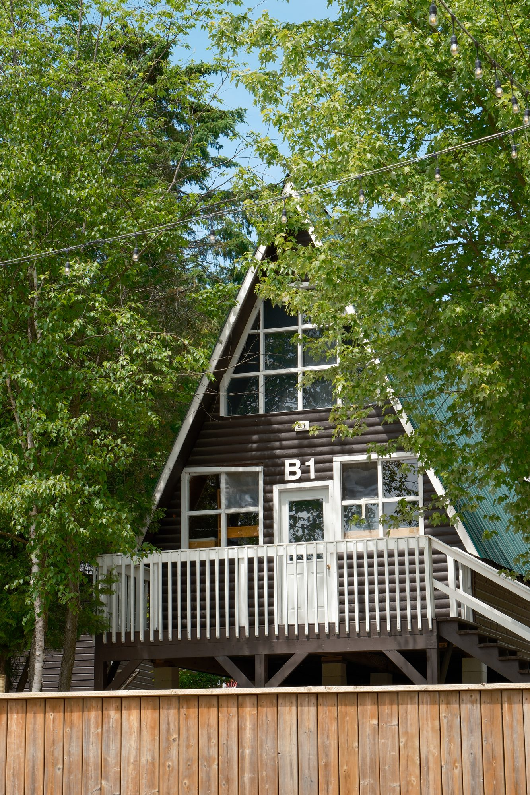
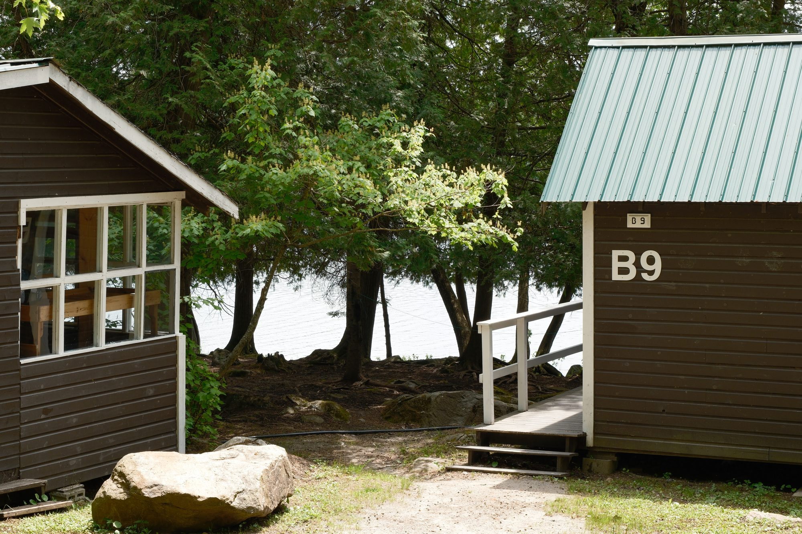
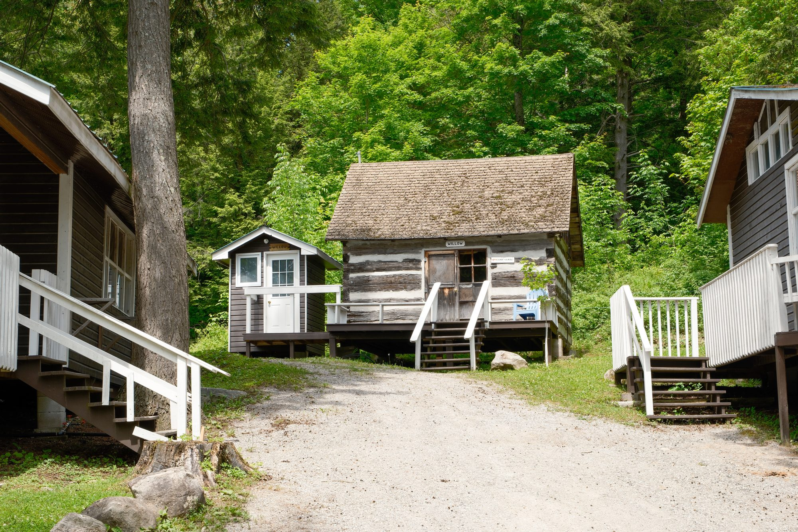

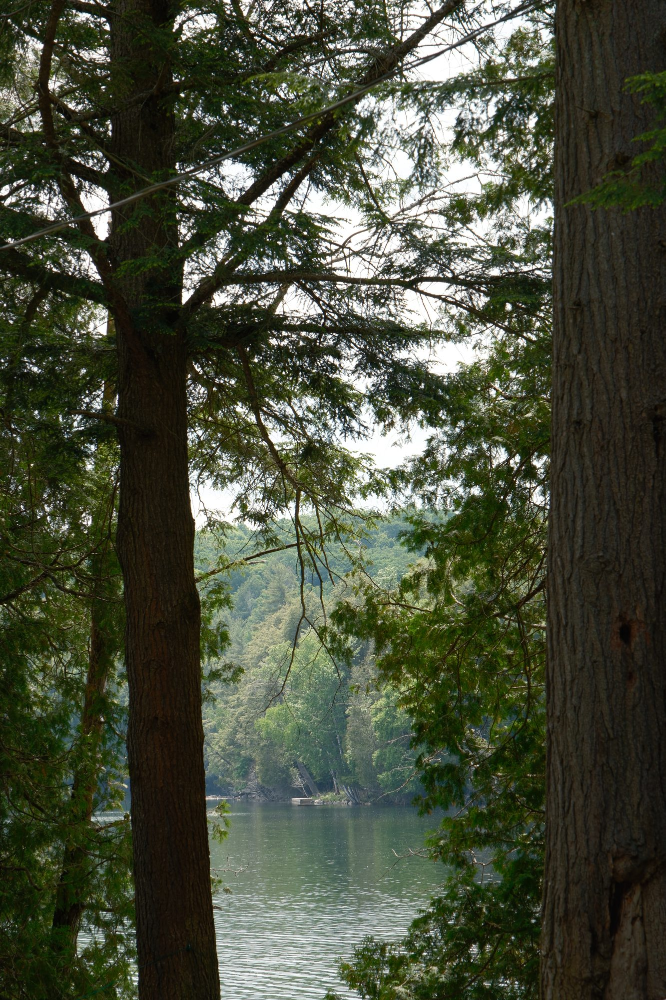
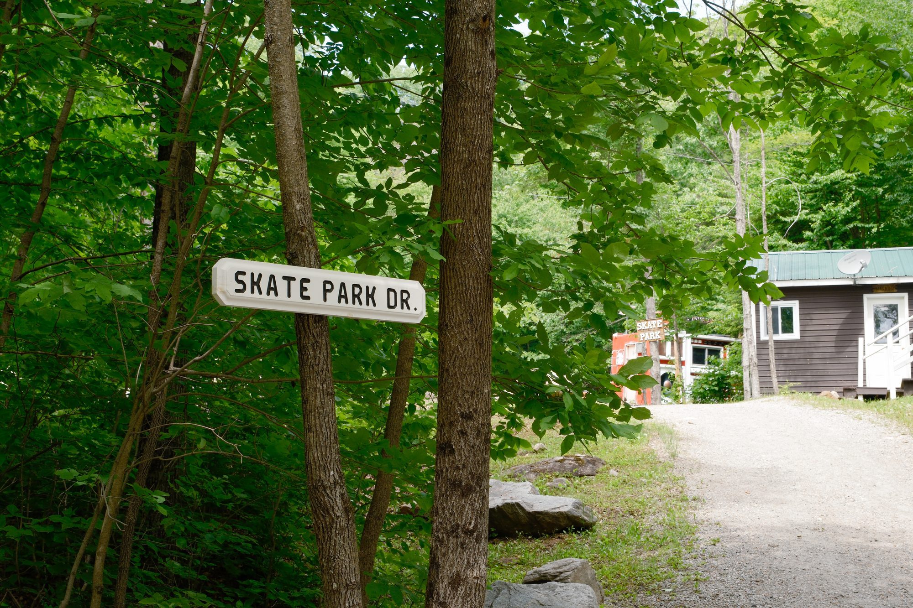

I never attended a summer camp, but my family owned a camp on a lake where I spent a lot of my childhood. This part of the country is different from where I grew up, but in broad strokes it felt familiar. There is something about a building that has been so _obviously,_ so _repeatedly_ jacked up to be level that feels like a warm blanket to me.

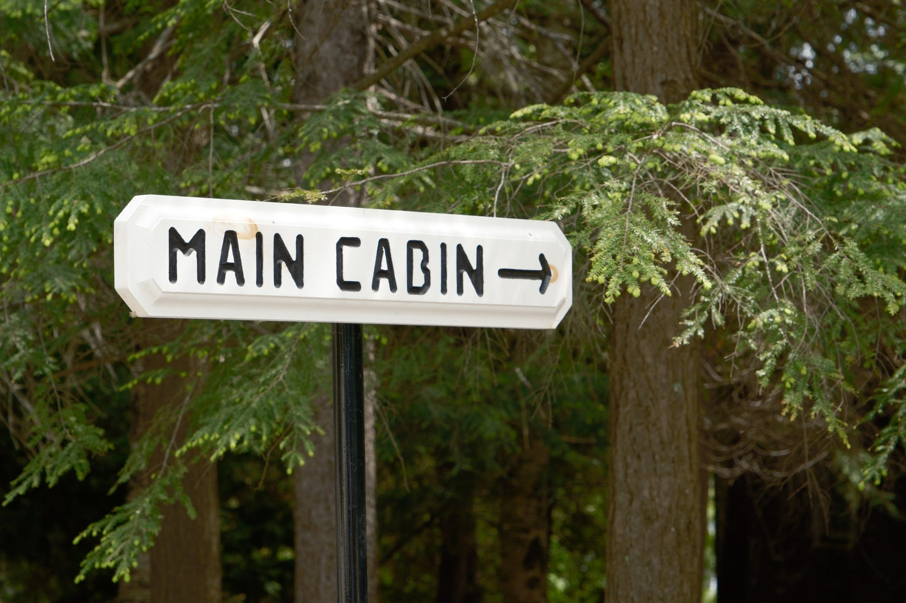
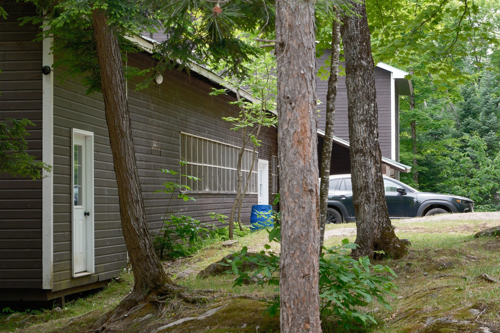
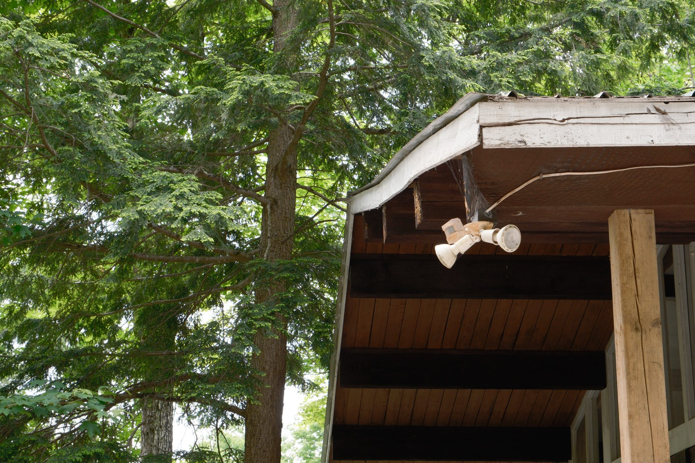

Later around sunset, coworkers remarked that I ought to get my camera and capture the golden hour. They weren't wrong, but sometimes you have to set the camera down and enjoy the moment. And I didn't need a big camera to take good photos, anyway. Here are the photos I took on my phone.

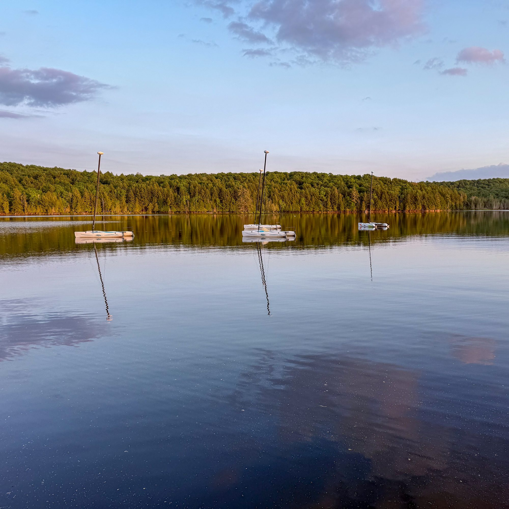
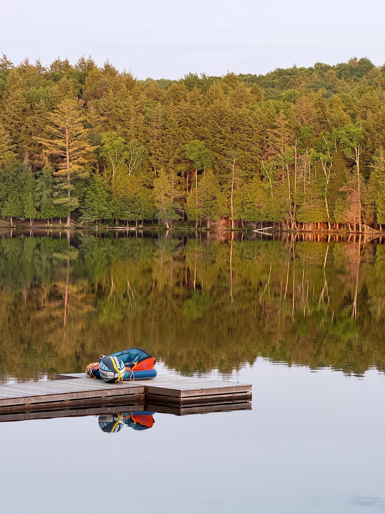

