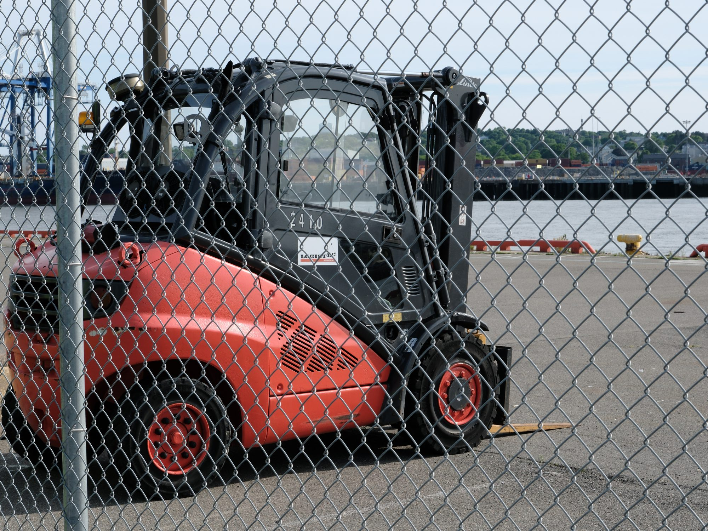
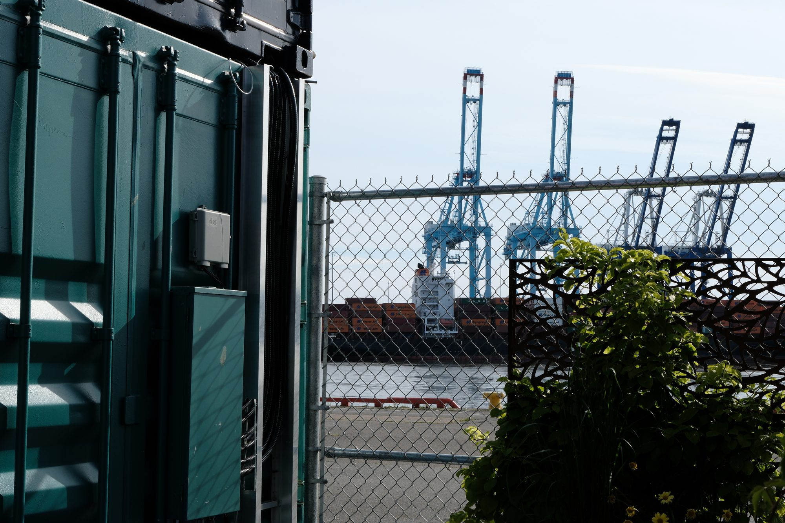
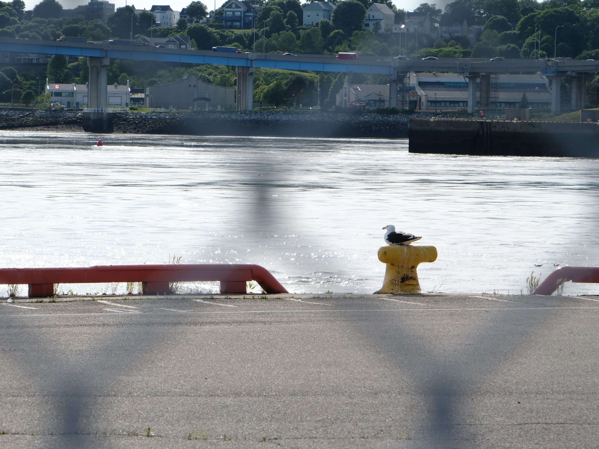
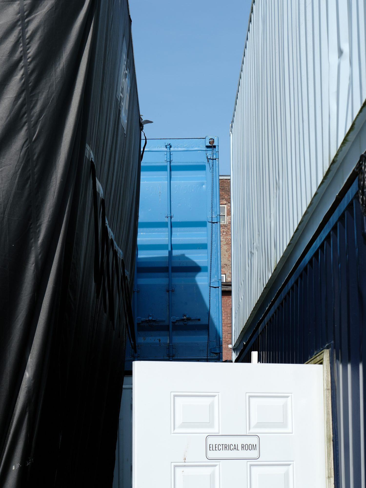
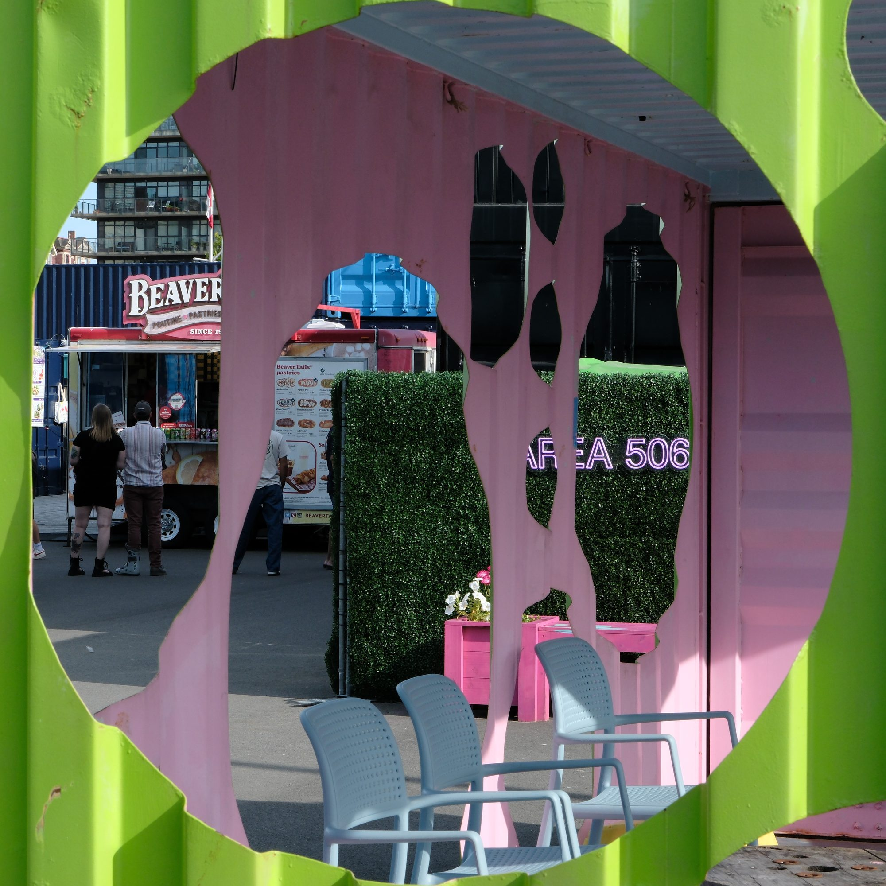
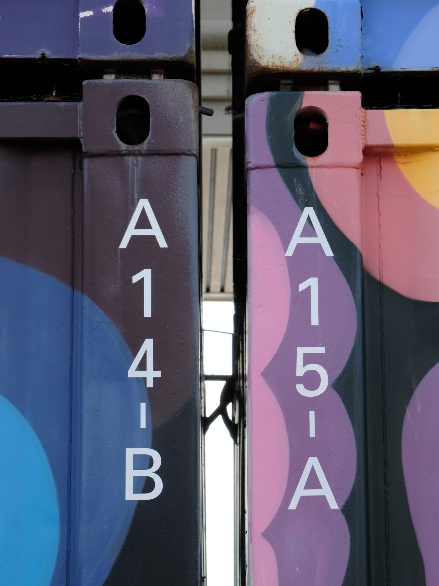
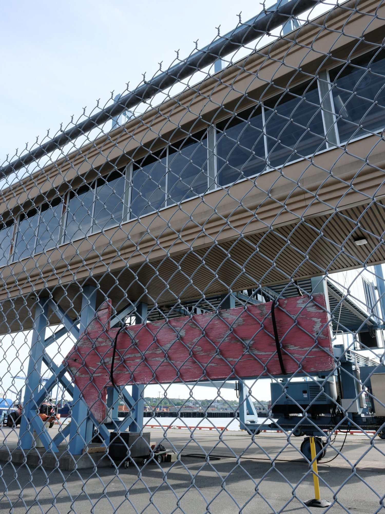
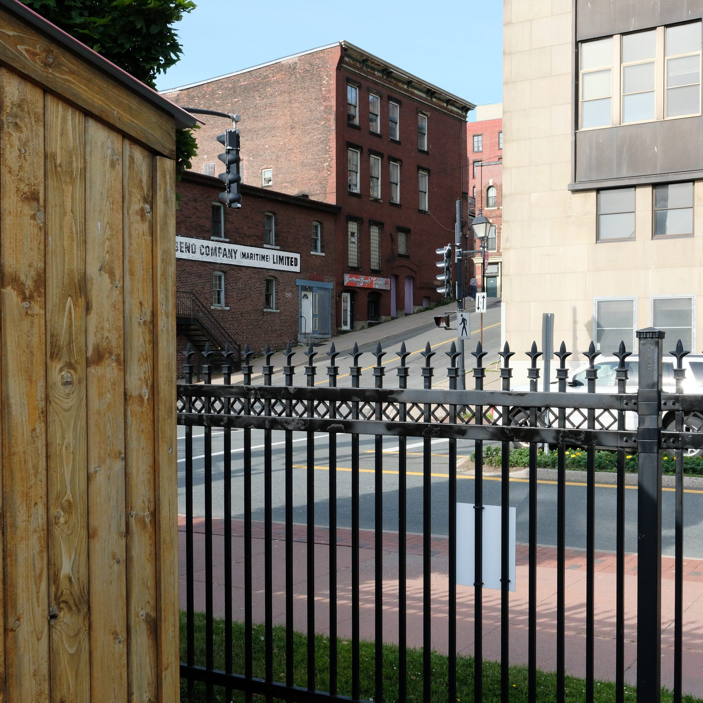
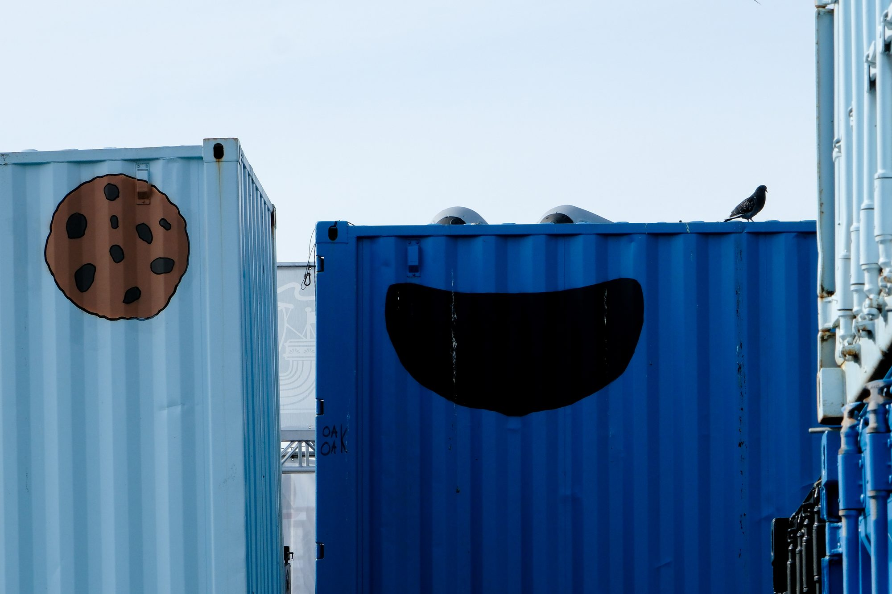
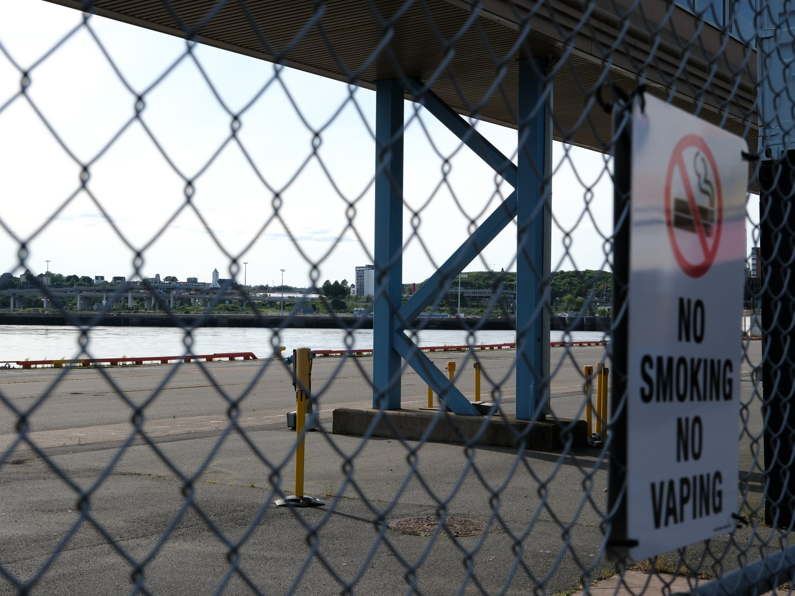

Over the summer, we visited Saint John for a date night. There wasn't a lot of time for photography, just a quick trip to the "container village", the city's private/public partnership celebrating its shipping industry. Constructed from shipping containers, it has a stage, restaurants, bars, a playground, shops, and its situated right next to the cruise ship port. This sounded like a place with a lot of inherent contradictions, which would be great for photography.

Harsh sun was tough. I think I could have done better here, both in camera and in the edit.

I had a lot of fun, and made some good photos, but there was one obvious keeper, for me.

I'd paid a little extra for a harbour view when I booked the room, so I made sure to bring a miniature tripod, hoping to take some nighttime shots. Things worked out! We had an unobstructed view of Saint John Harbour and I got some long exposures. The windows weren't that clean, but, you have to do your best with what you have.

Since I started photography, I've had fun playing with long exposures. Something about using the light of a scene to create an image that does _not_ accurately depict the scene itself... it's very fun! It's almost like you're telling a lie, but based in truth.

You have a lot less control that you normally do as a photographer, which makes it even more important to judiciously exercise the control that you _do_ have.

Take this first shot for example. The exposure time was 20 seconds, causing the waves in the water to reflect light differently over time. That's why the water looks so bright compared to the lights; the changing reflections "add up" on the sensor and make the reflection larger and brighter than it otherwise would. But look closer on the bottom left and you'll notice something else reflected in the water, something very well-defined.

I _think_ this is a shadow cast by one of the work lights on the crane. Because the light source is so close to the object that obstructing it, the shadow is very "hard" with defined edges. Normally, I'd expect the reflection to have its definition scattered by random waves. But over time, the waves seem to "average out" and you get a nice sharp edge. How weird! (You might think the other light sources should have defined edges too, then, but the lights _themselves_ don't have sharp edges; the waves are averaging out to accurately depict the soft edges.)

I took a few dozen images of the harbour, between half a second and thirty seconds. This is still a new camera for me, and I'm learning its limits. Like the balance of ISO sensitivity to noise.

This image is only 0.5s exposure, but at at higher ISO. The waves are way less smeared than the image above; they're not all smeared evenly, suggesting where the current might be stronger or weaker. I like this one a lot.

The cranes themselves were working during all this, and I had a few shots with "light trails" on the cranes. None of these ended up looking very appealing, though. Light trails can be so much fun, but in my opinion they need to be _the_ focus of the image. Having one small light trail on one part of a still crane, next to three other still cranes... it evoked "odd" instead of "awe." So I ended up picking the shots where the cranes were still. I hadn't even realized the cranes were moving at all! This is why long exposure photography benefits from experimenting and taking lots of images.

