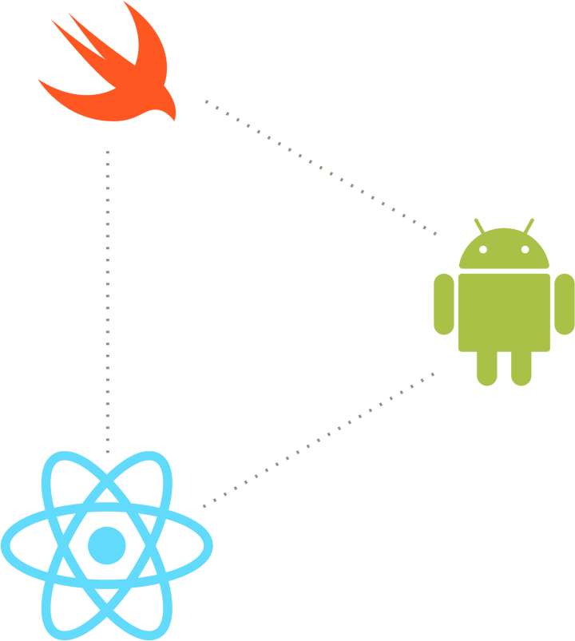
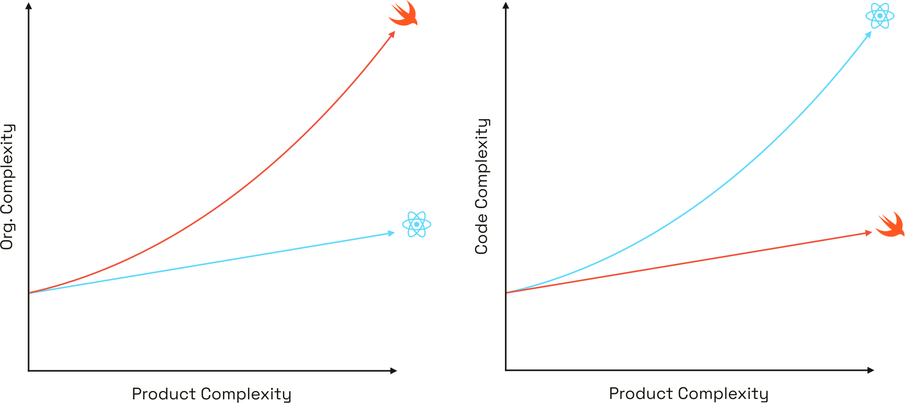
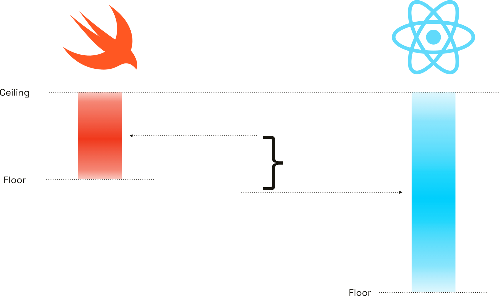
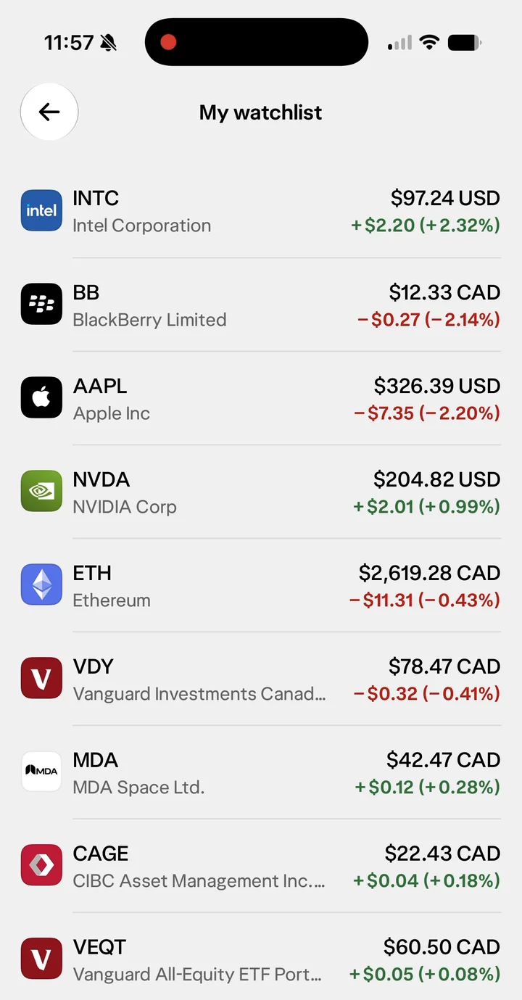
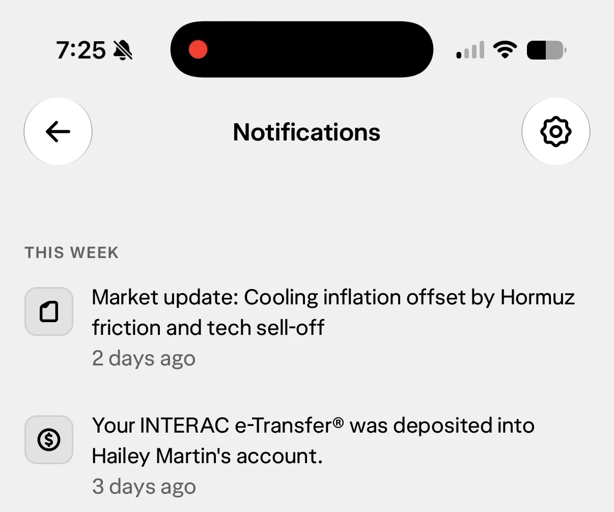
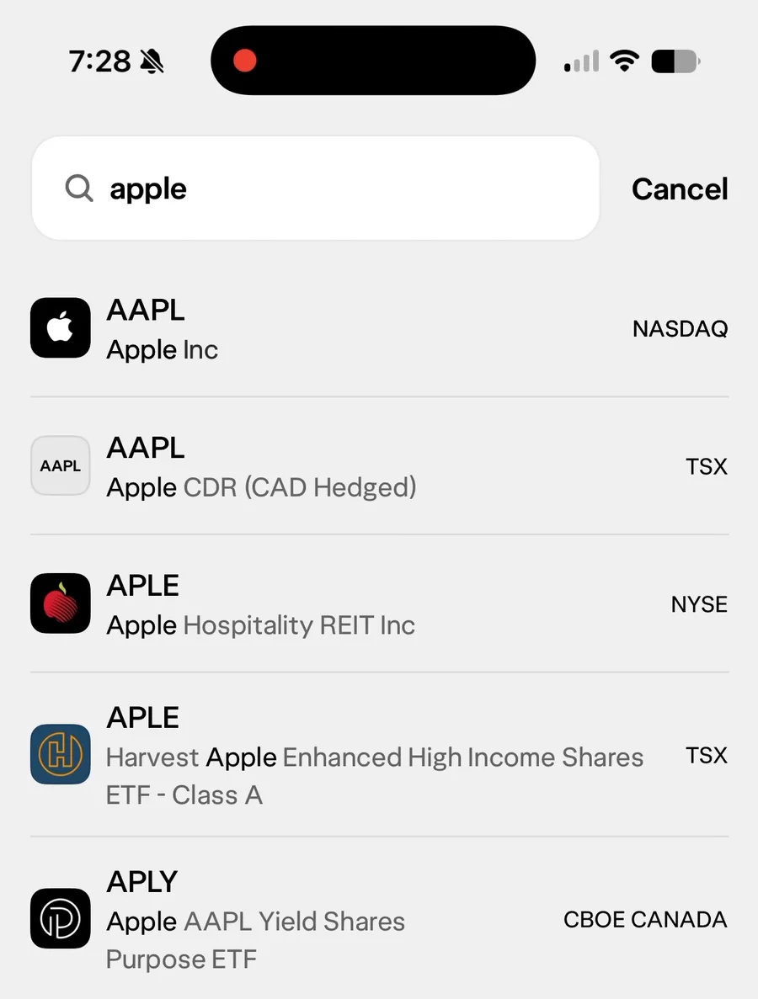

I recently gave this talk at [the SwiftRockies conference in Calgary](https://swiftrockies.com). This blog post expands on a few points that I didn't have time for
in the presentation, as well as some updates since then. [The talk is here](https://www.youtube.com/watch?v=UCimuzlrbcc).



Because I'll be discussing my work with React Native for an audience of iOS developers, I feel the need to establish my bona fides up front. I started building my first iOS app in 2009, and grew into a career in native app development. I literally wrote a book on Objective-C (well, I co-authored one). I was in the room at WWDC when Swift was announced. I know my stuff.

I found my way to [Artsy](http://artsy.net) as an iOS developer. I really liked Artsy. I still like Artsy. The company and product mean a lot to me.

And in 2016, after two or three years there, they said we're going to move to React Native. And I said "no thanks." But I liked the company more than I disliked JavaScript, so I stayed. I kept working on the native parts of our mobile app. Eventually I started working on some web apps in React, and that's when I realized that React is nice! And, maybe, React Native wouldn't be so bad.

So I started investing in React Native experience. My skills became valuable, and some momentum built up, and without me really realizing it, my Swift skills started getting left behind as the language and community advanced. I still used my native skills within React Native, they just weren't my focus. So I kept my React Native momentum up.

But something was missing.

Fast forward to 2025, and [I found an opportunity with Wealthsimple](/blog/joining-wealthsimple/) to leverage my background as a native iOS developer to help the company elevate its mobile app experience. I jumped at the chance.

Today I want to talk about the reasons why teams choose React Native, why they often overlook the technical costs of doing so, and what happens when they do earnestly try to make an _actually_ great app with React Native.

## Is it React? Is it native?

So first, and I'm sorry but, we do need to talk about React Native under the hood. Is it React? Is it native? I'm going to make each case.

So if you consider what I started my career building as a "native" application (Objective-C runtime, UIKit view hierarchy) that is a native app, right? This is not a controversial statement. And like the ship of Theseus, I could make small tweaks to it, and I can move some things over into a different thread, maybe it's a different programming language, and eventually we could get to something that looks like React Native. And at every step along the way, it was still a "native" app. It could call UI events synchronously from UIKit over into JavaScript, and JavaScript could manage the UI hierarchy.

So _technically_ React Native _is_ native.

Technically.

On the other hand, there is something missing. There are a couple things missing.

So the first thing I just want to highlight: apps are more than _just_ a view hierarchy. There is a lot to mobile apps that elevate them above software, and that's why I enjoy building mobile apps so much. My web developer peers are rolling their eyes right now, and I'm okay with that. Integrating with the underlying operating system is necessary to really delight users.

React Native was really written for the web, so it's optimized for writing web software. And as a consequence, you're way more limited than you'd want to be if you (like me) want to build a great app. _Unless_ you're comfortable writing native code. Unfortunately, most React Native developers aren't. And that's fine: there is still lots that can be done without writing native code. You'll just tend to fall short of a "great" app.

There are two examples I'm going to talk about. One I'm going to mostly skip over, but it's huge: threading. Dispatch queues, Swift's `Task`, threads... all very basic concepts in native development. Complicated to use effectively at scale, sure, but the building blocks are quite simple. These are all totally out of the conversation with React Native. (There _are_ new [`worklets`](https://docs.swmansion.com/react-native-worklets/) but generally JavaScript is not great at multithreading.)

So, the other example: fonts. At Wealthsimple, we care a lot about the design and the polish and the user experience of our application, and we had our own font made. Simple Sans. Is supports an OpenType font feature called case-sensitive layouts. Most fonts render parentheses so they vertically centre with lowercase letters by default. Case-sensitive layouts are a way to raise the parentheses and other punctuation so they align with _uppercase_ letters instead.

Why would you want that? Most letters are lowercase, so you generall _want_ parentheses and other punctuation lower to match those letters. But as a financial services app, Wealthsimple renders a lot of numbers. So we made sure our font supported this OpenType feature in order to align the parentheses with the uppercase letters, and therefore with the numbers.

It's a very small distinction but the parentheses feel too low for numbers otherwise.

iOS supports this natively, no problem. Android supports it, too. React Native does not. But that's okay, because I know React Native, and I can just go in and patch it, add boom. Case-sensitive forms in our app, no problem

It's kind of an indictment of React Native that I've had to add different OpenType features _so often_ that I could reasonably list this as a skill on my resume.

This is not an uncommon need: to reach into React Native and extend it, bending it to my will. _That_ is not "native." In my opinion, developers should be able to do things like this easily when it's support by both iOS and Android.

But they can't. Because React Native is not native.

I eventually started doing React Native at Artsy after I started doing React _web_ at Artsy, and React is... I think it's pretty cool, actually! React basically keeps an in-memory store of what your user interface is supposed to look like and then reconciles that to the actual browser DOM on-demand. And if you squint, you can kind of say: okay, React Native has a JavaScript runtime, it's a virtual DOM, it's a UIKit view hierarchy.

React Native is React, right? Well, kind of.

In one sense, React Native _is_ React... to a fault. On the web, there are sometimes good reasons to "punch through" the React abstraction to get to the underlying DOM elements, so you can `dangerouslySetHTML()`, or use a ref, or use an imperative handle, because React _has_ to work on the web with decades of HTML forms and other quirks. On native, there really aren't the same escape hatches because React wasn't built for native.

There are valid reasons that I might want to "punch through" and do things directly to the `UIView` instances. But it's very difficult because if it doesn't fit within the web paradigm, then making it easy is not a priority for React. To be fair, that has advantages too: fewer native-specific escape hatches mean that React Native is easier for React web developers to use.

So React Native _is_ React. For better and worse.

I've saved the most controversial take for last. The argument I just made was a lie! The JavaScript runtimes are _totally different_. In a browser, JavaScript is run by just-in-time compilation to be _very_ fast. But in React Native apps, we _precompile_ the JavaScript into bytecode and execute it on a very specific, mobile-optimized JavaScript execution engine called [Hermes](https://reactnative.dev/docs/hermes). Hermes is great, but it's not a web browser, and you have to know about some of its quirks because it's so specific.

React is an active project that comes out with new features, but those features rarely launch on React Native alongside the web. When React hooks were released, I remember waiting excitedly for React Native support. Years later, when Suspense launched, I didn't even bother getting excited because I knew I'd be waiting such a long time.

So if you're a React web developer thinking you can just use your React skills with React Native: not exactly. You're going to bump into differences eventually, and you have to know about these differences to make a great app. I don't even want to get into the distinction between shadow trees and virtual DOMs.

React Native is not actually React.

## The illusion of simplicity

So with all this complexity, you might be surprised to hear that the reason teams sometimes pick React Native is for the sake of simplicity. Unfortunately, that simplicity is an illusion.

The most compelling reason teams pick React Native (or at least, the one I understand the most) is simplicity. React Native promises to simplify mobile development. But the problem is that there is _irreducible complexity_ to mobile software.

Mobile apps get shipped to users' devices, and updated over time (hopefully). Mobile apps are closer to shrink-wrapped software or on-prem software than modern web apps. Web apps have become the "default" kind of a software, so it's appealing for React Native to flatten the differences between web apps and mobile apps.

There are many, many differences between web apps and mobile apps. (To name one: application state is not something you have to deal with on the web.) So React Native can't really simplify that. React Native can only move the complexity around, and as a result, the application becomes much more complex _on the whole_.



To make this concrete: if you're in North America building software, you likely want an iOS app, an Android app, and probably a web app, probably in React. You've got three different teams _just on the frontend_ trying to build the same product. If you want to release a new feature, you've got to keep each of these teams in sync with each other. That's a lot of overhead, and it slows you down.

The promise of React Native is: what if we replace all of this complexity with _just_ React?

React is easier to hire for. The people making the decision – the directors and the VPs – they often know React already so it's something they feel familiar with. React Native smooths over the organizational complexity in exchange for adding a ton of technical complexity under the hood.



I have a hard time vilifying this trade-off, but I do think teams sometimes overlook the costs because they're dispersed throughout the organization and hard to measure.





As your product gets more complex and you add more features, your organizational complexity with a React Native team grows roughly linearly – assuming you're architecting your app correctly. But if you have multiple native platforms, you have to coordinate between those teams, and the complexity scales higher.

From a code perspective, though, the opposite is true: assuming proper architecture, as you scale more products and features on the native side, you can do that without ballooning the complexity of your code. With React Native, you're forced to. Because if you try to build outside of what it's optimized for, you're in for a bad time – and you don't have to go far outside of the norm to feel the pain. High-performance needs like streaming live data, complex animations, deep platform integrations on iOS or Android... all introduce extreme complexity.

And even average apps will need to spend time managing the React Native platform. It is not free.


Businesses tend to "measure what matters."

But not everything that matters is easy to measure.


The prevailing wisdom in business is to measure what matters. You pick something that matters, you measure it, set some goals – OKRs, KPIs, whatever – and use those to make sure what matters moves "up and to the right."

But not everything that matters can be easily measured.

Things like user experience quality are very intangible: they show up across App Store reviews, net promoter scores, or just the feeling users have towards your app. And it's hard to attribute any of that back to "native versus React Native." Because these intangible qualities are hard to measure, I think that product teams sometimes underweight the importance of them. And that's really where React Native suffers.

But it's not all bad. Product teams _do_ like React Native. You get one codebase, one programming language, one-ish deploy process. It _is_ simpler.

Testing JavaScript-only changes is really nice too, because you can open up a pull request and have a computer in the cloud generate a JavaScript bundle, post a QR code to the pull request, you scan it with your app, it downloads the bundle, and that's it. My coworker can test my changes on their phone directly. No provisioning profiles, no signing, nothing. It's incredible.

Over-the-air updates are very common with React Native applications, and they're incredible. I cannot stress enough how amazing it is to fix a production issue with it. I have resolved production incidents by pushing a [CodePush](https://github.com/microsoft/react-native-code-push) bundle with fresh JavaScript that gets downloaded to all users, and it works. Everybody does it (_or so I hear_) and if you could do it on native mobile apps, I guarantee that you would too.

Startups and scale-ups need to prioritize speed above all else and that's okay. They can prioritize speed by using React Native, as long as they know that someday, if the company survives and is successful enough, their needs will likely outgrow React Native. And that's okay too.

The real issue I have is that by smoothing out the differences between platforms – between Android and iOS, between web and mobile – it encourages product teams to think about apps as mere software. And apps can be more that just software.

## The cost

React Native has a huge cost. The dependency upgrade churn is intense. It often comes in lockstep: if you need to upgrade Expo, you'll need to upgrade React Native, and you'll also need to upgrade your TypeScript and your Babel and your Reanimated and all of these things. They all have to be done at once, and they're all constantly moving. Huge risk. It's a nightmare, and I dislike it more than any other part of building React Native.

You also get a massively more complex runtime. Every React Native app tolerates a background radiation of random crashes that no one can explain, that are intractable to solve because the stack traces cross the JavaScript-to-C++ boundary, and you have to just live with it.

It bothers me more and more every day.

The abstraction of React Native pushes you further away from the platform and the tools. If there's a user interface idiom or native component that would be really great for your app, well, I hope you're willing to write some Objective-C++ to reach for it! And if there's a problem with your application, have fun with the React Native dev tools. The profiling tools have gotten better over time, but it's hard to hold a candle to Xcode's Instruments. I actually use Instruments to profile React Native apps because I can get better results from them. But I knew the tools already; teams _really_ have to push harder to achieve the same quality.

It's kind of like the speed of light – the closer you get, the harder you have to push to get even closer. That's true of native and Swift too, but it gets so much harder, so much earlier, with React Native.

And unfortunately, React Native has been trying to shrink the size of its core for several years, so some very basic things that you shouldn't have to use an external library for, you now do. The priority has been to make the core of React Native "more cross-platform" to support Windows, for example. I don't care about Window at all. This results in outcomes like React Native not even having an API to access the device's pasteboard anymore – you have to use a third-party library for that. WTF.

### Personal Costs

So what about the personal cost to me? It's complicated.

Being great at iOS helped me be great at React Native, but I don't know if that's because of my technical background or just because I cared. **There is no substitute for
caring.**

Unfortunately, React Native pulled me away from iOS: the technical side and the community side. More than I expected. _Way_ more than I expected.

But, I've gotten chances to solve really interesting technical problems at a scale I probably wouldn't have been able to without React Native. I also really love TypeScript – it's a fantastic programming language, and honestly, the way it models types as sets, I really like it.

However, it's been difficult to feel like part of the iOS developer community. It's sometimes been difficult for me to listen to iOS developer podcasts, or read developer blog posts, from peers whom I admire because of how they talk down about React Native and developers like me who use it.

And the need for me to constantly push React Native harder to reach a great app? It's left me exhausted. I'm so tired of it.

So those are the effects React Native has had on me.

### What it does to teams, what it does to apps

I hope I've built up enough trust here that I don't need to describe all the details, but I have compared React Native and native extensively. They have similar-ish ceilings of performance and quality, but React Native has a _much_ lower floor. What I mean is you can make an app in React Native as good as native if you consistently try hard, but you can also easily make a mistake. Then your React Native app can get a lot worse than it can on native. So that's what tends to happen.

Specifically...

You also just have to accept that React Native is going to chew up _at least_ 200 megabytes of RAM constantly. That's the baseline _before you even start_ wendering anything in your app. And you'll only stay close to that baseline if you're profiling often, to keep your app performant. Neither native mobile nor React Native developers tend to profile their apps enough, in my opinion. So, yeah.

In terms of CPU and graphics performance, you can get _close_. I've built similarly complex views in SwiftUI and React Native, with streaming data from the network and frequent updates, and tested scrolling performance. The React Native implementation can get within 5 to 10% of SwiftUI. (Even better if you use UIKit, actually, but I'm not here to pick another fight.) 5%, if you squint, is "close enough" to native to be a wash.





So if we visualize this: native and React Native have the same ceiling, but native's floor is much higher. How bad your app can accidentally be is higher in React Native than in native.

If you think about an average team reaching an average of what they can accomplish – and I'm not trying to look down on being average, that's just the way it is – if you look at the spread between the floor and ceilings of native and React Native, it's _possible_ to make a great app in React Native, but it's a matter of organizational priorities.


Anyone _can_ make a great app in React Native.

But they probably won't.


Is the team using React Native literally _always_ going to push for the extra effort it takes to make a great app, every time? Teams like that are exceptionally rare.

The fact is, anyone _can_ make a great app in React Native, but they probably won't. And that's okay. I don't actually think that every app needs to be exceptional. Some apps can be average. But I've only ever wanted to build exceptional software.

Back when I put up a big fuss about migrating to React Native, Artsy's Director of Engineering took me aside and promised that we would never compromise the user experience for the sake of using React Native. That we'd alwys use native if that's what it took to create a better product.

And they kept that promise.

And then they left the company.

So I was in charge. And so I kept the promise.

And then I left.

I have a ton of respect for Artsy. I care about this company and its products a lot. I helped hire and train a lot of the people who are _still_ there working on this code.

Are they still prioritizing quality in the same way? I hope so. I don't know – I can't know, because I don't work there anymore.

This experience really taught me that if you care about the products you're building, like I care about Artsy, then you have to make decisions with the foreknowledge that you're not always going to be the one making the decisions. You have to set your replacement up for success, but you also kind of want to box them in a little bit. And I think React Native is a failure to box in a successor.

So that was Artsy – my time there, my switch to React Native. What about my switch back?



Well, I'm thrilled! [I joined Wealthsimple last year](/blog/one-year-at-wealthsimple/), and one of the first projects we worked on was threading. Because JavaScript doesn't have the capability to put things on a background thread easily, so we built our own. We moved our WebSocket subscriptions into the native layer, with Swift and Kotlin on Android. We have a lot of this type of view in our application – data being updated from WebSockets in real time, and how fast we update the data to the user interface matters to our clients. When we rolled this change out, we saw slow frames (missing 16-millisecond deadline) drop in half.

This wasn't a very complex project. In some senses it was, because we had to be familiar with all these different native programming languages, but on the other hand, it's just threading. Not "just" threading – there was [a Swift concurrency talk](https://swiftrockies.com/recap-2026) the day before mine, and I know concurrency is more complex than I'm describing here.

But honestly, just moving some data processing to the background thread was a huge step up for our React Native app.





I've got a couple more examples of ways I've integrated native underlying UI components into React Native. A straightforward context menu from a `UIButton`, and a long-press `UIContextMenuInteraction`.

The wild thing is that the button is a React Native button, rendered in JavaScript, but it turns into a native context menu. And it all scrolls at 60 or 120Hz, whatever the device supports. It's performant now, and it support long press interactions too. (I even worked with an Android developer so it works on both platforms from one JavaScript interface!)

So we have those nice little touches that make the application feel like it belongs on iOS. Because it does belong on iOS.

I was hired at Wealthsimple to care about our app like a native iOS developer would, and it's been a thrill. But it's been hard, too. I would bet that I've struggled more with context menus than any native iOS developer. If you disagree, I want to hear about it.



Personally and professionally, I'm having a blast.

Unfortunately, I've also never been more angry at React Native.

After I patched our version to support case-sensitive layouts, I did the responsible thing as an open source contributor and opened [a pull request to React Native](https://github.com/react/react-native/pull/56766). I tested it, got an Android phone, found a font with case-sensitive layout on the default system fonts... I did the hard work. And six months later, I haven't heard a thing.

Seven years after releasing UIScene in 2019, Apple finally required developers to migrate to it for iOS 27. Apps that link with Xcode 27 without a scene delegate will crash on launch. React Native had [an RFC](https://github.com/react-native-community/discussions-and-proposals/pull/967) to do this migration, and when I gave my talk over the summer, there had been no updates all year.

React Native only released a version that supported UIScene in mid-October 2026, a full month _after_ iOS 27 was released. That means that for that month when iOS 27 was shipping, _any_ brand new React Native application created would _not_ be UIScene-based, which means it would not be resizable at all. That just – it hurts.

What are the chances React Native apps are going to support the iPhone Duo early after launch? What are the chances React Native apps out there are going to integrate with the new Siri AI features? It's a joke.

React Native simply does not care about integrating with its underlying platforms. A friend of mine [sent React Native a pull request to add UIScene support in 2019](https://github.com/react/react-native/pull/25425), and it never got merged in. The project simply does not care.

I don't blame any individuals at React Native – these are the same incentives that push companies to operate this way. I understand it. But it's not for me anymore.

## Wrapping up

We talked about a lot here. I hope you have a greater understanding of how frustrated I am with it. Native iOS developers dislike React Native, but _I dislike it more_.

Today we talked about simplicity and the complexity, and how the most complex thing is how I feel about React Native. We talked about how React Native apps will tend towards average, because that's what React Native is best at. That's okay, but I'm not okay with that anymore.

Similar to app quality, I think that my career – in terms of professional satisfaction – has a similar ceiling but a much lower floor. And I've felt more satisfied since I decided to be more picky. I'm now only working with teams like Wealthsimple who want my help reaching that ceiling. To create the best app they can.

As I've worked at Wealthsimple I've used my skills to create a great app. Often that's meant building with React Native. But more and more, it means I'm working with Swift.

That's it. This is my slow return to a Swift career.
