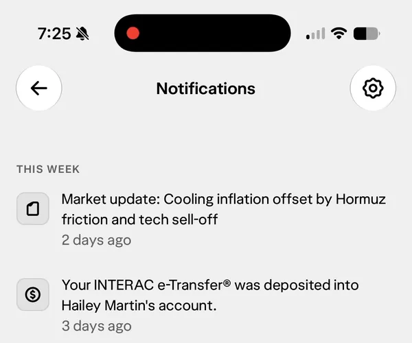

One year ago, after [reflecting on what I really wanted from my career](/blog/work-at-your-spikes/) (and what I _didn't_ want), [I joined Wealthsimple](/blog/joining-wealthsimple/). Time has absolutely flown by! And you know me, I can't help but blog about it.

I joined Wealthsimple with the role of caring about the mobile app as if it were a native iOS app, even though it's implemented in React Native. After all, it _is_ a native iOS app, it just happens to use JavaScript to render its UI.

I cared a lot. And that drove me to accomplish a lot. The first project I helped with cut the stalled frame rate of the app _in half_. I felt more accomplished in just the first few months than I had in a few years.

This summer saw me installing the iOS beta on my main phone and developing new features against the beta SDK. It had been... a while. I felt the joy and pain of a beta OS. Fun! Fun? Fun.

I navigated a product organization that wasn't used to concepts like "apps linked against older SDKs will run in compatibility mode on newer iOS versions", which was challenging. This is the air that iOS developers breathe so it can be tough to work in a a different environment. But I managed to _ship so much_. I bridged the gap between the underlying native technology and the JS layer that the organization was familiar with, in a way that empowered my peers. Just _doing the thing myself_ would have been a failure; instead, I helped others learn and grow. And I learned and grew myself.

When I joined Wealthsimple, I'd been building with React Native for eight years – fully half my career as an iOS developer – and I was excited to push the bounds of app quality with React Native. I didn't expect to hit those bounds so easily, so soon. Here's an example.

Do you see this context menu? I built it! Looks simple, right? **Wrong!** This is a native menu invoked from a UIButton, which contains a view sub-hierarchy that gets defined in JavaScript and managed by arcane Objective-C++ wizardry. I'm so proud of it, yet I feel appalled.

My thinking a year ago was that _organizational priorities_ were the main challenge to making a truly great app with React Native, that if a team were just to hire someone like me then it _could_ be done. To my surprise, when I was given the resources and was empowered to make a React Native app _truly_ great, I hit some fairly intractable technical hurdles, fairly quickly.

That's part of what spurred me to give my conference talk.

Oh yeah, I gave a talk!

Years ago, "back when I was Ash Furrow" (as I sometimes joke to my wife, to her chagrin), I gave conference talks. [_A lot_](/speaking/) of conference talks. I hadn't given a talk since covid, since I moved home to Canada. But this summer, I gave a talk at [Swift Rockies](https://swiftrockies.com). [_My Slow Return to a Swift Career_](https://www.youtube.com/watch?v=UCimuzlrbcc) was part career retrospective and part technical exploration of what React Native can and can't do. I shared a lot of what I'd learned at Wealthsimple.



iOS developers... tend not to hold React Native in high esteem, let's say. When I first showed up at the conference, I felt like I was wandering into a lion's den (not _only_ because the conference was held at the Calgary Zoo). But almost immediately, I felt more like I was returning to an old favourite hangout, with familiar and friendly faces.

"Welcome back", one of my peers told me after my talk. I fought back tears.

[I'd already been using AI coding tools throughout 2025](/blog/ai-coding-tools/), but my use of them really accelerated after joining Wealthsimple. I didn't join specifically because of their approach to AI tools, so this has been an unexpected, welcome highlight of my time here so far. Wealthsimple's approach to AI code tools has been pragmatic, responsible, and ambitions. My proficiency at using LLMs to ship products is leaps and bounds ahead of where it was a year ago. I've learned so much, and I feel closer to the cutting edge of how product development is evolving.

I'd been worried when I joined that my Swift skills would be too outdated to be a "proper" iOS developer, that I'd somehow tricked Wealthsimple into hiring me. But there's actually never been a better time to be "rusty" at a technical skill. I wasn't hired just for what I can _do_; I was hired for my opinions, for what I can inspire others to do, and for how I care about my work. **There is no substitute for caring** and that's never been as true as it is with the proliferation of AI coding tools.

So that's year one! I've built a lot and I've had a big impact: millions of Canadians benefit from my contributions so far! I've made interesting mistakes, the best kind. My sense of professional pride and accomplishment is as high as it's been since Artsy, "back when I was Ash Furrow." And I'm thrilled for what I'm working next. Stay tuned!
