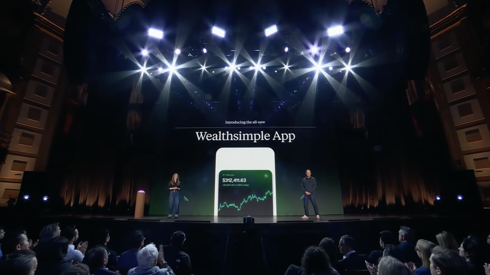

Last week, at Wealthsimple Presents, my employer announced the project I've been working on: a new native app! [Here's a timestamped link](https://youtu.be/MReTQMhB-FA?list=PLH2ZY82du82RJbqcBZih9lfNkqvSOqOIE&t=2150).

I'm really excited for this! Expect big things.

At times, I've told an iOS developer that Wealthsimple's app is written in React Native, and they're surprised! "It looks native, though!" I feel really proud of that. It's what I joined the company to do. But _looking_ native is not enough, and looking native on an iOS developer's _recent flagship iPhone_ is not enough, either.

Wealthsimple has millions of clients who all deserve an experience that _feels_ native.



The reasons to move to native aren't new. [Airbnb did it in 2018](https://medium.com/airbnb-engineering/sunsetting-react-native-1868ba28e30a). What changed are the economics of shipping and maintaining two codebases, for iOS and Android. Agentic coding changes the economics of cross-platform development, and companies are re-evaluating their tech stacks.

Wealthsimple is also different from when it adopted React Native years ago. React Native enables really fast iteration. When that's the top priority, choosing React Native makes a lot of sense. But Wealthsimple's needs have outgrown what React Native is capable of. And agentic coding tools enable _far_ faster iteration speedups than React Native ever did.

I started my career as an iOS developer writing Objective-C. I kept up to date with all the changes to the technology. When Swift came out, I dove right in. When React Native was ascendent, I got on board ([reluctantly, at first](/blog/swift-vs-react-native-feels/)). These were big changes in the technology foundations that I'd built my career on, and I benefited a lot from my embrace of the new tools. Agentic coding tools are the newest change to those foundations, and I'm diving in again. It's a huge change, and I'm very excited.

And it's quite a full-circle moment for me. I spent years at Artsy migrating our native iOS app to React Native ([here is a retrospective](https://www.youtube.com/watch?v=IEn2_WSKFHw)). As I left Artsy, we were just migrating the final piece before starting a project to support Android. That was 2021. [It took until last year](https://artsy.github.io/blog/2026/01/09/artsy-mobile-2025-wrapped/) to finish migrating the final native iOS feature to React Native. So, the Artsy app took nearly a decade to move from native iOS to React Native. I expect the migration back to be _significantly_ faster for Wealthsimple. Stay tuned.
